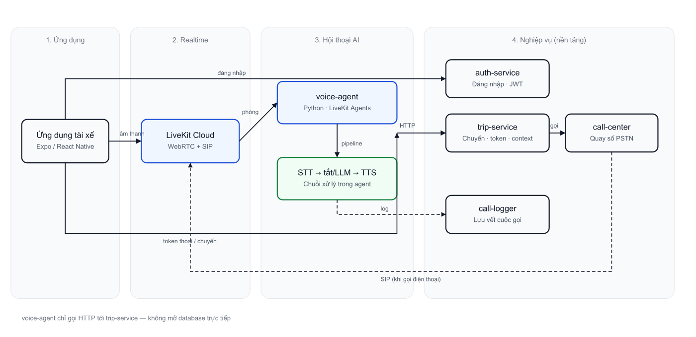
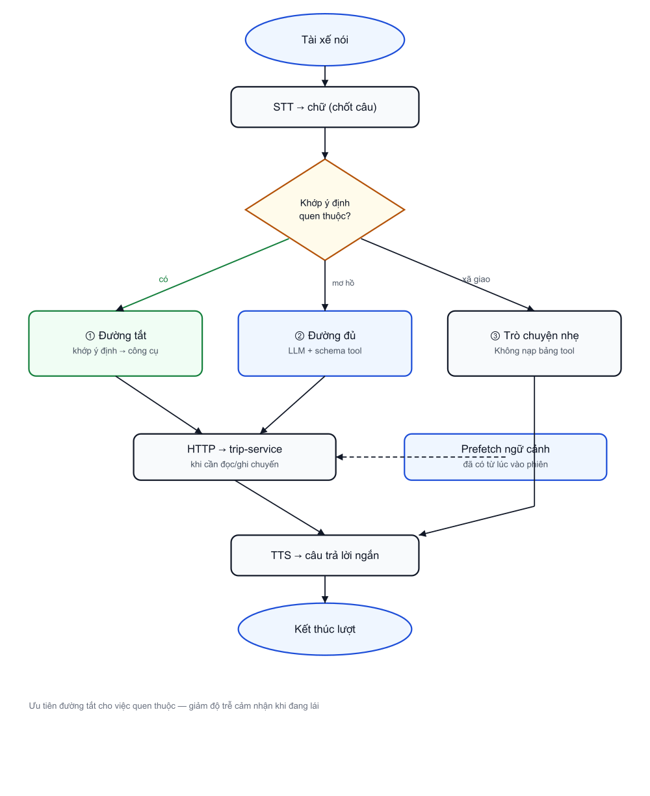

# Chương 4. Thiết kế hệ thống

Chương này giải thích *vì sao hệ thống được bố trí như hiện tại* và *một câu nói của tài xế đi qua những bước nào* trước khi có âm thanh trả lời hoặc một hành động trên chuyến đi. Thiết kế bám yêu cầu Chương 3 và hiện trạng kho mã nguồn dùng chung; chi tiết cài đặt để Chương 5.

## 4.1. Nguyên tắc thiết kế (nói bằng việc cần đạt)

1. **Bot nói chuyện; máy chủ giữ sổ sách.** Voice-agent chỉ hội thoại và gọi API. Mọi chuyến, trạng thái, thu nhập lấy từ trip-service. Tránh để AI “nhớ bừa” dữ liệu chuyến trong lời nhắc hệ thống.
2. **Nhanh với việc hay làm; đủ thông minh với việc lạ.** Câu quen (“xem lịch”, “nhận chuyến”, “gọi khách”) đi đường tắt. Câu mơ hồ mới cần suy luận đầy đủ.
3. **An toàn khi lái:** câu trả lời ngắn; hủy chuyến / gọi số lạ phải hỏi lại; không bịa số liệu.
4. **Một nghiệp vụ, nhiều cửa vào:** trong ứng dụng (WebRTC) và gọi điện (SIP) tái sử dụng logic nhận/từ chối, gọi khách…, nhưng cấu hình phòng và tập công cụ khác nhau cho đúng ngữ cảnh.
5. **Đổi ngôn ngữ không đổi việc:** gói tiếng Việt và tiếng Anh cùng bộ năng lực.
6. **Lỗi lần được theo từng cuộc nói:** mọi phiên gắn mã phòng trên nhật ký.

## 4.2. Kiến trúc tổng thể: ai phụ trách việc gì?

Hệ thống là một kho mã nguồn dùng chung gồm nhiều dịch vụ nhỏ chạy riêng, trao đổi với nhau qua mạng.

**Bảng 4.1.** Vai trò từng phần (nhìn theo việc)

| Phần | Việc người dùng cảm nhận | Việc kỹ thuật chính |
|---|---|---|
| Ứng dụng tài xế | Bấm trợ lý, nói, thấy chữ hội thoại, từ khóa đánh thức | Lấy token, vào phòng LiveKit, giao diện |
| LiveKit Cloud | Nghe–nói mượt trong ứng dụng; gọi điện khi cần | Phòng thời gian thực, cầu SIP |
| voice-agent | “Con bot” trả lời và làm hộ việc | STT → quyết định → TTS; gọi HTTP công cụ |
| trip-service | Chuyến đúng, gọi khách được, ngữ cảnh đủ | API chuyến, ngữ cảnh, token thoại, điều phối |
| auth-service | Đăng nhập, nhớ cấu hình gọi khách | JWT, cài đặt tài xế |
| call-center / call-logger | Điện thoại reo / có tóm tắt cuộc gọi | Quay số, lưu vết |
| admin / ops | Tạo chuyến thử, xem hệ thống có sống không | Không nằm trên đường nóng hội thoại |

**Hình 4.1.** Sơ đồ kiến trúc tổng thể (ứng dụng – LiveKit – voice-agent – trip-service và dịch vụ liên quan)

Luồng tư duy đọc Hình 4.1 từ trái sang phải: tài xế thao tác trên ứng dụng; ứng dụng lấy phiên đăng nhập và token thoại; âm thanh đi qua LiveKit tới voice-agent; mọi dữ liệu chuyến/thu nhập/gọi điện đi xuống trip-service (và call-center khi cần mạng điện thoại công cộng). Python **không** đọc cơ sở dữ liệu trực tiếp.

**Bảng 4.2.** Các đường gọi chính

| Từ → Đến | Để làm gì |
|---|---|
| Ứng dụng → auth-service | Đăng nhập |
| Ứng dụng → trip-service | Token thoại, chuyến, thông báo WebSocket |
| Ứng dụng → LiveKit | Âm thanh trợ lý |
| voice-agent → trip-service | Đọc ngữ cảnh, đổi trạng thái chuyến, bắt đầu cuộc gọi… |
| voice-agent → LiveKit | Vào phòng, phát TTS, nhận mic |
| trip-service → call-center / SIP | Quay số tài xế hoặc khách |

### 4.2.1. Phương án thiết kế đã cân nhắc

Trước khi chốt kiến trúc trên, có vài hướng thay thế thường gặp:

| Phương án | Ưu điểm bề ngoài | Vì sao không chọn làm lõi luận văn |
|---|---|---|
| A. Mọi câu đều qua LLM + toàn bộ công cụ | Đơn giản về mặt “một đường ống” | Dễ chậm trên câu quen; khó đạt cảm giác P95 ≤ 2 giây |
| B. Voice-agent đọc cơ sở dữ liệu trực tiếp | Ít bước gọi HTTP | Phá biên dịch vụ; khó vận hành/bảo mật; không tái dùng trip-service cho ứng dụng |
| C. Chỉ WebRTC, không SIP | Đỡ phức tạp thoại mạng điện thoại công cộng | Không phủ được đề nghị chuyến bằng cuộc gọi điện thoại và một phần gọi khách |
| D. Kết hợp (đã chọn): đường tắt + LLM khi cần; chỉ gọi HTTP; WebRTC + SIP | Khớp NFR độ trễ và FR đa kênh | Đổi lấy độ phức tạp phân loại phòng / chế độ gọi — chấp nhận và thiết kế rõ ở các mục sau |

---

## 4.2b. Chuỗi bước mở phiên trợ lý trong ứng dụng

Trước khi tài xế nói câu nghiệp vụ đầu tiên, hệ thống phải “vào chỗ” đúng thứ tự. Chuỗi thiết kế như sau (khớp hiện thực nguyên mẫu):

**Bảng 4.2b.** Chuỗi bước mở phiên trong ứng dụng (rút gọn)

| Bước | Ai | Việc |
|---|---|---|
| 1 | Ứng dụng | Gọi `POST /api/v1/voice/token` (số điện thoại, ngôn ngữ) |
| 2 | trip-service | Cấp token LiveKit + tên phòng `driver-{số}-{mã}`; có thể tái sử dụng phòng nếu phiên cũ còn agent |
| 3 | Ứng dụng | Tham gia phòng LiveKit (WebRTC) |
| 4 | voice-agent | Nhận việc, kết nối phòng, gắn nhật ký theo mã phòng |
| 5 | voice-agent | Chào nhanh (“Chào bạn, tôi là Czen…”) — không chờ tải xong toàn bộ số liệu |
| 6 | voice-agent | Song song / ngay sau đó: `GET /drivers/me/context` → đổ vào bộ nhớ phiên |
| 7 | voice-agent | Hỏi “Tôi có thể giúp gì cho bạn?” — sẵn sàng nhận lệnh |

Thiết kế “chào trước – tải ngữ cảnh sau/kèm” nhằm tránh cảm giác im lặng lúc mới bấm trợ lý (liên quan NFR-P01/P03).

---

## 4.3. Thiết kế một lượt nói: ba đường xử lý

### 4.3.1. Đường ống chung

Âm thanh tài xế → nhận dạng thành chữ (STT) → **chọn đường xử lý** → (có thể) gọi API → câu trả lời ngắn → TTS. Mục tiêu cảm nhận: càng ít khâu thừa trên việc quen thuộc càng tốt, hướng tới P95 ≤ 2 giây (NFR-P01).

**Hình 4.2.** Chuỗi xử lý hội thoại và điểm rẽ đường tắt / LLM / trò chuyện nhẹ

### 4.3.2. Vì sao cần “đường tắt”?

Nếu mọi câu đều chờ mô hình ngôn ngữ đọc hết danh sách công cụ rồi mới trả lời, độ trễ dễ đội lên — đặc biệt lúc tài xế chỉ cần “ok”, “xem lịch”, “nhận chuyến”. Thiết kế nguyên mẫu dùng **ba đường**:

**Bảng 4.3.** Ba đường xử lý một câu nói

| Đường | Ví dụ câu tài xế | Hệ thống làm gì |
|---|---|---|
| Đường tắt (khớp ý định nói) | “Chuyến sắp tới”, “Nhận chuyến”, “Gọi khách”, “Tắt máy”, “Cảm ơn” | Khớp mẫu → gọi thẳng đúng việc → nói kết quả → **dừng**, không để mô hình viết lại thêm vòng |
| Đường đủ (LLM + công cụ) | Câu mơ hồ hoặc việc phức tạp | Mô hình chọn công cụ / hỏi lại → gọi API → nói |
| Trò chuyện nhẹ | Câu xã giao không dính chuyến | Trả lời ngắn, **không** nạp cả bảng công cụ nặng |

Ngoài ra còn cơ chế **việc đang chờ**: bot vừa hứa “em gọi hộ” nhưng chưa kịp gọi; tài xế nói “ok, gọi đi” thì hệ thống thực thi việc đã hứa thay vì chỉ đáp “vâng”.

### 4.3.3. Làm nóng trước khi tài xế nói câu đầu

Để câu đầu không bị chậm oan:

- Worker nạp sẵn bộ tiếng Việt/Anh và thành phần nhận diện giọng nói khi khởi động (tránh lần đầu “lạnh”).
- Với phiên trong ứng dụng: **chào nhanh trước**, vừa chào vừa tải ngữ cảnh tài xế (`/drivers/me/context`), rồi mới hỏi cần gì — tránh bắt tài xế nghe im vì đang chờ tải số liệu.
- Công cụ ưu tiên đọc ngữ cảnh đã tải (ví dụ danh sách chuyến, địa chỉ đón đã có trong phiên) trước khi gọi mạng thêm.

## 4.4. Phân loại theo loại phòng hội thoại

Cùng một worker, nhưng **loại phòng** quyết định bot được phép làm gì:

**Bảng 4.4.** Loại phiên và tập việc mở

| Loại | Cách mở | Việc bot được làm |
|---|---|---|
| Tài xế chủ động (trong ứng dụng) | Ứng dụng / từ khóa đánh thức → phòng `driver-…` | Gần đủ nhóm: lịch, cập nhật, gọi khách, FAQ, thu nhập… |
| Đề nghị chuyến (SIP) | Hệ thống gọi điện, gắn metadata chuyến | Chủ yếu nhận / từ chối |
| Gọi khách nền | Phòng riêng `custcall-…` | Bot nói với khách; xong thì báo lại phòng tài xế |
| Nói trực tiếp (bridge) | Trong phiên tài xế | Tài xế nói thẳng với khách; cụm từ kết thúc chế độ nói trực tiếp |

Thiết kế này trực tiếp đáp ứng yêu cầu “đúng kiểu phiên” (FR-L03) và giảm rủi ro: lúc đang nghe đề nghị chuyến qua điện thoại, bot không mở nhầm menu “hủy chuyến đang chạy” như lúc làm việc trong ứng dụng.

### 4.4.1. Chuỗi bước gọi khách (ba chế độ)

Khi tài xế nói “gọi khách”, thiết kế tách thành ba chuỗi (cùng mục tiêu liên lạc, khác trải nghiệm trên xe):

**Bảng 4.4b.** Chuỗi bước gọi khách theo chế độ

| Chế độ | Các bước chính (rút gọn) | Điểm thiết kế |
|---|---|---|
| Agent gọi hộ | Xác định chuyến/khách → lấy chế độ (mặc định cài đặt hoặc lời nói rõ khác mặc định) → `POST /calls/start` → bàn giao agent nói với khách **trong cùng phòng** tài xế → kết thúc → có thể tóm tắt | Tài xế vẫn theo dõi được cuộc gọi |
| Nói trực tiếp | Tương tự khởi tạo → cầu nối để **tài xế nói thẳng** với khách; bot không nói đè → kết thúc bằng cụm từ (vd. “Trợ lý kết thúc”) | Phù hợp trao đổi nhanh, cá nhân |
| Gọi nền | Tạo phòng riêng `custcall-…` + agent cô lập → bot gọi khách trong khi tài xế **tiếp tục** hỏi việc khác trên trợ lý → xong đẩy tóm tắt về phòng tài xế | Không chiếm mic phiên chính |

Gọi số không thuộc chuyến: lưu “số đang chờ” → hỏi xác nhận → mới quay (giới hạn số lần mỗi phiên).

---

## 4.5. Gắn công cụ với API nghiệp vụ

### 4.5.1. Quy ước chung

- Mỗi việc có tên công cụ và mô tả rõ (tiếng Việt / Anh đối xứng nhau).
- **Đọc:** ưu tiên ngữ cảnh đã nạp trước.
- **Ghi:** HTTP tới trip-service; lỗi thì nói ngắn theo mã lỗi nghiệp vụ (không bịa “đã hủy” khi API thất bại).
- **Rủi ro:** cặp “đề nghị → xác nhận” (hủy chuyến, gọi số lạ…).

### 4.5.2. Thiết kế nhóm công cụ ↔ API ↔ yêu cầu

**Bảng 4.5a.** Nhóm năng lực hội thoại (thiết kế) — chi tiết tên công cụ ở Phụ lục A

| Nhóm | Việc tiêu biểu | API / nguồn dữ liệu chính | FR liên quan |
|---|---|---|---|
| Lịch & chuyến | Xem sắp tới / hiện tại; cập nhật trạng thái | `GET …/context`, `…/trips/upcoming`, `…/current`; `PATCH` chuyến | FR-T01–T03 |
| Nhận / từ chối | Đề nghị chuyến hoặc trong ứng dụng | Công cụ xác nhận/từ chối → cập nhật chuyến | FR-T04 |
| Hủy hai bước | Đề nghị hủy → xác nhận | Việc chờ trong phiên + `PATCH` cancelled | FR-T05 |
| Gọi / SMS khách | Ba chế độ; SMS; tóm tắt | `POST /calls/start`, SMS, summary/latest | FR-C01–C05 |
| Chờ & sự cố | Gia hạn chờ; khách không ra; sự cố | `extend-wait`, `no-show`, `issues` | FR-W*, FR-I* |
| Thu nhập & online | Hôm nay / tóm tắt; bật–tắt nhận chuyến | earnings, `…/status` | FR-E* |
| FAQ | Cách dùng ứng dụng | Công cụ FAQ + playbook tri thức | FR-F* |
| Kết thúc phiên | Tắt trợ lý | `POST /voice/end-session` | FR-L02 |

Token vào phòng do **ứng dụng** gọi `POST /voice/token` — voice-agent không tự cấp token cho tài xế.

### 4.5.3. Bộ nhớ ngữ cảnh phiên

Đây là thành phần thiết kế then chốt để vừa **đúng số liệu** vừa **giảm độ trễ**. Sau khi nạp trước, phiên giữ tối thiểu các nhóm thông tin sau (tên trường mang tính thiết kế, khớp nội dung ngữ cảnh thực tế):

**Bảng 4.5b.** Nội dung ngữ cảnh phiên (rút gọn)

| Nhóm | Ví dụ nội dung | Dùng để |
|---|---|---|
| Hồ sơ / cài đặt | Cấu hình gọi khách mặc định, tùy chọn rảnh tay… | Chọn chế độ gọi; cá nhân hóa |
| Chuyến | Sắp tới, đang chạy, hiện tại, lịch sử gần | “Còn mấy chuyến?”, cập nhật tiến độ |
| Thu nhập / thưởng | Hôm nay, tóm tắt, thưởng đang mở | Câu hỏi thu nhập |
| Cuộc gọi | Cờ đang gọi / nói trực tiếp / gọi nền; cuộc gọi gần nhất | Không gọi chồng; tóm tắt |
| Việc dang dở | Hủy chuyến đang chờ; số tùy ý chờ xác nhận; việc bot vừa hứa | Hai bước an toàn; “ok gọi đi” |
| Gợi ý TTS | Gợi ý ngắn sau công cụ | Câu nối tự nhiên, không đọc mẫu dài |

**Quy tắc thiết kế:** công cụ đọc ưu tiên bảng trên; thiếu thì gọi API làm mới; **cấm** sinh chuyến/thu nhập không có trong ngữ cảnh hoặc API.

### 4.5.4. FAQ

Câu hỏi “ứng dụng dùng thế nào” đi qua công cụ FAQ đọc playbook tri thức, thay vì để mô hình đoán quy trình. Ngoài phạm vi thì từ chối đúng yêu cầu Chương 3.

## 4.6. Xác thực, lỗi và quan sát — thiết kế cho tình huống xấu

**Đăng nhập:** auth-service cấp phiên; cấu hình như chế độ gọi khách mặc định đi theo tài xế vào ngữ cảnh.

**Khi im lặng:** khoảng **15 giây** không nói → bot hỏi còn đó không; lần hai vẫn im → chào kết thúc (tránh phiên treo). Đồng hồ tạm dừng khi bot đang nói.

**Khi API lỗi / không bắt máy:** nói được gì thì nói rõ (“không gọi được”, “chưa có dữ liệu”); không bịa chuyến cho có chuyện. Cuộc gọi không ai nghe có luồng dọn dẹp riêng (hết thời gian chờ không bắt máy).

**Nhật ký:** gắn mã phòng để lần lại một cuộc hội thoại khi đánh giá ở Chương 6; hạn chế ghi số điện thoại đầy đủ và token.

## 4.7. Trải nghiệm trên ứng dụng: thiết kế đủ để giọng nói thành công

Ở mức thiết kế (chi tiết màn hình ở Chương 5 / Phụ lục C), ứng dụng cần:

1. Chỗ vào trợ lý rõ (biểu tượng/nút), thể hiện đang chờ / đang nghe / đang nói.
2. Chữ hội thoại đồng bộ với lời nói — tiện đối chiếu khi dừng xe.
3. Từ khóa đánh thức chỉ **mở phiên**, không thay bộ hiểu lệnh của voice-agent.
4. Cài đặt chế độ gọi khách mặc định — giảm hỏi lại trên đường.
5. Quét đơn giao hàng trên luồng ảnh/API riêng; kết quả vào hệ thống đơn sau khi tài xế xác nhận trên giao diện.

Mục tiêu khớp Chương 3: các việc cốt lõi hoàn thành được bằng giọng nói trên đường hạnh phúc, không bắt buộc thao tác phức tạp lúc xe đang chạy.

## 4.8. Liên hệ yêu cầu ↔ quyết định thiết kế

**Bảng 4.8.** Ánh xạ ngắn

| Yêu cầu (Ch.3) | Quyết định thiết kế (Ch.4) |
|---|---|
| P95 ≤ 2s; việc quen phải nhanh | Đường tắt + nạp ngữ cảnh trước + chào hai pha; bác bỏ “mọi câu qua LLM” |
| Không bịa chuyến | Bộ nhớ ngữ cảnh + API; lời nhắc hệ thống cấm bịa |
| Ba cách gọi khách | Agent / nói trực tiếp / gọi nền + mặc định cài đặt |
| Hủy an toàn | Hai bước + việc chờ trong phiên |
| Đúng lúc gọi điện đề nghị chuyến | Phiên đề nghị chuyến chỉ nhận/từ chối; phân biệt SIP |
| Từ khóa đánh thức / quét đơn | Tách khỏi chuỗi xử lý công cụ hội thoại |
| Im lặng / lỗi | 15s × 2; thông báo lỗi ngắn |

## Kết luận chương

Chương 4 đã làm rõ kiến trúc và phương án đã chọn, chuỗi mở phiên, ba đường xử lý một câu nói (kèm Hình 4.1–4.2), phân loại phòng và ba chuỗi gọi khách, nhóm công cụ–API, bộ nhớ ngữ cảnh phiên, xử lý lỗi/im lặng và chỗ đứng của ứng dụng. Chương 5 trình bày hiện thực các quyết định này trong mã nguồn và môi trường chạy nguyên mẫu.

---

## Self-review (Chương 4 — rà từ ngữ đúng nghĩa)

| Hạng mục | Kết quả |
|---|---|
| Sequence → chuỗi bước; inbound → trong ứng dụng | Đạt |
| tool → công cụ; pipeline → chuỗi xử lý | Đạt |
| Hình 4.1 / 4.2 | PNG nền sáng — `gen_thesis_figures.py` |
| Không claim số đo | Đạt |
