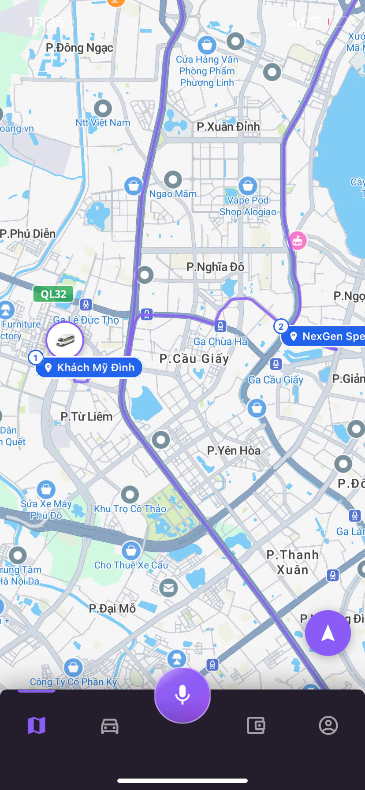
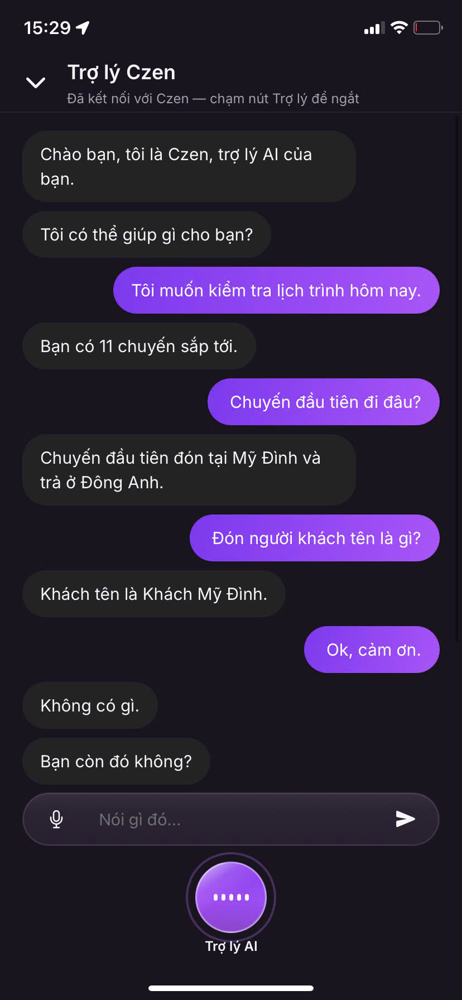
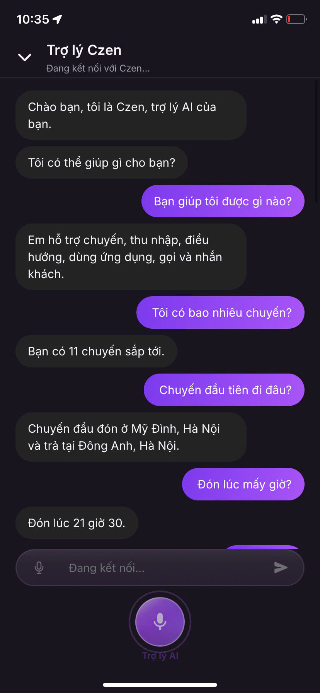

# Chương 5. Triển khai

Chương này mô tả cách hiện thực nguyên mẫu theo thiết kế Chương 4: công nghệ và tổ chức mã nguồn; hiện thực llm-orchestrator, các dịch vụ backend và ứng dụng tài xế; một số thành phần tiêu biểu (gọi khách, FAQ, từ khóa đánh thức); và ghi chú cấu hình triển khai không chứa bí mật. Mục 5.8 ánh xạ quyết định thiết kế sang vị trí mã nguồn để Chương 6 đối chiếu khi phân tích lỗi.

## 5.1. Công nghệ sử dụng

Nguyên mẫu chạy trên một kho mã nguồn dùng chung, chọn bộ công nghệ theo vai trò từng lớp:

**Bảng 5.1.** Công nghệ chính theo lớp

| Lớp | Công nghệ | Vai trò trong nguyên mẫu |
|---|---|---|
| Ứng dụng tài xế | React Native (Expo), TypeScript, Tamagui | Giao diện, mic/loa WebRTC, từ khóa đánh thức, cài đặt |
| Hội thoại AI | Python, LiveKit Agents | Worker vào phòng, STT–LLM–TTS, công cụ |
| Backend nghiệp vụ | Node.js / TypeScript, Express | external-api-service, identity-service, external-channel-service, call-records-service, ops-service |
| Truyền thông thời gian thực | LiveKit Cloud (WebRTC + SIP) | Phòng thoại trong ứng dụng và nhánh điện thoại |
| Dữ liệu phiên / bộ nhớ đệm | Redis (khi bật) | Tái sử dụng phòng, nhắc việc đang chờ… |
| Tri thức FAQ | LlamaIndex + playbook Markdown | Công cụ trả lời cách dùng ứng dụng |

Nhà cung cấp STT/LLM/TTS được gắn qua lớp cấu hình/plugin của LiveKit Agents, đúng nguyên tắc “đổi nhà cung cấp không đổi kiến trúc” ở Chương 4. Chi tiết tên mô hình/cấu hình môi trường để Phụ lục D (không đưa bí mật vào luận văn).

## 5.2. Tổ chức mã nguồn (kho mã dùng chung)

Kho mã chia hai nhánh chính: `src/backend/` (các dịch vụ nhỏ) và `src/frontend/` (ứng dụng và trang quản trị); thư mục `src/e2e/` chứa kịch bản kiểm thử đầu–cuối. Bảng 5.1b liệt kê các thành phần và vai trò.

**Bảng 5.1b.** Tổ chức mã nguồn theo thư mục dịch vụ

| Nhánh | Thư mục | Vai trò trong nguyên mẫu |
|---|---|---|
| Backend | `llm-orchestrator` | Worker Python trên LiveKit: STT–LLM–TTS, gọi công cụ, xử lý lượt thoại |
| Backend | `external-api-service` | API chuyến đi, cấp token thoại, gọi/SMS, ngữ cảnh tài xế |
| Backend | `identity-service` | Đăng nhập JWT, hồ sơ và cài đặt tài xế |
| Backend | `external-channel-service` | Điều phối quay số, webhook nhà cung cấp thoại |
| Backend | `call-records-service` | Lưu vết và bản ghi lời thoại phục vụ tóm tắt, đối soát |
| Backend | `ops-service` | Lớp giám sát vận hành, phục vụ trang Super Admin |
| Frontend | `driver-app` | Ứng dụng tài xế (React Native / Expo) — trọng tâm luận văn |
| Frontend | `customer-app`, `customer-web` | Ứng dụng và bản web phía khách (phụ) |
| Frontend | `driver-web` | Bản web phụ trợ của tài xế |
| Frontend | `admin-panel` | Tạo dữ liệu thử, điều phối chuyến, quản lý người dùng |
| Frontend | `super-admin-panel` | Giám sát sức khỏe dịch vụ, xem cấu hình STT–LLM–TTS và log |
| Frontend | `agents-playground` | Môi trường thử nghiệm agent hội thoại |
| Kiểm thử | `e2e` | Kịch bản kiểm thử đầu–cuối cho Chương 6 |

**Quy ước triển khai quan trọng:**

- llm-orchestrator **chỉ** gọi external-api-service (và dịch vụ liên quan) bằng HTTP — không mở kết nối cơ sở dữ liệu từ Python.
- Gói ngôn ngữ trợ lý nằm ở `voicebot/locales/vn` và `voicebot/locales/en` (hành vi công cụ đối xứng nhau).
- Tài liệu yêu cầu nội bộ (kịch bản hội thoại, playbook FAQ) nằm cạnh llm-orchestrator để đồng bộ với lời nhắc hệ thống và công cụ.

## 5.3. Hiện thực llm-orchestrator

### 5.3.1. Vào phiên và phân loại phòng

Điểm vào worker (`app/agent/session.py`) đọc **tên phòng** và metadata để chọn chế độ. Bảng 5.1c tóm tắt bốn trường hợp phân loại.

**Bảng 5.1c.** Dấu hiệu phòng và chế độ agent tương ứng

| Dấu hiệu phòng hoặc metadata | Chế độ agent | Tập việc mở |
|---|---|---|
| `driver-…` không SIP | Tài xế trong ứng dụng | Đủ nhóm công cụ hỗ trợ |
| `driver-…` + `sip_identity` | Đề nghị chuyến qua điện thoại | Chủ yếu nhận / từ chối |
| `custcall-…` | Gọi khách nền | Agent cô lập nói với khách |
| Metadata khách / custcall khác | Agent khách hoặc nói trực tiếp | Theo thiết kế Chương 4 |

Khi tài xế mở trợ lý trong ứng dụng, ứng dụng gọi `POST /api/v1/voice/token` trên external-api-service, nhận về token và `room_name`, tham gia phòng LiveKit; worker nhận việc và bắt đầu phiên.

### 5.3.2. Chào hai pha và nạp ngữ cảnh trước

Với phiên trong ứng dụng, hiện thực cố ý **không** chờ tải xong toàn bộ ngữ cảnh mới chịu chào:

1. Phát câu chào ngắn cố định (Czen).
2. Gọi `GET /api/v1/drivers/me/context`, đổ vào bộ nhớ phiên (`context_store`).
3. Hỏi tài xế cần gì.

Worker còn **làm nóng trước** (nạp gói ngôn ngữ, nhận diện giọng nói…) lúc tiến trình khởi động để lần kết nối sau đỡ “lạnh”.

### 5.3.3. Hiện thực một đường xử lý và câu giữ chỗ

Một đường xử lý thiết kế ở mục 4.3 được hiện thực như sau, sau khi STT chốt câu:

1. **STT → LLM kèm công cụ → TTS:** mọi câu (quen thuộc lẫn mơ hồ) đưa qua mô hình ngôn ngữ kèm schema công cụ; gọi HTTP nếu cần rồi phát TTS. Cờ `SPOKEN_INTENT_AUTO_TOOL=False` tắt nhánh cũ tự gọi công cụ theo ý định nói — không còn “đường tắt” bỏ qua LLM trong mã nguồn hiện hành.
2. **Câu giữ chỗ (`turn_filler`):** nếu khoảng hai giây sau khi tài xế dứt câu mà chưa có âm thanh trả lời, phát một lần “Đợi mình một chút…” (hoặc bản tiếng Anh); hủy nếu câu trả lời thật đã bắt đầu. Câu giữ chỗ **không** chứa sự kiện chuyến hay số liệu.
3. **Nạp ngữ cảnh trước / FollowUpKnowledge:** câu hỏi chi tiết trên dữ liệu đã có trong phiên ưu tiên đọc bộ nhớ phiên trước khi gọi mạng thêm.

Cơ chế **việc đang chờ** (`pending_action`): khi bot vừa hứa làm một việc mà chưa kịp gọi công cụ, câu xác nhận của tài xế ("ok", "gọi đi") sẽ kích hoạt công cụ đó thay vì chỉ nhận lời đáp xã giao.

### 5.3.4. Gọi HTTP nghiệp vụ

Mọi thao tác đọc và ghi chuyến, gọi điện, xem thu nhập đều đi qua lớp `backend_api` — một HTTP client có ghi nhật ký thời gian và lỗi. Công cụ đọc ưu tiên dữ liệu đã nạp trước; lỗi API được chuyển thành câu nói ngắn (không bịa “đã hủy” khi backend thất bại).

### 5.3.5. Im lặng và kết thúc phiên

Theo dõi im lặng phía tài xế: khoảng **15 giây** không nói, nhắc tối đa **hai** lần rồi chào kết thúc. Kết thúc chủ động dùng công cụ `end_conversation` hoặc gọi `POST /api/v1/voice/end-session`, tùy ngữ cảnh.

## 5.4. Hiện thực các dịch vụ backend (nền tảng tích hợp)

### 5.4.1. external-api-service

Đây là “sổ sách” chuyến đi và cửa cấp token thoại. Các nhóm đường dẫn liên quan trực tiếp trợ lý:

**Bảng 5.2.** Nhóm API external-api-service phục vụ hội thoại (rút gọn)

| Nhóm | Đường dẫn | Dùng cho |
|---|---|---|
| Thoại | `POST /api/v1/voice/token`, `POST /api/v1/voice/end-session` | Cấp token vào phòng, đóng phiên |
| Ngữ cảnh | `GET /api/v1/drivers/me/context` | Nạp trước lịch, chuyến, thu nhập, cài đặt |
| Chuyến | `GET /api/v1/drivers/me/trips/upcoming`, `.../trips/current`, `PATCH /api/v1/trips/{tripId}` | Xem chuyến sắp tới, chuyến hiện tại, cập nhật trạng thái |
| Gọi điện | `POST /api/v1/calls/start`, `POST /api/v1/calls/{callId}/summary` | Bắt đầu cuộc gọi, lấy tóm tắt cuộc gọi |
| Thu nhập, trạng thái | `GET /api/v1/drivers/me/earnings/today`, `.../earnings/summary`, `PATCH /api/v1/drivers/me/status` | Thu nhập hôm nay và theo kỳ, bật hoặc tắt nhận chuyến |

Điều phối đề nghị chuyến (`dispatchService`): tạo phòng, gắn metadata chuyến + `sip_identity` khi gọi SIP, phân công llm-orchestrator, quay số tài xế. Nếu tài xế đang mở phiên trong ứng dụng, có thể đẩy thông báo vào phòng hiện có thay vì luôn gọi mới.

### 5.4.2. identity-service và cấu hình gọi khách

Đăng nhập tài xế bằng số điện thoại + mật khẩu (vai trò `driver`). Trường cấu hình **`default_customer_call_mode`** (`agent` | `bridge`) được lưu cài đặt và đưa vào nội dung ngữ cảnh — llm-orchestrator đọc để khỏi hỏi lại chế độ mỗi lần gọi khách.

### 5.4.3. external-channel-service, call-records-service, ops

- **external-channel-service:** phối hợp quay số PSTN/SMS / webhook nhà cung cấp thoại (kênh ra ngoài).
- **call-records-service:** lưu lượt thoại phục vụ tóm tắt và đối soát khi đánh giá.
- **ops-service + super-admin:** giám sát, không nằm trên đường nóng hội thoại tài xế.

## 5.5. Hiện thực ứng dụng tài xế

Ứng dụng (`driver-app`) hiện thực các điểm chạm thiết kế ở mục 4.7:

1. **Đăng nhập:** lưu token JWT; các lời gọi tới external-api-service và identity-service dùng địa chỉ cơ sở cấu hình theo môi trường.

Màn hình chào giới thiệu ngắn gọn vai trò trợ lý và hai lối vào đăng nhập / đăng ký (Hình 5.1). Đăng nhập dùng số điện thoại và mật khẩu, gắn với vai trò `driver` (Hình 5.2).

**Hình 5.1. Màn hình chào (landing) của ứng dụng tài xế Czen Driver.**

**Hình 5.2. Màn hình đăng nhập tài xế bằng số điện thoại và mật khẩu.**

2. **Mở trợ lý:** lấy voice token, kết nối LiveKit; biểu tượng trợ lý phản ánh trạng thái đang chờ, đang nghe hoặc đang nói.

Sau khi đăng nhập, màn hình chính là bản đồ với trạng thái hoạt động và các điểm đón/trả của chuyến (Hình 5.3). Khi mở trợ lý, biểu tượng trợ lý đổi hình theo trạng thái phiên; Hình 5.4 minh họa trạng thái đang xử lý.

**Hình 5.3. Màn hình bản đồ sau khi đăng nhập và bật trạng thái hoạt động.**

**Hình 5.4. Phiên trợ lý giọng nói — biểu tượng trợ lý ở trạng thái đang xử lý.**

3. **Chat đồng bộ:** hiển thị bản ghi lời thoại STT/TTS để đối chiếu khi dừng xe.

Hình 5.5 là một lượt hội thoại mẫu: tài xế hỏi lịch trình trong ngày, số chuyến, điểm đón và tên khách; trợ lý trả lời ngắn gọn từng ý.

**Hình 5.5. Hội thoại mẫu: tra cứu lịch trình và thông tin chuyến bằng giọng nói.**

4. **Cài đặt trợ lý:** chọn chế độ gọi khách mặc định (`assistant-settings`).
5. **Từ khóa đánh thức:** thành phần nhận dạng trên thiết bị (Vosk); khi khớp từ khóa, ứng dụng gọi cùng luồng `connect` như lúc bấm mic, và **không** gửi đoạn âm thanh đánh thức vào mô hình ngôn ngữ.

Các ảnh giao diện còn lại (cài đặt trợ lý, tự tạo chuyến, điều hướng, trang quản trị và giám sát) đặt ở Phụ lục C.

## 5.6. Thành phần tiêu biểu

### 5.6.1. Gọi khách (ba chế độ)

Hiện thực bám Bảng 4.4b:

- **Agent:** bàn giao agent nói với khách trong phòng tài xế.
- **Nói trực tiếp:** cầu nối mic; kết thúc bằng cụm từ kích hoạt.
- **Gọi nền:** phòng `custcall-…` riêng; tóm tắt đẩy về phòng tài xế khi xong.

Với số tùy ý, hệ thống kiểm tra hợp lệ, lưu vào trạng thái chờ, và chỉ quay số sau khi tài xế xác nhận. Mỗi phiên giới hạn số lần gọi để giảm lạm dụng.

### 5.6.2. FAQ / truy xuất tăng cường sinh câu trả lời (RAG)

Công cụ `answer_app_faq` truy xuất playbook trong `requirements/knowledge/{vi,en}/` qua chuỗi xử lý RAG. Câu ngoài phạm vi đi theo chiến lược từ chối đã nêu ở Chương 3 — tránh bịa chính sách thanh toán/pháp lý.

### 5.6.3. Hủy chuyến hai bước

`request_cancel_trip` lưu việc chờ trong phiên và hỏi lại cho chắc; chỉ khi tài xế xác nhận, `confirm_cancel_trip` mới gọi API hủy. Hệ thống không hủy chuyến chỉ vì một câu mơ hồ.

## 5.7. Cấu hình và triển khai nguyên mẫu

Môi trường phát triển / thử nghiệm điển hình:

- Chạy các dịch vụ backend cục bộ (identity-service, external-api-service, call-records-service, …) và worker llm-orchestrator trỏ LiveKit Cloud.
- Ứng dụng trỏ địa chỉ mạng nội bộ / thử nghiệm qua biến `EXPO_PUBLIC_*` (không đưa bí mật vào kho mã).
- SIP / đề nghị chuyến qua điện thoại cần cấu hình trunk và quy tắc phân công trên LiveKit (chi tiết tham số để Phụ lục D).

**Bảng 5.3.** Thành phần cần có để demo đầu cuối tối thiểu

| Thành phần | Bắt buộc cho | Ghi chú |
|---|---|---|
| identity-service + external-api-service | Đăng nhập, token, ngữ cảnh | Nền tảng |
| llm-orchestrator worker + LiveKit | Hội thoại trong ứng dụng | Phải thấy worker đăng ký |
| driver-app | Mic/loa thật hoặc Simulator | Kiểm giao diện + kết nối |
| external-channel-service + SIP | Đề nghị chuyến / gọi khách mạng điện thoại công cộng | Có thể tắt nếu chỉ demo trong ứng dụng |
| call-records-service | Tóm tắt cuộc gọi | Không chặn bot nói nếu tắt |

Luận văn không công bố khóa API, token LiveKit hay mật khẩu trong văn bản hay phụ lục công khai.

## 5.8. Ánh xạ thiết kế Chương 4 sang mã nguồn

**Bảng 5.4.** Đối chiếu quyết định thiết kế và hiện thực

| Quyết định Chương 4 | Hiện thực tiêu biểu |
|---|---|
| Bot không đụng cơ sở dữ liệu | `backend_api.py` HTTP → external-api-service |
| Chào hai pha + nạp ngữ cảnh trước | `session.py`, lời chào trong gói ngôn ngữ agent |
| Một đường STT → LLM + tools → TTS | `session.py` + agent; `SPOKEN_INTENT_AUTO_TOOL=False` |
| Câu giữ chỗ ≈ 2 giây | `processors/turn_filler.py` |
| Bộ nhớ ngữ cảnh | `processors/context_store.py` |
| Phân loại phòng | `_parse_room` / chế độ trong `session.py` |
| Ba chế độ gọi khách | công cụ `call_customer` + call-service / phòng `custcall` |
| Token thoại | `external-api-service` `routes/voice.ts` |
| Từ khóa đánh thức | `driver-app/.../assistant-wakeword` |
| FAQ | `answer_app_faq` + `rag` / knowledge |
| Im lặng 15s × 2 | Theo dõi im lặng trong session/agent |

Bảng này giúp Chương 6 neo phép hợp kiểm thử vào đúng lớp hiện thực khi phân tích lỗi (STT, LLM/TTFT, câu giữ chỗ, API, SIP…).

## Kết luận chương

Chương 5 đã trình bày bộ công nghệ, cách tổ chức mã nguồn, hiện thực llm-orchestrator và các dịch vụ nền tảng, các điểm chạm trên ứng dụng tài xế, cùng ghi chú triển khai an toàn. Trên nền nguyên mẫu này, Chương 6 xây dựng phương pháp đo và báo cáo kết quả theo các chỉ số đã thống nhất từ Chương 2–3.

---

## Self-review (Chương 5 — rà từ ngữ đúng nghĩa)

| Hạng mục | Kết quả |
|---|---|
| substrate → nền tảng tích hợp | Đạt |
| inbound/outbound → trong ứng dụng / đề nghị chuyến | Đạt |
| Tên mã nguồn giữ trong `` khi cần đối chiếu Chương 6 | Đạt |
| Không lộ bí mật | Đạt |
| Không claim số đo Chương 6 | Đạt |
