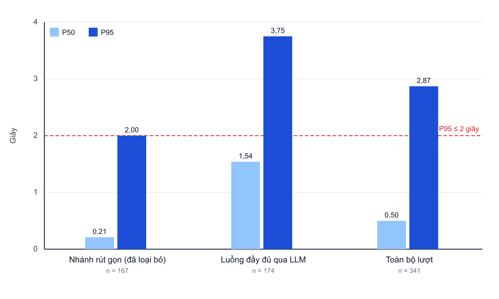
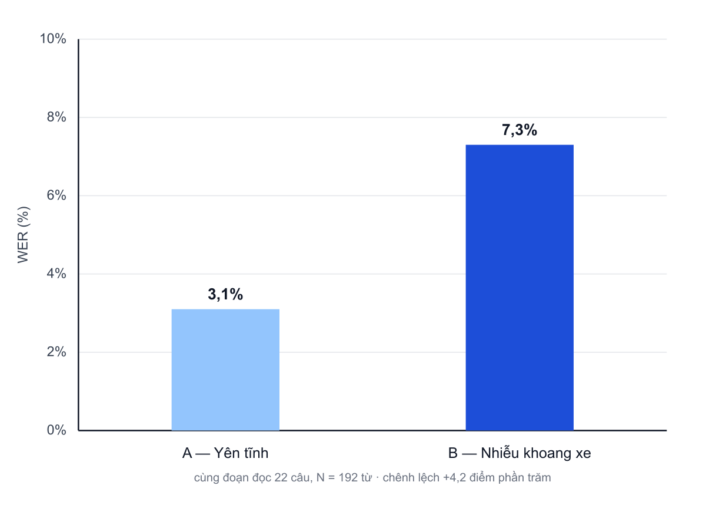

# Chương 6. Thực nghiệm và đánh giá

Chương này đánh giá nguyên mẫu đã triển khai ở Chương 5 theo từng yêu cầu đã đặc tả ở Chương 3 và trả lời các câu hỏi nghiên cứu RQ1–RQ4. Mỗi yêu cầu được đánh giá bằng kịch bản, chỉ số và ngưỡng đã xác định trước (Bảng 3.12). Chương trình bày ma trận đánh giá, môi trường thực nghiệm, định nghĩa chỉ số, kết quả theo từng yêu cầu, tổng hợp và thảo luận theo câu hỏi nghiên cứu, và các yếu tố ảnh hưởng đến độ tin cậy của kết luận.

> **Ghi chú liêm chính số liệu:** Số liệu độ trễ, tỷ lệ lỗi từ và độ chính xác gọi công cụ được trích từ nhật ký phiên thật (trường room) và bộ kiểm thử tự động trong cửa sổ hai ngày 05 và 06 tháng 9 năm 2026. Số liệu khả năng mở rộng và khả năng phục hồi được thu từ môi trường mô phỏng cục bộ (mục 6.2.2). Các ô chưa có số liệu được đánh dấu 「—」, không suy đoán giá trị.

## 6.1. Mục tiêu và ma trận đánh giá

Bảng 6.1 liên kết từng yêu cầu với câu hỏi nghiên cứu, kịch bản, chỉ số, ngưỡng và mục trình bày kết quả.

**Bảng 6.1.** Ma trận đánh giá theo yêu cầu

| Yêu cầu | Câu hỏi nghiên cứu | Kịch bản | Chỉ số | Ngưỡng | Mục |
|---|---|---|---|---|---|
| NFR-02 Performance | RQ2 | Phiên hội thoại UC01, UC03, UC04, UC07 | P50, P95 độ trễ phản hồi | P95 ≤ 2 giây | 6.4 |
| Nhận dạng giọng nói | RQ3 | Bộ câu tham chiếu, hai điều kiện âm thanh | Tỷ lệ lỗi từ | So sánh tương đối | 6.5 |
| FR-T, FR-C, FR-E, FR-F | RQ4 | UC01–UC08 | Độ chính xác gọi công cụ; tỷ lệ hoàn thành nghiệp vụ | Báo cáo theo nhóm | 6.6 |
| NFR-01 Usability | RQ4 | UC01–UC06, UC09 | Danh mục kiểm tra hành vi khi lái | 100% thao tác rủi ro có xác nhận | 6.7 |
| NFR-03 Scalability | RQ1 | SC-01, SC-02, SC-03 | P95 và tỷ lệ lỗi theo số phiên đồng thời | Tăng P95 ≤ 20%; lỗi < 1% | 6.8 |
| NFR-04 Resilience | RQ1 | RS-01 đến RS-05 | Tỷ lệ phiên duy trì; thời gian khôi phục | 100% phiên duy trì | 6.9 |
| NFR-05 Security | — | Kiểm tra mã nguồn, cấu hình, nhật ký | Danh mục kiểm tra bảo mật | 100% mục đạt | 6.10 |
| Luồng khách hàng | RQ4 | Bộ trường hợp kiểm thử khách hàng | Tỷ lệ trường hợp kiểm thử đạt | Đạt / không đạt | 6.11 |
| FR-O01, FR-O02 | — | Kiểm thử tự động mô-đun chỉ số phiên và báo cáo ngày | Tỷ lệ trường hợp kiểm thử đạt | Đạt / không đạt | 6.11 |

Ngoài phạm vi đánh giá: khảo sát trải nghiệm của khách hàng thật; đo an toàn giao thông thực địa; so sánh quy mô lớn giữa các nhà cung cấp STT, LLM, TTS; thử tải trên hạ tầng AWS thực tế.

## 6.2. Môi trường thực nghiệm

### 6.2.1. Môi trường đo hội thoại

Bảng 6.2 mô tả môi trường dùng để đo độ trễ, tỷ lệ lỗi từ và độ chính xác gọi công cụ.

**Bảng 6.2.** Môi trường đo hội thoại

| Thành phần | Cấu hình | Ghi chú |
|---|---|---|
| Ứng dụng tài xế | Thiết bị thật hoặc trình giả lập | Ưu tiên thiết bị thật khi đo micro, loa |
| Tác nhân hội thoại | Chạy cục bộ, kết nối LiveKit Cloud | Nhật ký gắn mã phòng |
| Dịch vụ backend | Dịch vụ Định danh, Dịch vụ Chuyến đi và Điều phối chạy cục bộ | Cấu hình không chứa bí mật ở Phụ lục D |
| Truyền thông | LiveKit Cloud, WebRTC; SIP khi đo UC02, UC04 | — |
| Mô hình AI | LLM gpt-5.6-luna; STT Google chirp_3 (vi-VN); TTS Google vi-VN-Chirp3-HD-Kore | Cố định trong suốt cửa sổ đo |
| Dữ liệu | Tài khoản và chuyến thử nghiệm nội bộ | Che thông tin cá nhân trên nhật ký và ảnh |
| Kiểm thử tự động | pytest trong thư mục kiểm thử của tác nhân | Bổ trợ trường hợp kiểm thử khách hàng |

Số liệu độ trễ được trích từ nhật ký `turn_metrics` của tác nhân trong hai ngày 2026-09-05 và 2026-09-06 (n = 341 lượt), kênh WebRTC trong ứng dụng. Mô hình gpt-5.6-luna là mô hình họ GPT truy cập qua giao diện tương thích OpenAI (bí danh nội bộ của dự án); kết luận về thời gian sinh token đầu gắn với mô hình này. Kịch bản do tác giả đọc; script trích xuất `extract_ch6_metrics.py` đi kèm để tái lập.

### 6.2.2. Môi trường mô phỏng thử tải và tiêm lỗi

Khả năng mở rộng và khả năng phục hồi được đánh giá trên môi trường mô phỏng cục bộ, trong đó mỗi thành phần AWS được thay bằng một thành phần tương đương (Bảng 6.3). Nhà cung cấp STT, LLM, TTS được thay bằng bộ giả lập có độ trễ cấu hình được để kết quả phản ánh tính chất kiến trúc, không phụ thuộc biến động của nhà cung cấp bên ngoài.

**Bảng 6.3.** Ánh xạ thành phần AWS sang môi trường mô phỏng

| Trên AWS | Môi trường mô phỏng |
|---|---|
| API Gateway và Lambda của từng dịch vụ | Tiến trình Node.js của từng dịch vụ, mỗi dịch vụ một cổng |
| Amazon DynamoDB | DynamoDB Local hoặc chế độ lưu trữ cục bộ của dịch vụ |
| ECS Fargate với DesiredCount = N | N tiến trình tác nhân cùng đăng ký vào một máy chủ LiveKit |
| LiveKit Cloud | Máy chủ LiveKit chạy ở chế độ phát triển |
| Nhà cung cấp STT, LLM, TTS | Bộ giả lập có độ trễ và tỷ lệ lỗi cấu hình được |
| Twilio | Bộ giả lập HTTP có thể cấu hình trả lỗi |
| Lỗi mạng giữa các dịch vụ | Công cụ toxiproxy chèn độ trễ, ngắt kết nối, lỗi |

Công cụ tạo tải gồm k6 (kiểm thử tải API) và LiveKit CLI (tạo nhiều người tham gia giả lập phát âm thanh vào phòng).

## 6.3. Định nghĩa chỉ số

**Độ trễ phản hồi.** Thời gian từ lúc tài xế kết thúc phát ngôn đến lúc tác nhân bắt đầu phát âm thanh trả lời, ghi trong nhật ký với tên `user_stop_to_agent_speak`. Các mốc phụ trong một lượt (phát hiện kết thúc phát ngôn, thời gian sinh token đầu của LLM, thời gian đến âm thanh đầu của TTS) dùng để phân tích điểm nghẽn. Báo cáo P50 và P95 theo giây.

**Tỷ lệ lỗi từ.** WER = (S + D + I) / N, trong đó S, D, I là số từ bị thay thế, bị xóa, bị chèn so với câu tham chiếu và N là số từ của câu tham chiếu.

**Độ chính xác gọi công cụ.** Một lượt được tính là đúng khi tên công cụ thuộc tập kỳ vọng của trường hợp sử dụng, tham số chính đúng và không có lời gọi công cụ gây sai nghiệp vụ.

**Tỷ lệ hoàn thành nghiệp vụ.** Một trường hợp sử dụng được tính là hoàn thành khi thỏa điều kiện thành công ở Bảng 3.8; câu trả lời trôi chảy nhưng dữ liệu phía backend không thay đổi đúng vẫn tính là không hoàn thành.

**Chỉ số khả năng mở rộng.** Mức tăng tương đối của P95 độ trễ phản hồi và tỷ lệ phiên lỗi khi tăng số phiên đồng thời, với số bản sao tác nhân tương ứng.

**Chỉ số khả năng phục hồi.** Tỷ lệ phiên không bị kết thúc bất thường khi tiêm lỗi; tỷ lệ lượt vẫn được phản hồi; thời gian từ khi bản sao tác nhân bị dừng đến khi phiên mới được phục vụ.

## 6.4. Kết quả hiệu năng — NFR-02 (RQ2)

Số liệu độ trễ hiện có thuộc đợt đo ngày 05–06/09/2026, khi nguyên mẫu còn nhánh xử lý rút gọn theo ý định (Bảng 6.4). Sau đợt đo, nhánh này đã bị loại bỏ theo ADR-02 (mục 4.2.2); các con số của nhánh rút gọn không còn là kết quả của thiết kế hiện hành mà là bằng chứng cho thấy thời gian sinh token đầu của LLM là điểm nghẽn chính.

**Bảng 6.4.** Độ trễ phản hồi theo nhánh xử lý (giây, nhật ký 05–06/09/2026, gpt-5.6-luna)

| Nhánh xử lý | n | P50 | P90 | P95 | Tỷ lệ lượt ≥ 2 giây | Đạt P95 ≤ 2 giây |
|---|---|---|---|---|---|---|
| Nhánh rút gọn theo ý định (không qua LLM) | 167 | 0,21 | 1,48 | 2,00 | 5,4% | Đạt (sát ngưỡng) |
| Luồng đầy đủ qua LLM | 174 | 1,54 | 2,78 | 3,75 | 30,5% | Chưa đạt |
| Toàn bộ lượt | 341 | 0,50 | 2,29 | 2,87 | 18,2% | Chưa đạt |

Nhánh xử lý được gán theo việc mô-đun nhận dạng ý định có kích hoạt trong lượt hay không (cách gán xấp xỉ, xem mục 6.13). Nhóm UC03 và UC07 không đủ mẫu để tách riêng.

**Bảng 6.5.** Phân tích điểm nghẽn độ trễ trong một lượt (mili-giây)

| Chặng | P50 | P95 | Nhận xét |
|---|---|---|---|
| Phát hiện kết thúc phát ngôn | 935 | 1 700 | Phụ thuộc mô hình phát hiện lượt và độ dài câu |
| LLM sinh token đầu | 1 249 | 2 487 | Chi phí lớn nhất của mọi lượt qua LLM |
| TTS đến âm thanh đầu | 161 | 288 | Không đáng kể |

**Hình 6.1.** P50 và P95 độ trễ phản hồi theo nhánh xử lý, đợt đo 05–06/09/2026 (n = 341 lượt)

Kết quả cho thấy: nhánh rút gọn đạt ngưỡng sát biên (P95 = 2,00 giây); luồng đầy đủ qua LLM chưa đạt (P95 = 3,75 giây), với thời gian sinh token đầu (P95 ≈ 2,5 giây) là nguyên nhân chính. Trong thiết kế hiện hành, mọi lượt đều đi qua LLM, vì vậy câu đệm sau 2 giây được dùng để báo hiệu hệ thống đang xử lý, còn tải trước ngữ cảnh rút ngắn thời gian thực thi công cụ.

**Bảng 6.6.** Độ trễ phản hồi trên thiết kế hiện hành (luồng xử lý đơn và câu đệm)

| Nhóm trường hợp sử dụng | n | P50 | P95 | Tỷ lệ lượt có câu đệm | Đạt P95 ≤ 2 giây |
|---|---|---|---|---|---|
| UC01 Xem lịch | 「—」 | 「—」 | 「—」 | 「—」 | 「—」 |
| UC03 Cập nhật tiến độ | 「—」 | 「—」 | 「—」 | 「—」 | 「—」 |
| UC04 Gọi khách | 「—」 | 「—」 | 「—」 | 「—」 | 「—」 |
| UC07 Hỏi đáp | 「—」 | 「—」 | 「—」 | 「—」 | 「—」 |

## 6.5. Kết quả nhận dạng giọng nói (RQ3)

**Bảng 6.7.** Tỷ lệ lỗi từ theo điều kiện âm thanh (một người đọc, một lượt mỗi điều kiện)

| Điều kiện | Số câu / số từ | S / D / I | WER |
|---|---|---|---|
| A — Yên tĩnh | 22 câu / 192 từ | 1 / 5 / 0 | 3,1% |
| B — Nhiễu mô phỏng khoang xe | 22 câu / 192 từ | 3 / 5 / 6 | 7,3% |
| Chênh lệch B − A | | | +4,2 điểm phần trăm |

**Thiết lập.** Cùng một bộ 22 câu (tra cứu chuyến, xác nhận, gọi và nhắn tin cho khách, hai địa chỉ có số nhà, mốc giờ) được đọc một lượt ở mỗi điều kiện, cùng thiết bị và micro. Ở điều kiện B, tiếng ồn nền mô phỏng khoang xe được phát từ một thiết bị khác để tránh bộ khử tiếng vọng của điện thoại loại bỏ tín hiệu. Văn bản nhận dạng lấy từ sự kiện `stt_final` trong nhật ký, chuẩn hóa chữ số và dấu câu trước khi so sánh bằng script `compute_wer.py`.

**Hình 6.2.** Tỷ lệ lỗi từ ở điều kiện yên tĩnh và điều kiện nhiễu mô phỏng khoang xe

Tỷ lệ lỗi từ tăng hơn gấp đôi khi có nhiễu, từ 3,1% lên 7,3%. Ở điều kiện nhiễu xuất hiện các lỗi thay từ mang nghĩa ("thu nhập" thành "phim Nhật"), sai chữ số trong địa chỉ và mất các hư từ ngắn. Nhận dạng vẫn dùng được cho câu lệnh ngắn nhưng độ tin cậy giảm, phù hợp với giới hạn không huấn luyện lại mô hình nhận dạng nêu ở Chương 1.

## 6.6. Kết quả tính đúng chức năng (RQ4)

**Bảng 6.8.** Độ chính xác gọi công cụ và tỷ lệ hoàn thành nghiệp vụ (đánh giá thủ công, một người đánh giá, nhật ký 2026-09-05 đến 2026-09-06)

| Nhóm nghiệp vụ | n | Đúng công cụ | Hoàn thành ngay lần đầu | Lỗi quan sát |
|---|---|---|---|---|
| UC01 Xem lịch, hỏi chuyến | 21 | ≈ 100% | ≈ 95% | 1 lần địa chỉ bị cắt (E-UX) |
| UC02 Nhận, từ chối chuyến | 4 | 100% | 100% | Không có |
| UC04 Gọi khách | 6 | ≈ 67% | ≈ 50% | Hỏi cách gọi khách bị hiểu thành lệnh gọi (E-INTENT); chuyển lời nhắn sai nghĩa (E-UX) |
| UC08 Thu nhập | 6 | ≈ 100% | ≈ 67% | Hỏi thu nhập theo tháng, theo năm trả về thu nhập trong ngày (E-PARAM) |
| UC07 Hỏi đáp cách sử dụng | 2 | 100% | 100% | Không có |
| Tổng | ≈ 39 | ≈ 88% | ≈ 77% | Xem Bảng 6.9 |

Lỗi E-INTENT ở UC04 phát sinh từ nhánh rút gọn theo ý định; nhánh này đã bị loại bỏ và kiểm thử `test_spoken_intent` xác nhận câu hỏi cách gọi khách không còn kích hoạt công cụ gọi. Số liệu theo từng trường hợp sử dụng UC03, UC05, UC06 cần đợt đánh giá có gắn nhãn, kịch bản mù và ít nhất hai người đánh giá.

**Bảng 6.9.** Phân loại lỗi quan sát (n ≈ 39 lượt)

| Mã | Nhóm lỗi | Ví dụ | Khâu nghi ngờ | Số lần |
|---|---|---|---|---|
| E-INTENT | Nhận dạng đúng nhưng chọn sai thao tác | Hỏi cách gọi khách bị hiểu thành lệnh gọi | Nhánh rút gọn (đã loại bỏ) | ≈ 3 |
| E-PARAM | Đúng công cụ, sai tham số | Thu nhập "tháng vừa rồi" trả về thu nhập hôm nay | Ngữ cảnh, LLM | ≈ 2 |
| E-UX | Hoàn thành nghiệp vụ nhưng câu nói khó nghe khi lái | Địa chỉ bị cắt; lời nhắn chuyển sai nghĩa | Lời nhắc hệ thống, TTS | ≈ 3 |
| E-CONFIRM | Đáp lời nhưng chưa gọi công cụ | Trả lời "Vâng" nhưng không thực hiện cho tới khi tài xế hỏi lại | Lời nhắc hệ thống, hành động chờ xác nhận | ≈ 2 |
| E-STT | Nhận dạng sai tên riêng | "NexGen Speak" thành "Nick Jan Speed" | STT, nhiễu | ≈ 2 |
| E-API | Đúng công cụ nhưng API lỗi | Gửi SMS trả mã 503; tác nhân báo không gửi được, phiên tiếp tục (Bảng 5.3) | Dịch vụ Kênh liên lạc, backend | 1 |

## 6.7. Kết quả khả năng sử dụng — NFR-01

**Bảng 6.10.** Danh mục kiểm tra hành vi khi lái

| STT | Tiêu chí | Trường hợp sử dụng | Kết quả | Bằng chứng |
|---|---|---|---|---|
| 1 | Hoàn thành nghiệp vụ cốt lõi không cần chạm màn hình | UC01–UC04 | Đạt (mẫu) | Phiên 2026-09-06: hỏi lịch, số chuyến, điểm đón, tên khách không thao tác màn hình |
| 2 | Mỗi câu trả lời một ý chính | UC01, UC03 | Đạt | Độ dài câu TTS trên toàn nhật ký: trung vị 44 ký tự, 93% câu ≤ 120 ký tự (n = 2 638 câu) |
| 3 | Thao tác rủi ro có bước xác nhận | UC05, UC06 | Đạt | Kiểm thử `test_confirm_trip`, `test_pending_action` đạt |
| 4 | Không đưa ra dữ liệu chuyến, thu nhập, vị trí không có nguồn | UC01, UC08 | Đạt (mẫu) | Câu trả lời khớp dữ liệu ngữ cảnh từ API; không quan sát thấy dữ liệu không có nguồn |
| 5 | Im lặng được nhắc, sau đó kết thúc phiên | UC09 | Đạt | Phiên mẫu: tác nhân hỏi "Bạn còn đó không?", chào kết thúc và gọi API kết thúc phiên (mã 200) |

## 6.8. Kết quả khả năng mở rộng — NFR-03 (RQ1)

**Bảng 6.11.** Kết quả thử tải trên môi trường mô phỏng

| Mã | Kịch bản | Cấu hình | P50 (giây) | P95 (giây) | Mức tăng P95 so với 1 phiên | Tỷ lệ phiên lỗi | Đạt |
|---|---|---|---|---|---|---|---|
| SC-01 | 1, 5, 10, 20 phiên đồng thời | 1 bản sao tác nhân | 「—」 | 「—」 | 「—」 | 「—」 | 「—」 |
| SC-02 | 20 phiên đồng thời | 2 và 4 bản sao tác nhân | 「—」 | 「—」 | 「—」 | 「—」 | 「—」 |
| SC-03 | Tải tăng dần 10 đến 200 người dùng ảo trên API ngữ cảnh và cập nhật chuyến | Dịch vụ Chuyến đi và Điều phối | 「—」 | 「—」 | 「—」 | 「—」 | 「—」 |

## 6.9. Kết quả khả năng phục hồi — NFR-04 (RQ1)

**Bảng 6.12.** Kết quả tiêm lỗi trên môi trường mô phỏng

| Mã | Lỗi được tiêm | Kỳ vọng | Tỷ lệ phiên duy trì | Chỉ số bổ sung | Đạt |
|---|---|---|---|---|---|
| RS-01 | Dừng Dịch vụ Nhật ký cuộc gọi giữa phiên | Phiên tiếp tục; bản ghi được ghi vào nhật ký | 「—」 | 「—」 | 「—」 |
| RS-02 | Dịch vụ Chuyến đi và Điều phối trả lỗi 5xx hoặc quá thời gian chờ | Tác nhân thông báo không thực hiện được; phiên tiếp tục | 「—」 | 「—」 | 「—」 |
| RS-03 | Dừng một bản sao tác nhân khi đang có phiên | Phiên mới được phục vụ bởi bản sao khác | 「—」 | Thời gian khôi phục: 「—」 | 「—」 |
| RS-04 | Nhà cung cấp dịch vụ thoại trả lỗi | Tác nhân thông báo không gọi được | 「—」 | 「—」 | 「—」 |
| RS-05 | Nhà cung cấp STT, LLM hoặc TTS chính lỗi | Chuyển sang nhà cung cấp dự phòng; lượt vẫn được phản hồi | 「—」 | Độ trễ tăng thêm: 「—」 | 「—」 |

Trong khi chờ đợt tiêm lỗi có kiểm soát, nhật ký phát triển đã ghi nhận một trường hợp lỗi thật tương ứng kịch bản RS-02: ngày 06/09/2026, trong khoảng 235 lời gọi HTTP của tác nhân có một lời gọi gửi SMS trả mã 503 (Bảng 5.3). Tác nhân thông báo "Không thể gửi tin nhắn lúc này", phiên không bị ngắt và tài xế tiếp tục thực hiện thêm các nghiệp vụ khác (cập nhật trạng thái, báo khách không có mặt, hỏi thu nhập, đặt nhắc việc) trong cùng phiên. Quan sát này mới là một mẫu, chưa thay thế được Bảng 6.12.

## 6.10. Kết quả bảo mật — NFR-05

**Bảng 6.13.** Danh mục kiểm tra bảo mật

| STT | Kiểm tra | Kỳ vọng | Kết quả | Bằng chứng |
|---|---|---|---|---|
| 1 | JWT đăng nhập chỉ do Dịch vụ Định danh phát hành | Dịch vụ khác chỉ xác minh | Đạt | Chỉ `identity-service/src/services/tokenService.ts` ký access token và refresh token của người dùng; Dịch vụ Chuyến đi và Điều phối, Dịch vụ Giám sát vận hành và tác nhân chỉ ký token dịch vụ cho lời gọi giữa các dịch vụ |
| 2 | Tham số bí mật không nằm trong mã nguồn | Khai báo NoEcho, nạp từ tệp môi trường ngoài kho mã | Đạt | Template SAM/CloudFormation; tệp `.env` nằm trong danh sách bỏ qua của git |
| 3 | Nhật ký không chứa token hoặc mật khẩu | Chỉ mã phòng và mã lỗi | Đạt | Tìm kiếm trong nhật ký không thấy Bearer, chuỗi JWT, password, khóa API |
| 4 | Nhật ký không chứa số điện thoại đầy đủ | Số điện thoại được che | 「—」 | Cần kiểm tra lại: một số dòng nhật ký của tác nhân ghi số điện thoại khi đăng ký phiên |
| 5 | Tác nhân không truy cập cơ sở dữ liệu (CON-01) | Chỉ gọi HTTP | Đạt | Mã tác nhân không có trình điều khiển cơ sở dữ liệu |
| 6 | Vị trí khách chỉ lấy từ dữ liệu chuyến | Không đưa ra vị trí không có nguồn | Đạt (mẫu) | Câu trả lời vị trí trong phiên mẫu lấy từ API chuyến |

## 6.11. Kết quả luồng khách hàng và giám sát vận hành qua trường hợp kiểm thử

**Bảng 6.14.** Kết quả trường hợp kiểm thử phía khách hàng và giám sát vận hành

| Nhóm trường hợp kiểm thử | Nội dung kiểm tra | Trường hợp kiểm thử | Kết quả |
|---|---|---|---|
| Gọi khách từ tài xế | Đúng chế độ; không quay số khi thiếu chuyến | `test_call_customer`, `test_outbound_call_modes` | Đạt |
| Tác nhân trao đổi với khách | Mở đầu đúng; không đưa ra thời gian đến hoặc giá khi thiếu dữ liệu; tóm tắt về tài xế | `test_customer_outbound_opening`, `test_customer_call_faq` | Đạt |
| Ghi nhận yêu cầu khách | Yêu cầu chờ thêm, ghi chú được lưu và gửi tóm tắt | `test_record_customer_request`, `test_resolve_customer_trip` | Đạt |
| Chỉ số phiên (FR-O01) | Đếm độ trễ, câu đệm, công cụ, lỗi HTTP, dự phòng; không lỗi khi chưa có bộ thu | `test_session_metrics` (4 ca) | Đạt |
| Báo cáo ngày (FR-O01) | Số phiên, số tài xế, độ trễ trung bình/P95, tỷ lệ công cụ thành công, tỷ lệ API lỗi, lỗi hàng đầu, mẫu chấm lặp lại được, đếm kết quả chấm, suy ra loại phiên của bản ghi cũ | `ops-service` selfcheck báo cáo (npm run verify:ops) | Đạt |
| Báo cáo ngày trên dữ liệu thật (FR-O01, FR-O02) | Dựng lại báo cáo 5 ngày có dữ liệu (30/08–10/09/2026) từ bảng nhật ký cuộc gọi; trang giám sát hiển thị đúng số liệu (Hình 5.6) | Chạy cục bộ ops-service + call-records-service | Đạt; độ trễ chưa có vì bản ghi trước ngày có chỉ số phiên |
| Truy vấn bản ghi theo ngày | Quy đổi ngày giờ Việt Nam, biên ngày theo UTC | `call-records-service` selfcheck (npm run verify:records) | Đạt |

Bộ kiểm thử tự động của tác nhân tại ngày 2026-09-06: 451/452 ca đạt (ca còn lại kiểm tra độ dài lời nhắc hệ thống); tại ngày 2026-09-27, sau khi bổ sung chỉ số phiên và dự phòng nhà cung cấp: 476/476 ca đạt. Kết quả đạt trường hợp kiểm thử chứng minh luồng khách hàng hoạt động trong phạm vi đã thiết kế, không suy ra mức hài lòng của khách hàng thật.

## 6.12. Tổng hợp và thảo luận theo câu hỏi nghiên cứu

**Bảng 6.15.** Tổng hợp kết quả theo yêu cầu

| Yêu cầu | Kết quả chính | Trạng thái |
|---|---|---|
| NFR-02 Performance | Đợt đo 05–06/09/2026: luồng đầy đủ qua LLM P95 = 3,75 giây; thiết kế hiện hành: 「—」 | Chưa đạt ở đợt đo 05–06/09; chờ đo lại |
| Nhận dạng giọng nói | WER 3,1% (yên tĩnh), 7,3% (nhiễu) | Đã đo (mẫu nhỏ) |
| FR (tính đúng chức năng) | ≈ 88% đúng công cụ, ≈ 77% hoàn thành lần đầu | Đã đo (mẫu nhỏ) |
| NFR-01 Usability | 5/5 tiêu chí đạt | Đạt |
| NFR-03 Scalability | 「—」 | Chờ số liệu |
| NFR-04 Resilience | 「—」 | Chờ số liệu |
| NFR-05 Security | 5/6 mục đạt; 1 mục cần kiểm tra lại | Đạt một phần |
| Luồng khách hàng | Các trường hợp kiểm thử đạt | Đạt |
| FR-O01, FR-O02 | Kiểm thử tự động đạt; báo cáo dựng trên dữ liệu thật (Hình 5.6); chỉ số độ trễ có từ ngày triển khai chỉ số phiên | Đạt |

**RQ1 (kiến trúc, khả năng mở rộng và khả năng phục hồi).** 「—」 Kết luận được rút ra sau khi có số liệu Bảng 6.11 và Bảng 6.12.

**RQ2 (độ trễ).** Trên 341 lượt của đợt đo 05–06/09/2026, luồng đầy đủ qua LLM chưa đạt ngưỡng (P95 = 3,75 giây), điểm nghẽn chính là thời gian LLM sinh token đầu (P95 ≈ 2,5 giây). Thiết kế hiện hành đưa mọi lượt qua LLM để bảo đảm tính đúng nghiệp vụ và dùng câu đệm để giảm cảm nhận chờ; hướng cải thiện là rút gọn lời nhắc hệ thống, giảm số vòng gọi công cụ hoặc dùng mô hình có thời gian sinh token đầu thấp hơn. Kết luận cuối cùng cho RQ2 phụ thuộc số liệu Bảng 6.6.

**RQ3 (nhận dạng giọng nói).** Tỷ lệ lỗi từ tăng từ 3,1% lên 7,3% khi có nhiễu mô phỏng khoang xe; nhiễu làm tăng lỗi thay từ mang nghĩa và sai chữ số trong địa chỉ.

**RQ4 (gọi công cụ, hoàn thành nghiệp vụ).** Khoảng 88% lượt chọn đúng công cụ và 77% hoàn thành đúng ngay lần đầu trên mẫu 39 lượt. Các nhóm lỗi chính là chọn sai thao tác với phát ngôn không rõ ý định, sai phạm vi tham số, câu nói khó nghe khi lái và chưa thực hiện thao tác sau khi xác nhận bằng lời.

## 6.13. Hạn chế và yếu tố ảnh hưởng đến độ tin cậy của kết luận

**Điều kiện thử nghiệm thuận lợi hơn thực tế.** Người đọc kịch bản biết trước câu nói nên phát âm trôi chảy hơn tài xế thật phải ứng biến; nhiễu mô phỏng không đại diện cho mọi khoang xe.

**Môi trường mô phỏng cho thử tải và tiêm lỗi.** Thử nghiệm khả năng mở rộng và khả năng phục hồi chạy trên một máy, không có độ trễ mạng thật giữa các vùng, nhà cung cấp AI được giả lập. Kết quả chứng minh tính chất kiến trúc (mở rộng theo chiều ngang, cô lập lỗi), không phải năng lực tải của hệ thống trên AWS thực tế.

**Chỉ số không bao phủ mọi khái niệm.** Độ trễ phản hồi đo trải nghiệm hội thoại, không đo an toàn giao thông thực địa; danh mục kiểm tra hành vi không thay thế khảo sát mức hài lòng dài hạn.

**Cỡ mẫu nhỏ.** Tỷ lệ lỗi từ đo với một người đọc; độ chính xác gọi công cụ đánh giá trên khoảng 39 lượt bởi một người. Luận văn nêu rõ cỡ mẫu và tránh kết luận tuyệt đối.

**Số liệu độ trễ lấy từ nhật ký phát triển.** 341 lượt trong hai ngày, một tài khoản thử nghiệm, kịch bản do tác giả đọc, còn lẫn một số lượt tự kiểm thử; việc phân loại nhánh xử lý dựa trên mô-đun nhận dạng ý định chỉ áp dụng cho đợt đo này; một lượt ngoại lệ khoảng 21 giây do nghẽn mạng vẫn được tính vào thống kê.

**Phụ thuộc nhà cung cấp mô hình.** Kết quả gắn với cấu hình STT, LLM, TTS của buổi đo (Phụ lục D).

**Thiên lệch người đánh giá.** Đợt đánh giá chính thức cần ít nhất hai người đánh giá độc lập theo cùng tiêu chí ở Bảng 6.9 và Bảng 6.10.

## Kết luận chương

Chương 6 đã đánh giá nguyên mẫu theo từng yêu cầu. Kết quả hiện có cho thấy: luồng đầy đủ qua LLM chưa đạt ngưỡng độ trễ trong đợt đo 05–06/09/2026 với điểm nghẽn ở thời gian sinh token đầu; tỷ lệ lỗi từ tăng hơn gấp đôi trong điều kiện nhiễu; khoảng 88% lượt chọn đúng công cụ; các tiêu chí khả năng sử dụng và luồng khách hàng đạt; bảo mật đạt một phần. Số liệu khả năng mở rộng, khả năng phục hồi và độ trễ trên thiết kế hiện hành sẽ được bổ sung sau đợt thử nghiệm trên môi trường mô phỏng.
