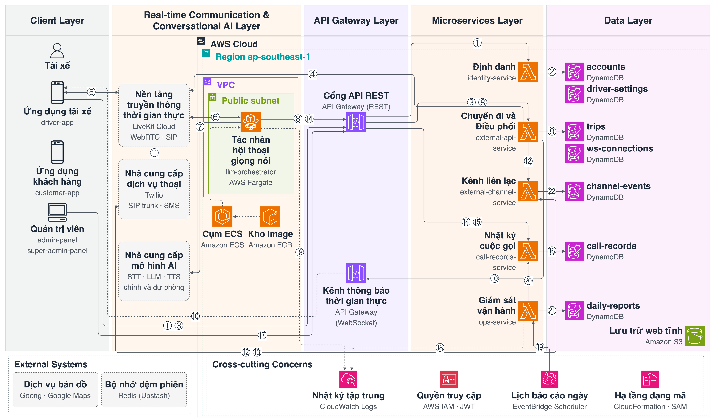
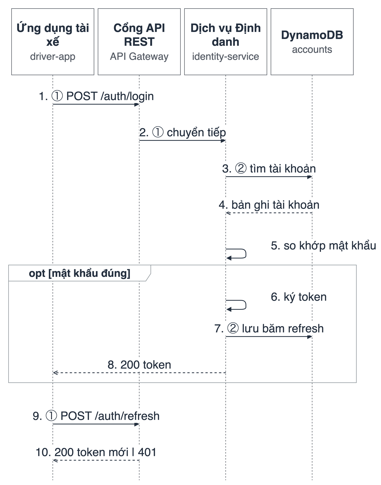
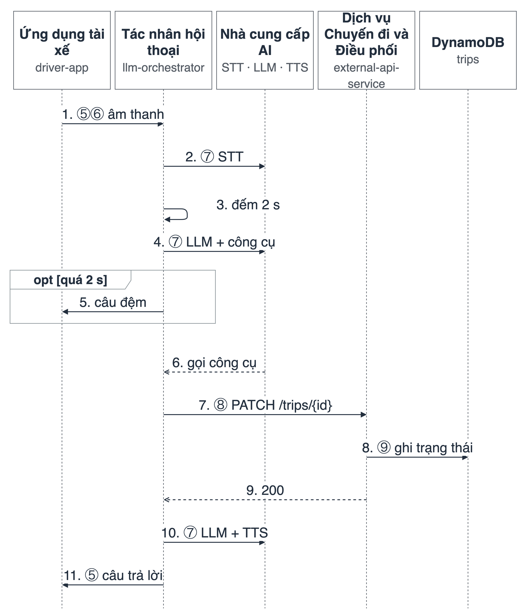
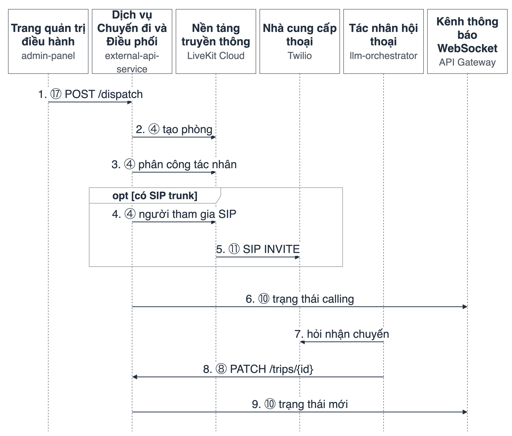
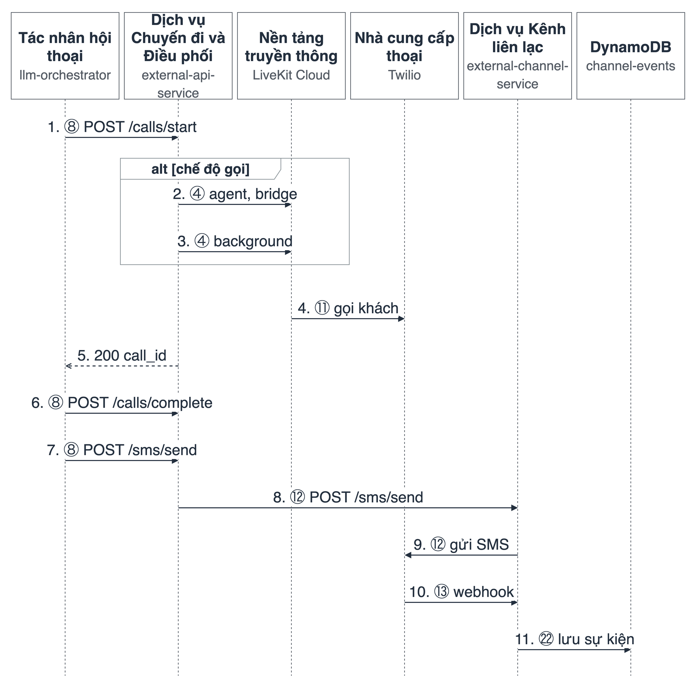
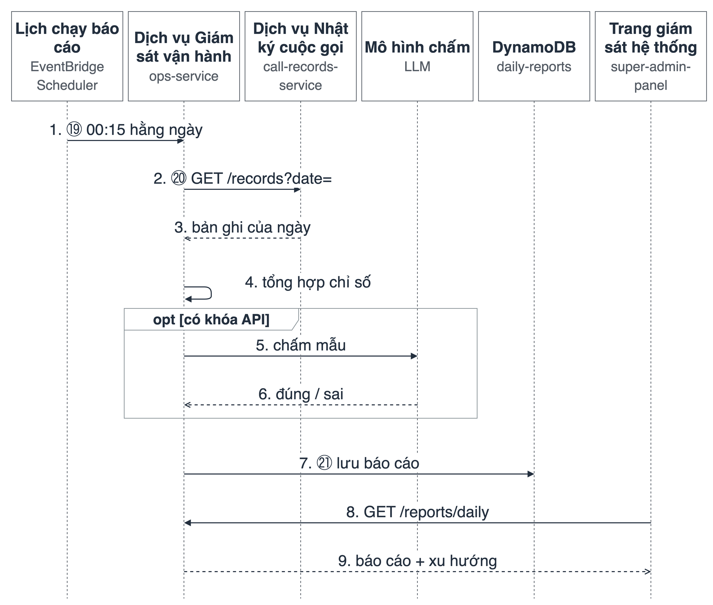

# AI-Powered Driver Assistant

Hands-free voice assistant for a ride-hailing driver. The driver speaks in the app; the assistant checks trips, earnings, and can call or message the rider. Each folder below owns one job. A service does not open another service's database.

## Who resolves what

| Folder | Resolves |
|---|---|
| `src/frontend/driver-app` | Driver phone app (the product surface). |
| `src/frontend/customer-app` | Rider phone app. |
| `src/frontend/driver-web`, `customer-web` | Web previews of those apps. |
| `src/frontend/admin-panel` | Dispatcher: seed trips, watch dispatch. |
| `src/frontend/super-admin-panel` | Operations screens. Talks only to `ops-service`. |
| `src/frontend/agents-playground` | LiveKit debug UI, not a product app. |
| `src/backend/identity-service` | Accounts, login, JWT. The only writer of account data. Port 8003. |
| `src/backend/external-api-service` | Trips, driver context, maps, and LiveKit dial for a trip. Port 8002. |
| `src/backend/external-channel-service` | SMS and Twilio webhooks (call status, inbound calls); stores provider events. Port 8000. |
| `src/backend/call-records-service` | Call transcripts and summaries. Port 8001. |
| `src/backend/llm-orchestrator` | The voice worker: speech to text, the language model with tools, text to speech. No database. |
| `src/backend/ops-service` | Backend for the super-admin panel: health, log tail, call-record proxy, daily operations report. Port 8004. |
| `src/e2e` | Scripts that cross services. Not a product. |
| `infra/` | Deploy scripts for the services above. |

How to run each service is in that folder's README.

## One spoken question

The driver speaks in `driver-app`. LiveKit carries the audio to `llm-orchestrator`. That worker asks `external-api-service` for trip data (already loaded into the session when it can) and lets the language model decide whether to call a tool. The spoken answer goes back through LiveKit. If the real answer is not ready about two seconds after the driver stops, the worker says a short hold phrase first.

Login tokens come from `identity-service`. Other services check that token; they do not issue accounts. `llm-orchestrator` never reads DynamoDB. Twilio's REST API and webhooks stay in `external-channel-service`; the assistant's voice calls reach Twilio through the LiveKit SIP trunk, started by `external-api-service`.

## How it works (diagrams)

The figures below are generated from `Assignment/diagrams/gen_drawio.py` (draw.io sources next to the PNGs; see [`Assignment/diagrams/README.md`](Assignment/diagrams/README.md)). Labels are in Vietnamese; the service names in small type match the folders above. Circled numbers ①–㉒ are the same flows in every figure.

### Architecture on AWS

Read left to right, one column per layer: apps → real-time voice (LiveKit, the voice worker on ECS Fargate, AI providers) → API Gateway → one Lambda per service → that service's own DynamoDB tables. The bottom band holds what every layer uses: CloudWatch logs, IAM/JWT, CloudFormation/SAM, and the EventBridge schedule that builds the daily report. Grey dashed boxes are outside AWS.

| Flow | Meaning |
|---|---|
| ① ② | Login: app → API Gateway → `identity-service` → `accounts` |
| ③ ④ ⑤ ⑥ | Start a voice session: app asks for a voice token, `external-api-service` creates the LiveKit room, audio flows app ↔ LiveKit ↔ voice worker |
| ⑦ | Voice worker → speech-to-text, language model, text-to-speech (primary, then fallback) |
| ⑧ ⑨ ⑩ | A tool call: voice worker → `external-api-service` → `trips`; push the change to apps over WebSocket |
| ⑪ | LiveKit SIP → Twilio → phone (trip offer to the driver, calls to the rider) |
| ⑫ ⑬ ㉒ | SMS through `external-channel-service`; Twilio webhooks stored in `channel-events` |
| ⑭ ⑮ ⑯ | Call transcript saved to `call-records`; later read back as a summary |
| ⑰ | Admin and ops panels → API Gateway |
| ⑱ | Every service and the voice worker log to CloudWatch |
| ⑲ ⑳ ㉑ | 00:15 daily: EventBridge → `ops-service` reads the day's records → `daily-reports` |

### One spoken turn

Every sentence goes speech-to-text → language model with the tools allowed for this session → text-to-speech. Tools read the session state loaded when the session opened and call the trip service only when data is missing or must be written. If no audio is ready two seconds after the driver stops talking, a short hold phrase plays once.

### Main flows, step by step

**S1 — Login.** The app sends phone and password; `identity-service` checks the bcrypt hash and returns access and refresh tokens.

**S2 — Open the assistant.** The app gets a LiveKit token (reusing an open room if there is one), joins the room, and a voice worker is dispatched. The worker greets first, then loads the driver's context.

**S3 — One turn with a tool.** Example "picked up the rider": the model calls `update_trip_status`, the worker PATCHes the trip, and confirms only after the API says OK.

**S4 — Trip offer by phone.** The dispatcher sends a trip; `external-api-service` rings the driver through LiveKit SIP. In that call the worker can only accept or reject.

**S5 — Call or text the rider.** Three call modes (assistant speaks, driver speaks directly, background call); SMS goes through `external-channel-service`, which stores Twilio events.

**S6 — Call log.** When a session ends the worker saves the transcript and summary; later the driver can ask for the last call's summary.

**S7 — Daily report.** At 00:15 `ops-service` reads yesterday's records, computes sessions, drivers, latency, errors, grades a sample of answers with an LLM, and stores the report for the super-admin panel.

The same flows with every parameter, timeout, and error code are in `Assignment/Chuong4_Thiet_ke_he_thong_DRAFT.md` (tables 4.4–4.12).

## Names you will still see

Environment files accept both the current names and the older ones:

| Current | Older alias still accepted |
|---|---|
| `IDENTITY_SERVICE_URL` | `AUTH_SERVICE_URL` |
| `EXTERNAL_API_SERVICE_URL` | `TRIP_SERVICE_URL` |
| `CALL_RECORDS_SERVICE_URL` | `CALL_LOGGER_URL` |
| `EXTERNAL_CHANNEL_SERVICE_URL` | `CALL_CENTER_URL` |

Scripts under `src/e2e` still read `TRIP_SERVICE_URL`. The AWS log group for the voice worker is still `dev-driver-assistant-voice-agent`.
