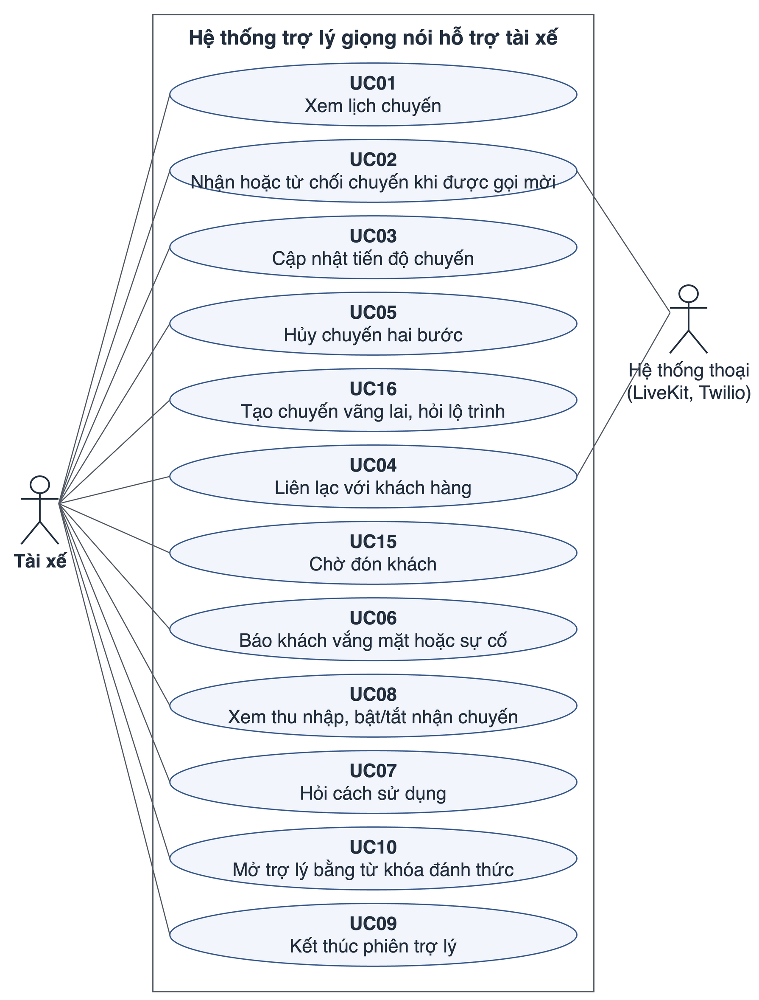
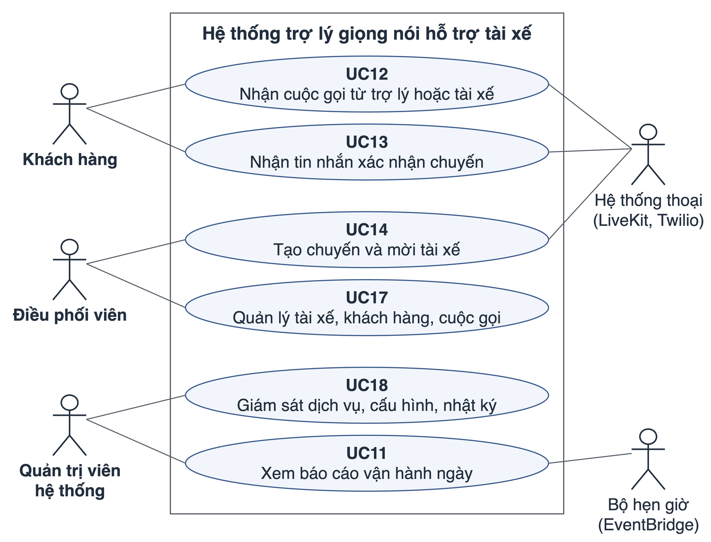

# Chương 3. Phân tích yêu cầu

Chương này xác định hệ thống phải làm gì và phải làm tốt đến mức nào, xuất phát từ những người sẽ dùng hệ thống. Chương được sắp theo trình tự: bốn chân dung người sử dụng (mục 3.2) → yêu cầu chức năng của từng chân dung (mục 3.3.1 đến 3.3.4) → mô hình use case cho thấy mỗi chân dung dùng các chức năng đó để đạt mục tiêu của mình như thế nào (mục 3.3.5) → yêu cầu phi chức năng mà các use case phải thỏa mãn và chiến thuật kiến trúc tương ứng (mục 3.4) → tiêu chí chấp nhận để kiểm chứng từng yêu cầu (mục 3.4.4).

## 3.1. Phương pháp xác định yêu cầu

Yêu cầu được xác định theo năm bước, mỗi bước dựa trên một phương pháp đã được hệ thống hóa trong tài liệu:

1. **Xác định lớp người dùng và chân dung.** Người dùng được chia thành các lớp theo cách sử dụng hệ thống, chọn lớp người dùng ưu tiên (Wiegers & Beatty, 2013), rồi mô tả mỗi lớp bằng một chân dung có mục tiêu và bối cảnh cụ thể (Cooper et al., 2014). Kết quả ở mục 3.2.
2. **Xác định yêu cầu chức năng theo từng chân dung.** Từ nghiệp vụ thực tế của mỗi chân dung, các việc người dùng cần làm được viết thành yêu cầu người dùng, mỗi yêu cầu có một mã riêng, theo góc nhìn người dùng (Sommerville, 2016). Kết quả ở mục 3.3.1 đến 3.3.4.
3. **Tổ chức yêu cầu chức năng thành use case.** Cockburn (2001) chỉ ra hai cách dùng use case: khám phá yêu cầu khi hệ thống còn mới hoàn toàn, hoặc ghi lại và mô hình hóa các yêu cầu chức năng đã biết dưới dạng câu chuyện dễ hiểu hơn một danh sách. Vì nghiệp vụ gọi xe và phạm vi của nguyên mẫu đã xác định, luận văn dùng cách thứ hai: mỗi use case ứng với một việc người dùng muốn hoàn thành trọn vẹn (ví dụ "nhận chuyến"), gom các yêu cầu chức năng phục vụ việc đó và mô tả trình tự tương tác giữa người dùng với hệ thống để hoàn thành nó. Kết quả ở mục 3.3.5.
4. **Xác định yêu cầu phi chức năng từ bối cảnh sử dụng.** Use case mô tả hành vi nhưng không phải toàn bộ yêu cầu (Cockburn, 2001); các yêu cầu chất lượng được đặc tả riêng. Ràng buộc của từng chân dung (ví dụ tài xế không thể nhìn màn hình khi lái) và đặc điểm của các use case (ví dụ cuộc hội thoại cần phản hồi nhanh) được đặc tả thành kịch bản thuộc tính chất lượng theo ISO/IEC 25010 và Bass et al. (2021), gắn với các use case chịu tác động. Kết quả ở mục 3.4.
5. **Đặt tiêu chí chấp nhận.** Mỗi nhóm yêu cầu có tiêu chí chấp nhận dạng Given – When – Then (mục 2.4.4) để Chương 6 kết luận đạt hay không đạt.

Nguồn thông tin cho các bước trên gồm ba loại. Thứ nhất là nghiên cứu về hành vi của tài xế gọi xe khi lái: khảo sát của IIHS cho thấy tài xế làm việc qua nền tảng số có khả năng thường xuyên dùng ứng dụng điện thoại khi lái cao gần gấp bốn lần những người lái khác, và các thao tác này gồm cả những việc ngoài liên lạc với khách và tìm đường tới điểm đón (Insurance Institute for Highway Safety, 2022), và tài xế gọi xe trực tuyến thao tác điện thoại để nhận chuyến ngay trong lúc lái (Song et al., 2023). Thứ hai là tài liệu nội bộ của dự án: tài liệu yêu cầu, sổ tay hướng dẫn sử dụng và bộ kịch bản hội thoại mẫu (Phụ lục B). Thứ ba là các ràng buộc an toàn khi lái (mục 2.8). Các mã (FR, UC, NFR, AC) được dùng lại ở các chương sau và trong ma trận đối chiếu yêu cầu (Phụ lục E).

## 3.2. Đối tượng sử dụng

Theo cách tiếp cận ở mục 2.4.1, hệ thống có bốn lớp người dùng (Wiegers & Beatty, 2013): tài xế, khách hàng, điều phối viên và quản trị viên hệ thống. Tài xế là lớp người dùng ưu tiên, vì là nhóm duy nhất thao tác trong lúc điều khiển phương tiện; khi nhu cầu của các nhóm xung đột, nhu cầu của tài xế được ưu tiên. Mỗi lớp được mô tả bằng một chân dung người dùng (Cooper et al., 2014) gồm mục tiêu chính, bối cảnh và đặc điểm, kênh tương tác (Bảng 3.1). Tên gọi bốn chân dung được dùng thống nhất trong toàn luận văn.

**Bảng 3.1.** Chân dung người sử dụng

| Chân dung | Mục tiêu chính | Bối cảnh và đặc điểm | Kênh tương tác |
|---|---|---|---|
| Tài xế | Hoàn thành chuyến đúng hẹn, liên lạc với khách và theo dõi thu nhập mà không phải nhìn hay chạm màn hình khi lái | Mắt nhìn đường, tay giữ vô-lăng; khoang xe có tiếng ồn; câu hỏi ngắn, gắn với việc đang làm ("còn mấy chuyến", "đến nơi rồi", "gọi khách"); không muốn nghe danh sách dài | Hội thoại giọng nói trong ứng dụng (WebRTC); cuộc gọi điện thoại mời nhận chuyến (SIP) |
| Khách hàng | Đặt được xe và liên lạc được với tài xế khi cần | Không cài ứng dụng; đặt xe bằng cách gọi điện hoặc nhắn tin vào nhóm Zalo của hãng (kênh nằm ngoài hệ thống); có thể nhận cuộc gọi do trợ lý thực hiện thay tài xế | Điện thoại thường: cuộc gọi qua mạng điện thoại công cộng (PSTN) và tin nhắn SMS |
| Điều phối viên | Điều phối chuyến, quản lý tài xế và khách hàng, theo dõi các cuộc gọi | Nhân viên vận hành của hãng, làm việc trên máy tính, không chịu ràng buộc khi lái; làm việc với dữ liệu nghiệp vụ (chuyến, tài xế, khách hàng, cuộc gọi) | Trang quản trị điều hành |
| Quản trị viên hệ thống | Bảo đảm hệ thống hoạt động ổn định và theo dõi chất lượng của trợ lý theo từng ngày | Người vận hành kỹ thuật; làm việc với tình trạng dịch vụ, cấu hình tác nhân, nhật ký và báo cáo vận hành, không làm việc với dữ liệu chuyến | Trang giám sát hệ thống |

Bốn chân dung tham gia vào cùng một quy trình nghiệp vụ: khách đặt xe qua điện thoại hoặc nhóm Zalo; điều phối viên tạo chuyến và mời tài xế; tài xế nhận chuyến, liên lạc với khách và thực hiện chuyến bằng giọng nói; quản trị viên hệ thống theo dõi để quy trình này vận hành ổn định. Tài xế là đối tượng đánh giá trọng tâm; yêu cầu của ba chân dung còn lại được kiểm chứng chủ yếu bằng kiểm thử. Mục 3.3 lần lượt xác định những gì hệ thống phải làm cho từng chân dung, theo đúng thứ tự trong quy trình trên.

## 3.3. Yêu cầu chức năng

Yêu cầu chức năng được viết theo góc nhìn người dùng ("tài xế có thể…", "hệ thống phải…") và không gắn với thành phần phần mềm cụ thể; việc phân bổ yêu cầu cho từng dịch vụ được trình bày ở Chương 4 và Phụ lục E. Mỗi bảng có cột quy tắc nghiệp vụ, là ràng buộc hệ thống phải tuân theo khi thực hiện yêu cầu. Quy tắc nghiệp vụ chung cho mọi yêu cầu: trợ lý không được đưa ra dữ liệu chuyến, thu nhập, vị trí hoặc kết quả cuộc gọi nào không lấy từ dữ liệu của hệ thống.

### 3.3.1. Yêu cầu chức năng của tài xế

Tài xế tương tác với trợ lý trong hai hoàn cảnh. Thứ nhất, tài xế chủ động mở trợ lý trong ứng dụng bằng nút bấm hoặc từ khóa đánh thức để thực hiện các nghiệp vụ dưới đây. Thứ hai, khi có chuyến mới, hệ thống chủ động gọi điện mời tài xế nhận chuyến. Cuộc gọi này chỉ nhằm để tài xế quyết định nhanh có nhận chuyến hay không, nên tài xế chỉ được nhận hoặc từ chối, không dùng được các chức năng khác như khi chủ động mở trợ lý.

**Nghiệp vụ chuyến đi.** Nhóm này gồm các yêu cầu trong vòng đời một chuyến, từ xem lịch, nhận chuyến, cập nhật tiến độ đến hủy chuyến (Bảng 3.2).

**Bảng 3.2.** Yêu cầu chức năng của tài xế: nghiệp vụ chuyến đi (FR-T)

| Mã | Yêu cầu | Quy tắc nghiệp vụ |
|---|---|---|
| FR-T01 | Tài xế có thể hỏi danh sách các chuyến sắp tới trong ngày | Số chuyến và thông tin chuyến khớp dữ liệu hệ thống |
| FR-T02 | Tài xế có thể hỏi thông tin chuyến hiện tại (điểm đón, điểm trả, trạng thái) | Thiếu dữ liệu thì nói rõ là chưa có thông tin |
| FR-T03 | Tài xế có thể cập nhật trạng thái chuyến (đã đến, đã đón, hoàn thành) bằng giọng nói | Trợ lý chỉ báo "đã cập nhật" sau khi hệ thống đã lưu trạng thái mới |
| FR-T04 | Tài xế có thể nhận hoặc từ chối chuyến mới, cả khi đang mở trợ lý và trong cuộc gọi mời nhận chuyến | Không nhầm từ chối chuyến mới với hủy chuyến đang chạy |
| FR-T05 | Tài xế có thể hủy chuyến đang hoạt động | Hai bước: trợ lý đề nghị, tài xế xác nhận rồi mới hủy |
| FR-T06 | Tài xế có thể tạo chuyến cho khách vãng lai (khách vẫy xe dọc đường, không đặt trước) | Chuyến được tạo ở trạng thái đã xác nhận |
| FR-T07 | Tài xế có thể hỏi điểm dừng tiếp theo, thứ tự ghé tối ưu và tình trạng giao thông | Thông tin lấy từ dịch vụ bản đồ; không đọc hướng dẫn rẽ từng bước |

**Liên lạc khách hàng.** Khi tài xế yêu cầu gọi khách, hệ thống hỗ trợ ba chế độ tương ứng ba hoàn cảnh sử dụng (Bảng 3.3). Chế độ mặc định lấy từ cài đặt của tài xế, trừ khi tài xế nêu rõ chế độ khác trong câu nói. Các yêu cầu liên lạc được liệt kê trong Bảng 3.4.

**Bảng 3.3.** Ba chế độ gọi khách hàng

| Chế độ | Hành vi | Hoàn cảnh phù hợp |
|---|---|---|
| Tác nhân gọi thay | Tác nhân trao đổi với khách; tài xế nghe và có thể can thiệp | Tài xế muốn tác nhân hỏi thay nhưng vẫn theo dõi |
| Nói trực tiếp (bridge) | Kết nối để tài xế nói trực tiếp với khách; tác nhân không phát âm chồng lấn | Cần trao đổi nhanh, mang tính cá nhân |
| Gọi nền | Tác nhân gọi trong phòng riêng; tài xế tiếp tục sử dụng trợ lý cho việc khác | Tài xế đang bận, chỉ cần kết quả sau cuộc gọi |

**Bảng 3.4.** Yêu cầu chức năng của tài xế: liên lạc khách hàng (FR-C)

| Mã | Yêu cầu | Quy tắc nghiệp vụ |
|---|---|---|
| FR-C01 | Tài xế có thể gọi khách của chuyến theo một trong ba chế độ (Bảng 3.3) | Gọi đúng khách của chuyến; áp dụng chế độ mặc định trừ khi tài xế nêu khác |
| FR-C02 | Tài xế có thể gọi một số điện thoại khác hoặc một người trong danh bạ | Phải có bước xác nhận số hoặc người nhận trước khi quay số |
| FR-C03 | Tài xế có thể gửi tin nhắn SMS cho khách hoặc cho số khác | Thông báo ngắn kết quả gửi thành công hoặc thất bại |
| FR-C04 | Tài xế có thể hỏi vị trí đón của khách và gửi xác nhận chuyến cho khách | Không đưa ra vị trí không có trong dữ liệu |
| FR-C05 | Tài xế có thể hỏi trạng thái và nghe tóm tắt cuộc gọi gần nhất với khách | Chưa có dữ liệu thì thông báo chưa có |
| FR-A02 | Tài xế có thể kết thúc chế độ nói trực tiếp bằng một cụm từ quy định | Tác nhân trở lại hội thoại với tài xế sau khi nghe cụm từ kết thúc |

**Chờ đón, sự cố, thu nhập và hỗ trợ.** Nhóm này gồm các nghiệp vụ còn lại trong lúc vận hành (Bảng 3.5).

**Bảng 3.5.** Yêu cầu chức năng của tài xế: chờ đón, sự cố, thu nhập và hỗ trợ

| Mã | Yêu cầu | Quy tắc nghiệp vụ |
|---|---|---|
| FR-W01 | Tài xế có thể đặt nhắc việc trước giờ đón và nghe lại thời điểm nhắc | Thời điểm đọc lại khớp yêu cầu |
| FR-W02 | Tài xế có thể gia hạn thời gian chờ khách | Trợ lý chỉ báo đã gia hạn sau khi hệ thống đã lưu |
| FR-I01 | Tài xế có thể báo khách không có mặt | Hệ thống chỉ ghi nhận sau khi tài xế xác nhận lại |
| FR-I02 | Tài xế có thể báo sự cố trong chuyến | Hỏi loại sự cố; không xử lý tranh chấp thanh toán hoặc pháp lý |
| FR-E01 | Tài xế có thể hỏi thu nhập trong ngày và theo kỳ, lịch sử chuyến và chỉ số cá nhân | Số liệu lấy từ dữ liệu hệ thống; thiếu thì thông báo chưa có |
| FR-E02 | Tài xế có thể bật hoặc tắt trạng thái sẵn sàng nhận chuyến | Trợ lý chỉ báo trạng thái mới sau khi hệ thống đã lưu |
| FR-F01 | Tài xế có thể hỏi cách sử dụng các chức năng | Trả lời theo sổ tay hướng dẫn; câu hỏi ngoài phạm vi được từ chối và hướng dẫn kênh phù hợp |

**Phiên hội thoại.** Nhóm này quy định cách tài xế mở, sử dụng và kết thúc một phiên trợ lý (Bảng 3.6). Từ khóa đánh thức được nhận dạng ngay trên điện thoại vì ba lý do: phải phản hồi tức thì khi tài xế nói từ khóa; không nên gửi âm thanh liên tục lên máy chủ khi trợ lý chưa được kích hoạt; và sau khi kích hoạt chỉ cần dùng lại luồng mở phiên đã có.

**Bảng 3.6.** Yêu cầu chức năng của tài xế: phiên hội thoại (FR-A, FR-L)

| Mã | Yêu cầu | Quy tắc nghiệp vụ |
|---|---|---|
| FR-A01 | Tài xế có thể mở trợ lý bằng từ khóa đánh thức | Mở phiên giống như khi bấm nút; nếu không nhận được từ khóa, tài xế vẫn mở được bằng nút |
| FR-L01 | Tài xế có thể hội thoại bằng tiếng Việt hoặc tiếng Anh | Cùng tập chức năng của tài xế ở hai ngôn ngữ |
| FR-L02 | Tài xế có thể kết thúc phiên bằng lời nói; phiên tự kết thúc khi tài xế im lặng kéo dài | Nhắc tối đa hai lần (khoảng 15 giây mỗi lần) rồi kết thúc lịch sự |
| FR-L03 | Hệ thống phải giới hạn tập chức năng theo loại phiên (trong ứng dụng, mời nhận chuyến, gọi khách) | Phiên mời nhận chuyến chỉ có nhận hoặc từ chối chuyến |

### 3.3.2. Yêu cầu chức năng của khách hàng

Khách hàng không cần cài ứng dụng. Khách đặt xe bằng cách gọi điện hoặc nhắn tin vào nhóm Zalo của hãng; điều phối viên tiếp nhận yêu cầu và tạo chuyến trên hệ thống (FR-Q02). Kênh tiếp nhận này nằm ngoài hệ thống của luận văn. Từ lúc chuyến được tạo, khách tương tác với hệ thống hoàn toàn qua điện thoại thường: nhận cuộc gọi do trợ lý thực hiện thay tài xế hoặc cuộc gọi nói trực tiếp với tài xế (Bảng 3.3), và nhận tin nhắn SMS. Bảng 3.7 liệt kê các yêu cầu tương ứng.

**Bảng 3.7.** Yêu cầu chức năng của khách hàng (FR-K)

| Mã | Yêu cầu | Quy tắc nghiệp vụ |
|---|---|---|
| FR-K01 | Khách hàng có thể nhận cuộc gọi do trợ lý thực hiện thay tài xế, trao đổi và để lại yêu cầu (ví dụ xin chờ thêm) | Yêu cầu được ghi nhận và tóm tắt gửi về cho tài xế; không đưa ra giá hoặc thời gian đến khi thiếu dữ liệu |
| FR-K02 | Khách hàng có thể nói chuyện trực tiếp với tài xế khi tài xế chọn chế độ nói trực tiếp | Trợ lý không phát âm chồng lấn trong cuộc gọi |
| FR-K03 | Khách hàng nhận tin nhắn SMS xác nhận chuyến hoặc lời nhắn của tài xế | Nội dung tin nhắn khớp dữ liệu chuyến |
| FR-K04 | Trong cuộc gọi do trợ lý thực hiện, khách hàng có thể hỏi thông tin cơ bản về chuyến và về dịch vụ | Chỉ trả lời từ dữ liệu chuyến và sổ tay hướng dẫn |

### 3.3.3. Yêu cầu chức năng của điều phối viên

Điều phối viên làm việc với dữ liệu nghiệp vụ trên trang quản trị điều hành: điều phối chuyến, mời tài xế nhận chuyến, quản lý tài khoản tài xế và khách hàng, xem nhật ký cuộc gọi (Bảng 3.8).

**Bảng 3.8.** Yêu cầu chức năng của điều phối viên (FR-Q)

| Mã | Yêu cầu | Quy tắc nghiệp vụ |
|---|---|---|
| FR-Q01 | Điều phối viên có thể xem bảng điều phối chuyến, lọc theo trạng thái và gán tài xế cho chuyến | Chỉ tài khoản quản trị truy cập được |
| FR-Q02 | Điều phối viên có thể tạo chuyến từ yêu cầu đặt xe của khách và mời tài xế được gán nhận chuyến | Lời mời kích hoạt cuộc gọi mời nhận chuyến (FR-T04) hoặc thông báo vào phiên đang mở |
| FR-Q03 | Điều phối viên có thể xem danh sách tài xế, trạng thái trực tuyến và khóa tài khoản tài xế | Tài khoản bị khóa không đăng nhập được |
| FR-Q04 | Điều phối viên có thể xem danh sách khách hàng và trạng thái tài khoản | Hiển thị đủ số điện thoại để điều phối viên liên lạc; chỉ tài khoản quản trị truy cập được |
| FR-Q05 | Điều phối viên có thể xem nhật ký cuộc gọi kèm tóm tắt nội dung hội thoại | Chỉ đọc; không sửa bản ghi |

### 3.3.4. Yêu cầu chức năng của quản trị viên hệ thống

Quản trị viên hệ thống theo dõi tình trạng kỹ thuật của các dịch vụ và chất lượng vận hành của trợ lý theo từng ngày mà không phải đọc từng bản ghi hội thoại (Bảng 3.9).

**Bảng 3.9.** Yêu cầu chức năng của quản trị viên hệ thống (FR-S, FR-O)

| Mã | Yêu cầu | Quy tắc nghiệp vụ |
|---|---|---|
| FR-S01 | Quản trị viên hệ thống có thể xem tình trạng hoạt động của từng dịch vụ backend | Dịch vụ không phản hồi được hiển thị là ngừng hoạt động |
| FR-S02 | Quản trị viên hệ thống có thể xem cấu hình chuỗi STT – LLM – TTS (nhà cung cấp chính và dự phòng) của tác nhân theo từng ngôn ngữ | Không hiển thị khóa bí mật |
| FR-S03 | Quản trị viên hệ thống có thể xem nhật ký thời gian thực của các dịch vụ, lọc theo mã phòng hội thoại | Nhật ký không chứa số điện thoại đầy đủ hoặc token |
| FR-O01 | Hệ thống phải lập báo cáo vận hành cho từng ngày (giờ Việt Nam): số phiên và số tài xế được phục vụ; tỷ lệ công cụ thành công, tỷ lệ API lỗi và tỷ lệ trả lời đúng trên mẫu có chấm; lỗi theo loại; độ trễ phản hồi trung bình, P50, P95 | Báo cáo tự lập sau nửa đêm cho ngày trước, lập lại được theo yêu cầu, ghi rõ cỡ mẫu và phương pháp chấm |
| FR-O02 | Quản trị viên hệ thống có thể xem báo cáo theo ngày và xu hướng 7 ngày | Chỉ tài khoản quản trị hệ thống truy cập được |

### 3.3.5. Mô hình use case

Các yêu cầu chức năng ở mục 3.3.1 đến 3.3.4 cho biết hệ thống phải làm gì, nhưng chưa cho thấy mỗi người dùng dùng các chức năng đó theo trình tự nào để đạt mục tiêu của mình. Mục này tổ chức các yêu cầu đã xác định thành use case. Theo Cockburn (2001), một use case mô tả mọi cách mà tác nhân chính có thể đạt (hoặc không đạt) một mục tiêu khi tương tác với hệ thống. Trong mục này, "tác nhân" (actor) theo nghĩa của use case là người hoặc hệ thống bên ngoài tương tác với hệ thống, khác với "tác nhân hội thoại" ở các chương khác; luận văn viết use case ở mức mục tiêu người dùng, tức một việc người dùng hoàn thành trong một lần sử dụng.

Luận văn xác định 18 use case. Tài xế, với tư cách lớp người dùng ưu tiên, có 12 use case (Hình 3.1); ba chân dung còn lại mỗi chân dung có hai use case (Hình 3.2). Ngoài bốn tác nhân chính, sơ đồ có hai tác nhân hỗ trợ: hệ thống thoại (nền tảng truyền thông thời gian thực và nhà cung cấp dịch vụ thoại) tham gia các use case có cuộc gọi hoặc tin nhắn, và bộ hẹn giờ kích hoạt việc lập báo cáo ngày.

**Hình 3.1.** Sơ đồ use case của tài xế

**Hình 3.2.** Sơ đồ use case của khách hàng, điều phối viên và quản trị viên hệ thống

Bảng 3.10 là danh mục use case. Cột cuối liệt kê các yêu cầu chức năng mà use case đó hiện thực; mỗi yêu cầu chức năng ở mục 3.3.1 đến 3.3.4 xuất hiện trong ít nhất một use case, riêng FR-L01 (hội thoại song ngữ) áp dụng cho mọi use case của tài xế.

**Bảng 3.10.** Danh mục use case theo chân dung người sử dụng

| Mã | Chân dung | Use case | Mục tiêu của người dùng | Kết quả thành công | Ngoại lệ chính | Yêu cầu chức năng |
|---|---|---|---|---|---|---|
| UC01 | Tài xế | Xem lịch chuyến | Biết hôm nay còn chuyến nào và chuyến hiện tại ở đâu | Danh sách đúng theo dữ liệu | Không có dữ liệu chuyến: báo chưa có chuyến hoặc tải lại | FR-T01, FR-T02 |
| UC02 | Tài xế | Nhận hoặc từ chối chuyến khi được gọi mời | Quyết định nhận chuyến mà không cầm điện thoại | Quyết định được cập nhật | Không nghe rõ: hỏi lại; lỗi hệ thống: báo không cập nhật được | FR-T04, FR-L03 |
| UC03 | Tài xế | Cập nhật tiến độ chuyến | Báo đã đến, đã đón, đã hoàn thành | Trạng thái mới được xác nhận | Chưa đủ điều kiện (ví dụ còn cách điểm đón hơn 200 m): giải thích ngắn | FR-T03 |
| UC04 | Tài xế | Liên lạc với khách hàng | Gọi hoặc nhắn tin cho khách khi cần | Cuộc gọi đúng chế độ, tin nhắn đúng người | Đang có cuộc gọi: không mở thêm; lỗi quay số hoặc gửi: báo rõ | FR-C01, FR-C02, FR-C03, FR-C05, FR-A02 |
| UC05 | Tài xế | Hủy chuyến hai bước | Hủy chuyến mà không hủy nhầm | Chỉ hủy sau khi tài xế đồng ý | Tài xế không đồng ý: giữ nguyên chuyến | FR-T05 |
| UC06 | Tài xế | Báo khách vắng mặt hoặc sự cố | Ghi nhận sự việc để được xử lý | Ghi nhận sau xác nhận | Không đưa ra quy định bồi thường | FR-I01, FR-I02 |
| UC07 | Tài xế | Hỏi cách sử dụng | Biết cách dùng một chức năng mà không dừng xe đọc hướng dẫn | Trả lời theo sổ tay hướng dẫn | Ngoài phạm vi: hướng dẫn kênh phù hợp | FR-F01 |
| UC08 | Tài xế | Xem thu nhập, bật/tắt nhận chuyến | Biết thu nhập và kiểm soát việc nhận chuyến | Số liệu hoặc trạng thái đúng | Không có dữ liệu: thông báo chưa có | FR-E01, FR-E02 |
| UC09 | Tài xế | Kết thúc phiên trợ lý | Kết thúc khi xong việc hoặc khi không dùng nữa | Phiên kết thúc lịch sự | Im lặng kéo dài: nhắc tối đa hai lần rồi kết thúc | FR-L02 |
| UC10 | Tài xế | Mở trợ lý bằng từ khóa đánh thức | Bắt đầu dùng trợ lý không cần chạm màn hình | Vào phiên trợ lý | Không nhận từ khóa: vẫn mở bằng nút | FR-A01 |
| UC15 | Tài xế | Chờ đón khách | Đến đúng điểm đón và không bỏ lỡ khách | Nhắc việc được đặt, thời gian chờ được gia hạn, vị trí khách được đọc đúng | Không có vị trí trong dữ liệu: báo chưa có | FR-W01, FR-W02, FR-C04 |
| UC16 | Tài xế | Tạo chuyến vãng lai, hỏi lộ trình | Nhận khách đón dọc đường và biết nên ghé điểm nào trước | Chuyến được tạo; thứ tự ghé được đọc | Dịch vụ bản đồ lỗi: báo không lấy được lộ trình | FR-T06, FR-T07 |
| UC12 | Khách hàng | Nhận cuộc gọi từ trợ lý hoặc tài xế | Trao đổi với tài xế hoặc để lại lời nhắn | Yêu cầu được ghi nhận, tài xế nhận được tóm tắt | Khách không nghe máy: báo cho tài xế | FR-K01, FR-K02, FR-K04 |
| UC13 | Khách hàng | Nhận tin nhắn xác nhận chuyến | Biết chuyến đã có tài xế và thông tin chuyến | Khách nhận tin nhắn đúng thông tin chuyến | Gửi thất bại: trợ lý báo cho tài xế | FR-K03 |
| UC14 | Điều phối viên | Tạo chuyến và mời tài xế | Chuyển yêu cầu đặt xe của khách thành chuyến có tài xế nhận | Tài xế nhận được lời mời | Tài xế ngoại tuyến hoặc từ chối: chuyến giữ trạng thái chờ để gán lại | FR-Q01, FR-Q02 |
| UC17 | Điều phối viên | Quản lý tài xế, khách hàng, cuộc gọi | Kiểm soát tài khoản và xem lại các cuộc gọi | Danh sách và nhật ký hiển thị đúng | Tài khoản bị khóa: không đăng nhập được | FR-Q03, FR-Q04, FR-Q05 |
| UC18 | Quản trị viên hệ thống | Giám sát dịch vụ, cấu hình, nhật ký | Phát hiện sớm dịch vụ ngừng hoạt động và cấu hình sai | Tình trạng, cấu hình, nhật ký hiển thị đúng | Dịch vụ không phản hồi: hiển thị ngừng hoạt động | FR-S01, FR-S02, FR-S03 |
| UC11 | Quản trị viên hệ thống | Xem báo cáo vận hành ngày | Đánh giá chất lượng trợ lý mà không đọc từng bản ghi | Báo cáo hiển thị đủ các nhóm chỉ số | Chưa có báo cáo: cho phép lập lại từ bản ghi | FR-O01, FR-O02 |

Năm use case tiêu biểu, ít nhất một use case cho mỗi chân dung, được đặc tả đầy đủ theo mẫu của Cockburn (2001): tác nhân chính, tiền điều kiện, điều kiện kích hoạt, kịch bản chính, kịch bản mở rộng (các nhánh ngoại lệ hoặc lựa chọn khác của kịch bản chính) và hậu điều kiện (Bảng 3.11 đến Bảng 3.15). Bốn use case đầu nằm trên chuỗi nghiệp vụ chính của một chuyến: điều phối viên tạo chuyến và mời tài xế (UC14), tài xế nhận chuyến qua cuộc gọi (UC02), tài xế liên lạc với khách (UC04) và khách nhận cuộc gọi (UC12); use case cuối thuộc quản trị viên hệ thống (UC11). Lời thoại mẫu đặt ở Phụ lục B.

**Bảng 3.11.** Đặc tả UC14 – Tạo chuyến và mời tài xế

| Mục | Nội dung |
|---|---|
| Tác nhân chính | Điều phối viên |
| Tác nhân hỗ trợ | Hệ thống thoại (gọi điện mời tài xế) |
| Mục tiêu | Chuyển yêu cầu đặt xe của khách thành một chuyến có tài xế nhận |
| Tiền điều kiện | Điều phối viên đã đăng nhập trang quản trị điều hành; khách đã gửi yêu cầu đặt xe qua điện thoại hoặc nhóm Zalo của hãng |
| Kích hoạt | Điều phối viên nhận được một yêu cầu đặt xe mới |
| Kịch bản chính | 1. Điều phối viên mở bảng điều phối và chọn tạo chuyến. 2. Điều phối viên nhập điểm đón, điểm trả, thời gian và số điện thoại của khách. 3. Hệ thống lưu chuyến ở trạng thái chờ. 4. Điều phối viên chọn tài xế và gửi lời mời. 5. Hệ thống gọi điện mời tài xế nhận chuyến (UC02). 6. Tài xế nhận chuyến; bảng điều phối cập nhật trạng thái đã xác nhận. |
| Kịch bản mở rộng | 5a. Tài xế đang mở trợ lý trong ứng dụng: hệ thống gửi lời mời vào phiên đang mở thay vì gọi điện. 5b. Tài xế ngoại tuyến hoặc không nghe máy: chuyến giữ trạng thái chờ, điều phối viên gán tài xế khác. 6a. Tài xế từ chối: chuyến chuyển trạng thái từ chối, điều phối viên gán lại. |
| Hậu điều kiện | Chuyến có trạng thái phản ánh đúng quyết định của tài xế; mọi thay đổi được ghi nhận |
| Yêu cầu liên quan | FR-Q01, FR-Q02; FR-T04 |

**Bảng 3.12.** Đặc tả UC02 – Nhận hoặc từ chối chuyến khi được gọi mời

| Mục | Nội dung |
|---|---|
| Tác nhân chính | Tài xế |
| Tác nhân hỗ trợ | Hệ thống thoại |
| Mục tiêu | Quyết định nhận hay từ chối chuyến mới mà không cầm điện thoại |
| Tiền điều kiện | Có chuyến ở trạng thái chờ được gán cho tài xế (UC14); tài xế không mở trợ lý trong ứng dụng |
| Kích hoạt | Hệ thống gọi điện tới số của tài xế |
| Kịch bản chính | 1. Tài xế nghe máy. 2. Trợ lý chào, đọc điểm đón và hỏi tài xế có nhận chuyến không. 3. Tài xế trả lời nhận. 4. Hệ thống ghi chuyến sang trạng thái đã xác nhận. 5. Trợ lý xác nhận bằng lời sau khi trạng thái đã được ghi nhận và kết thúc cuộc gọi. |
| Kịch bản mở rộng | 3a. Tài xế trả lời không nhận: chuyến chuyển sang từ chối, trợ lý xác nhận. 3b. Trợ lý không nghe rõ: hỏi lại. 3c. Tài xế yêu cầu việc khác ngoài nhận hoặc từ chối: trợ lý từ chối vì phiên mời nhận chuyến chỉ có hai thao tác. 4a. Hệ thống không ghi nhận được: trợ lý báo không cập nhật được, không xác nhận sai. |
| Hậu điều kiện | Trạng thái chuyến khớp quyết định của tài xế |
| Yêu cầu liên quan | FR-T04, FR-L03 |

**Bảng 3.13.** Đặc tả UC04 – Liên lạc với khách hàng

| Mục | Nội dung |
|---|---|
| Tác nhân chính | Tài xế |
| Tác nhân hỗ trợ | Hệ thống thoại; khách hàng (UC12) |
| Mục tiêu | Gọi hoặc nhắn tin cho khách của chuyến mà không thao tác màn hình |
| Tiền điều kiện | Tài xế đang mở trợ lý trong ứng dụng; có chuyến đang hoạt động với số điện thoại của khách |
| Kích hoạt | Tài xế nói "gọi khách" hoặc "nhắn cho khách…" |
| Kịch bản chính | 1. Trợ lý xác định chuyến và khách của chuyến. 2. Trợ lý chọn chế độ gọi mặc định trong cài đặt của tài xế (Bảng 3.3), trừ khi tài xế nêu chế độ khác. 3. Hệ thống quay số tới điện thoại của khách. 4. Cuộc gọi diễn ra theo chế độ đã chọn (UC12). 5. Khi cuộc gọi kết thúc, trợ lý báo kết quả cho tài xế; ở chế độ gọi nền, trợ lý đọc tóm tắt cuộc gọi. |
| Kịch bản mở rộng | 1a. Tài xế đọc một số khác hoặc tên trong danh bạ: trợ lý đọc lại và chỉ quay số sau khi tài xế xác nhận. 1b. Tài xế muốn nhắn tin: hệ thống gửi SMS và trợ lý báo kết quả gửi. 3a. Đang có một cuộc gọi khác: không mở thêm. 3b. Quay số thất bại: trợ lý báo không gọi được. 4a. Ở chế độ nói trực tiếp, tài xế nói cụm từ kết thúc: trợ lý trở lại hội thoại với tài xế. |
| Hậu điều kiện | Cuộc gọi hoặc tin nhắn tới đúng người; bản ghi và tóm tắt cuộc gọi được lưu |
| Yêu cầu liên quan | FR-C01, FR-C02, FR-C03, FR-C05, FR-A02 |

**Bảng 3.14.** Đặc tả UC12 – Nhận cuộc gọi từ trợ lý hoặc tài xế

| Mục | Nội dung |
|---|---|
| Tác nhân chính | Khách hàng |
| Tác nhân hỗ trợ | Hệ thống thoại |
| Mục tiêu | Trao đổi với tài xế hoặc để lại lời nhắn về chuyến của mình |
| Tiền điều kiện | Khách có chuyến đã được tạo (UC14); tài xế yêu cầu gọi khách (UC04) |
| Kích hoạt | Điện thoại của khách đổ chuông |
| Kịch bản chính | 1. Khách nghe máy. 2. Trợ lý giới thiệu là trợ lý của tài xế và nêu mục đích cuộc gọi. 3. Khách trao đổi hoặc để lại yêu cầu (ví dụ xin chờ thêm vài phút). 4. Trợ lý ghi nhận yêu cầu và xác nhận lại với khách. 5. Cuộc gọi kết thúc; tài xế nhận được tóm tắt. |
| Kịch bản mở rộng | 1a. Khách không nghe máy: hệ thống báo cho tài xế. 2a. Tài xế chọn chế độ nói trực tiếp: khách nói chuyện trực tiếp với tài xế, trợ lý không phát âm chồng lấn. 3a. Khách hỏi giá hoặc thời gian đến mà dữ liệu chuyến không có: trợ lý không tự đưa ra con số. 3b. Khách hỏi thông tin chung về dịch vụ: trợ lý trả lời theo sổ tay hướng dẫn. |
| Hậu điều kiện | Yêu cầu của khách được ghi nhận và tóm tắt gửi về cho tài xế |
| Yêu cầu liên quan | FR-K01, FR-K02, FR-K04 |

**Bảng 3.15.** Đặc tả UC11 – Xem báo cáo vận hành ngày

| Mục | Nội dung |
|---|---|
| Tác nhân chính | Quản trị viên hệ thống |
| Tác nhân hỗ trợ | Bộ hẹn giờ (lập báo cáo tự động) |
| Mục tiêu | Đánh giá chất lượng của trợ lý trong một ngày mà không đọc từng bản ghi hội thoại |
| Tiền điều kiện | Có bản ghi hội thoại của ngày cần xem; quản trị viên hệ thống đã đăng nhập trang giám sát |
| Kích hoạt | Đầu ngày làm việc, quản trị viên hệ thống mở trang báo cáo |
| Kịch bản chính | 1. Lúc 00:15 giờ Việt Nam, bộ hẹn giờ kích hoạt việc lập báo cáo cho ngày trước. 2. Hệ thống tổng hợp số phiên, số tài xế, độ trễ, tỷ lệ công cụ thành công, tỷ lệ API lỗi, lỗi theo loại và chấm một mẫu câu trả lời. 3. Quản trị viên hệ thống chọn ngày. 4. Trang giám sát hiển thị báo cáo và xu hướng 7 ngày. |
| Kịch bản mở rộng | 2a. Không có khóa của mô hình chấm: báo cáo ghi chú chưa chấm mẫu. 3a. Chưa có báo cáo cho ngày được chọn: quản trị viên hệ thống yêu cầu lập lại từ bản ghi. |
| Hậu điều kiện | Báo cáo của ngày được lưu, ghi rõ cỡ mẫu và phương pháp chấm |
| Yêu cầu liên quan | FR-O01, FR-O02 |

Các use case trên mô tả hệ thống phải làm gì và theo trình tự nào, nhưng chưa nói hệ thống phải làm tốt đến mức nào khi thực hiện chúng: tài xế ở UC02 và UC04 cần nghe câu trả lời đủ nhanh, mọi use case phải tiếp tục được khi một dịch vụ phụ trợ lỗi, và dữ liệu của khách trong UC12, UC14 phải được bảo vệ. Đó là nội dung của mục 3.4.

## 3.4. Yêu cầu phi chức năng

### 3.4.1. Đặc tả yêu cầu phi chức năng

Năm yêu cầu phi chức năng được rút ra từ bối cảnh của các chân dung và từ đặc điểm của các use case:

- **Tính khả dụng (NFR-01):** tài xế dùng hệ thống khi mắt nhìn đường, tay giữ vô-lăng (Bảng 3.1), nên mọi use case của tài xế phải hoàn thành được bằng giọng nói, câu trả lời ngắn, và thao tác khó hoàn tác (UC05, UC06, UC04 với số ngoài chuyến) phải có bước xác nhận.
- **Hiệu năng (NFR-02):** các use case của tài xế và cuộc gọi với khách là hội thoại thời gian thực; khoảng chờ dài làm người nói tưởng hệ thống không nghe (mục 2.8).
- **Khả năng mở rộng (NFR-03):** vào giờ cao điểm, nhiều tài xế dùng trợ lý cùng lúc và nhiều cuộc gọi tới khách diễn ra đồng thời.
- **Khả năng phục hồi (NFR-04):** mọi use case đều phụ thuộc dịch vụ bên ngoài (nhà cung cấp AI, hệ thống thoại) hoặc dịch vụ phụ trợ; một lỗi đơn lẻ không được làm hỏng cuộc hội thoại đang diễn ra.
- **Bảo mật (NFR-05):** UC12, UC14 và UC17 xử lý số điện thoại và thông tin chuyến của khách; chỉ người có vai trò phù hợp được truy cập, và dữ liệu cá nhân không được lộ ra nhật ký.

Mỗi yêu cầu được phân loại theo đặc tính của ISO/IEC 25010 (ISO/IEC, 2023) và đặc tả dưới dạng kịch bản thuộc tính chất lượng (Bass et al., 2021) như trong Bảng 3.16. Cột "chân dung và use case liên quan" cho biết ai cảm nhận trực tiếp yêu cầu đó và yêu cầu ràng buộc những use case nào, tương ứng với nguồn kích thích và môi trường trong kịch bản của Bass et al. (2021).

**Bảng 3.16.** Yêu cầu phi chức năng theo ISO/IEC 25010 và kịch bản thuộc tính chất lượng

| Mã | Phân loại (ISO/IEC 25010) | Chân dung và use case liên quan | Kích thích và môi trường | Phản ứng mong đợi | Thước đo |
|---|---|---|---|---|---|
| NFR-01 | Tính khả dụng (interaction capability) | Tài xế; UC01–UC10, UC15, UC16 | Tài xế thực hiện nghiệp vụ cốt lõi bằng giọng nói khi đang lái | Mỗi lượt phản hồi chứa một ý chính; thao tác có rủi ro được xác nhận trước khi thực thi | 100% thao tác rủi ro có bước xác nhận; tỷ lệ đạt danh mục kiểm tra hành vi khi lái (Chương 6) |
| NFR-02 | Hiệu năng (time behaviour) | Tài xế, khách hàng; UC01, UC02, UC03, UC04, UC07, UC12 | Tài xế kết thúc phát ngôn trong phiên hội thoại bình thường | Hệ thống bắt đầu phát âm thanh trả lời; phát câu đệm nếu phản hồi chưa sẵn sàng sau khoảng 2 giây | P95 độ trễ phản hồi ≤ 2 giây trên luồng cốt lõi |
| NFR-03 | Khả năng mở rộng (scalability, thuộc đặc tính linh hoạt) | Tài xế, khách hàng; mọi use case có hội thoại | Số phiên hội thoại đồng thời tăng từ 1 lên 20 | Hệ thống mở rộng theo chiều ngang bằng cách tăng số bản sao tác nhân, không thay đổi mã hay các dịch vụ khác | P95 ở 20 phiên (với số bản sao tương ứng) tăng không quá 20% so với 1 phiên; tỷ lệ phiên lỗi < 1% |
| NFR-04 | Khả năng phục hồi (độ tin cậy: availability, fault tolerance, recoverability) | Cả bốn chân dung; mọi use case | Một dịch vụ phụ trợ, API nghiệp vụ hoặc nhà cung cấp AI chính gặp lỗi trong phiên; hoặc một bản sao tác nhân bị dừng | Phiên hội thoại tiếp tục; tác nhân thông báo rõ thao tác không thực hiện được; nhà cung cấp AI dự phòng được sử dụng; bản sao tác nhân được thay thế | 100% phiên không bị kết thúc bất thường trong các kịch bản tiêm lỗi; thời gian khôi phục bản sao tác nhân được đo và báo cáo |
| NFR-05 | Bảo mật (confidentiality, authenticity) | Cả bốn chân dung; đặc biệt UC12, UC14, UC17, UC18 | Người dùng hoặc dịch vụ truy cập API; hệ thống ghi nhật ký | Chỉ một dịch vụ định danh phát hành JWT, các dịch vụ khác xác minh; tham số bí mật không nằm trong mã nguồn; nhật ký không chứa số điện thoại đầy đủ hoặc token | 100% mục đạt trong danh mục kiểm tra bảo mật (Chương 6) |

### 3.4.2. Ràng buộc kiến trúc

Bên cạnh các yêu cầu phi chức năng, hệ thống có bốn ràng buộc kiến trúc (Bảng 3.17). Đây là quy tắc thiết kế bắt buộc được rút ra từ yêu cầu, dùng để kiểm tra mã nguồn có làm đúng thiết kế hay không.

**Bảng 3.17.** Ràng buộc kiến trúc

| Mã | Ràng buộc | Yêu cầu nguồn |
|---|---|---|
| CON-01 | Dịch vụ Liên lạc hội thoại thời gian thực chỉ truy cập dữ liệu nghiệp vụ qua API HTTP, không kết nối trực tiếp cơ sở dữ liệu | Quy tắc nghiệp vụ chung của FR; NFR-03; NFR-04 |
| CON-02 | Mỗi dịch vụ sở hữu dữ liệu của mình; dịch vụ khác truy cập qua API | NFR-03; NFR-04 |
| CON-03 | JWT đăng nhập chỉ do dịch vụ định danh phát hành | NFR-05 |
| CON-04 | Mọi phiên hội thoại được gắn mã phòng (mã định danh của phòng hội thoại) trên nhật ký để theo dõi và tìm nguyên nhân lỗi | NFR-04 |

### 3.4.3. Từ yêu cầu phi chức năng đến chiến thuật kiến trúc

Theo cách tiếp cận ở mục 2.5, mỗi NFR được đáp ứng bằng một hoặc nhiều chiến thuật kiến trúc của Bass et al. (2021). Bảng 3.18 nêu chiến thuật được chọn cho từng NFR và cơ chế dự kiến hiện thực chiến thuật đó. Bảng này là đầu vào cho quyết định kiến trúc ở mục 4.2.

**Bảng 3.18.** Chiến thuật kiến trúc đáp ứng từng yêu cầu phi chức năng

| Yêu cầu | Nhóm chiến thuật | Chiến thuật | Cơ chế dự kiến trong hệ thống |
|---|---|---|---|
| NFR-02 Hiệu năng | Kiểm soát nhu cầu tài nguyên | Giảm chi phí tính toán phụ trội | Tải trước ngữ cảnh (tải sẵn chuyến, cài đặt và dữ liệu liên quan của tài xế) khi mở phiên; dùng lại kết nối HTTP; tránh gọi lại API cho dữ liệu đã có trong phiên |
| NFR-02 Hiệu năng | Kiểm soát nhu cầu tài nguyên | Giới hạn thời gian thực thi | Thời gian chờ cho mỗi lời gọi API và nhà cung cấp AI |
| NFR-02 Hiệu năng | Quản lý tài nguyên | Đưa vào xử lý đồng thời | Phát câu đệm song song khi mô hình ngôn ngữ đang sinh phản hồi; tải ngữ cảnh song song với lời chào |
| NFR-02 Hiệu năng | Quản lý tài nguyên | Duy trì nhiều bản sao dữ liệu | Lưu ngữ cảnh trong trạng thái phiên và bộ nhớ đệm |
| NFR-02 Hiệu năng | Quản lý tài nguyên | Tăng tài nguyên | Tác nhân chạy dài hạn trên container riêng, không tranh chấp tài nguyên với các API nghiệp vụ |
| NFR-03 Khả năng mở rộng | Quản lý tài nguyên | Tăng tài nguyên; duy trì nhiều bản sao tính toán | Tăng số bản sao tác nhân độc lập với API; nền tảng truyền thông phân công phiên cho các bản sao; API nghiệp vụ tự mở rộng theo số yêu cầu |
| NFR-04 Khả năng phục hồi | Phát hiện lỗi | Giám sát; nhịp tim; phát hiện ngoại lệ | Kiểm tra định kỳ bản sao tác nhân còn hoạt động (health check); bắt lỗi và hết thời gian chờ khi gọi API; chỉ số phiên và báo cáo ngày |
| NFR-04 Khả năng phục hồi | Khôi phục sau lỗi | Dự phòng thay thế | Chuỗi nhà cung cấp STT, LLM, TTS chính và dự phòng; nền tảng container thay bản sao tác nhân bị dừng |
| NFR-04 Khả năng phục hồi | Khôi phục sau lỗi | Thử lại; xử lý ngoại lệ; suy giảm có kiểm soát | Lỗi API được chuyển thành câu thông báo ngắn, phiên vẫn tiếp tục; lỗi của dịch vụ phụ trợ (tin nhắn, nhật ký cuộc gọi) không làm dừng hội thoại |
| NFR-05 Bảo mật | Chống tấn công | Nhận diện, xác thực, phân quyền đối tượng truy cập | Một dịch vụ định danh phát hành JWT có vai trò; các dịch vụ khác xác minh JWT |
| NFR-05 Bảo mật | Chống tấn công | Giới hạn truy cập; giới hạn phơi lộ; mã hóa dữ liệu | Quyền truy cập tài nguyên riêng cho từng dịch vụ; tác nhân chỉ mở kết nối chiều ra; che số điện thoại trong nhật ký; truyền qua HTTPS và WSS |
| NFR-05 Bảo mật | Khôi phục sau tấn công | Lưu vết để kiểm tra lại (audit) | Nhật ký tập trung gắn mã phòng hội thoại |
| NFR-01 Tính khả dụng | Hỗ trợ chủ động của người dùng | Hủy bỏ | Tài xế từ chối ở bước xác nhận hoặc kết thúc phiên bất kỳ lúc nào bằng lời nói |
| NFR-01 Tính khả dụng | Hỗ trợ chủ động của hệ thống | Duy trì mô hình tác vụ, mô hình người dùng, mô hình hệ thống | Trạng thái phiên lưu hành động đang chờ xác nhận; cài đặt tài xế (ngôn ngữ, chế độ gọi mặc định); tập chức năng giới hạn theo loại phiên; câu đệm báo hệ thống đang xử lý |

Bảng 3.18 cho thấy các chiến thuật của bốn NFR hiệu năng, khả năng mở rộng, khả năng phục hồi và bảo mật đòi hỏi ba quyết định cấu trúc: tách tác nhân hội thoại khỏi các dịch vụ nghiệp vụ để chạy và mở rộng riêng; tách các chức năng phụ trợ (tin nhắn, nhật ký cuộc gọi) khỏi nguồn dữ liệu chuyến để lỗi của chúng không lan sang luồng chính; và tập trung định danh vào một dịch vụ. Microservices là mẫu kiến trúc gói các chiến thuật này (Bảng 2.2); Chương 4 lập luận lựa chọn này so với các phương án thay thế. Các chiến thuật của NFR-01 nằm bên trong tác nhân hội thoại nên không phụ thuộc vào kiểu kiến trúc tổng thể.

### 3.4.4. Tiêu chí chấp nhận

Tiêu chí chấp nhận là bước cuối của phần phân tích: mỗi tiêu chí lấy một use case làm bối cảnh (phần Given), một hành động của chân dung làm kích thích (phần When) và yêu cầu chức năng hoặc phi chức năng làm kết quả phải quan sát được (phần Then). Tiêu chí được viết theo dạng Given – When – Then (mục 2.4.4). Mỗi tiêu chí có mã AC-xx, gắn với yêu cầu nguồn và là căn cứ để Chương 6 kết luận yêu cầu đạt hay không đạt. Bảng 3.19 nêu tiêu chí cho các yêu cầu chức năng tiêu biểu, xếp theo bốn chân dung: tài xế (AC-01 đến AC-09), khách hàng (AC-10, AC-11), điều phối viên (AC-12) và quản trị viên hệ thống (AC-13); Bảng 3.20 nêu tiêu chí cho năm yêu cầu phi chức năng và khâu nhận dạng giọng nói.

**Bảng 3.19.** Tiêu chí chấp nhận cho yêu cầu chức năng

| Mã | Yêu cầu | Given (cho trước) | When (khi) | Then (thì) |
|---|---|---|---|---|
| AC-01 | FR-T01, FR-T02 | Tài xế có các chuyến trong ngày trên hệ thống | Tài xế hỏi "hôm nay còn mấy chuyến" hoặc hỏi về chuyến hiện tại | Trợ lý gọi đúng công cụ tra cứu và đọc số chuyến, thông tin khớp dữ liệu hệ thống |
| AC-02 | FR-T03 | Tài xế có chuyến đã nhận | Tài xế nói "đã đón khách" | Trạng thái chuyến chuyển sang đã đón; trợ lý chỉ xác nhận bằng lời sau khi trạng thái được ghi nhận |
| AC-03 | FR-T04, FR-L03 | Hệ thống gọi điện mời tài xế nhận chuyến | Tài xế nói "nhận" hoặc "không nhận" | Chuyến được cập nhật đúng quyết định; trong phiên này không có chức năng nào khác ngoài nhận và từ chối |
| AC-04 | FR-T05, FR-I01 | Tài xế có chuyến đang hoạt động | Tài xế yêu cầu hủy chuyến hoặc báo khách không có mặt | Trợ lý hỏi xác nhận; thay đổi chỉ được ghi nhận khi tài xế đồng ý; nếu tài xế từ chối, chuyến giữ nguyên |
| AC-05 | FR-C01, FR-C02 | Tài xế có chuyến với số điện thoại khách | Tài xế nói "gọi khách" (hoặc đọc một số khác) | Cuộc gọi tới đúng khách theo chế độ mặc định; với số khác, trợ lý đọc lại số và chỉ quay số sau khi tài xế xác nhận |
| AC-06 | FR-E01, FR-E02 | Hệ thống có dữ liệu thu nhập của tài xế | Tài xế hỏi thu nhập hôm nay hoặc yêu cầu tắt nhận chuyến | Số liệu đọc ra khớp dữ liệu hệ thống; trạng thái mới được xác nhận sau khi đã ghi nhận |
| AC-07 | FR-F01, FR-K04 | Sổ tay hướng dẫn đã được nạp | Người dùng hỏi một câu về cách sử dụng hoặc một câu ngoài phạm vi | Câu trả lời đúng theo sổ tay; câu ngoài phạm vi được từ chối và hướng dẫn kênh phù hợp, không đưa ra chính sách không có trong tài liệu |
| AC-08 | FR-L02 | Phiên trợ lý đang mở | Tài xế im lặng | Trợ lý nhắc sau khoảng 15 giây, tối đa hai lần, rồi kết thúc phiên lịch sự |
| AC-09 | FR-A01 | Ứng dụng đang chạy, trợ lý chưa mở | Tài xế nói từ khóa đánh thức | Phiên trợ lý được mở như khi bấm nút |
| AC-10 | FR-K01 | Tác nhân gọi khách thay tài xế | Khách xin tài xế chờ thêm | Yêu cầu được ghi nhận; tài xế nhận được tóm tắt; tác nhân không đưa ra giá hoặc thời gian đến khi thiếu dữ liệu |
| AC-11 | FR-K03 | Chuyến có số điện thoại của khách | Tài xế yêu cầu xác nhận chuyến với khách | Khách nhận tin nhắn SMS chứa thông tin chuyến; trợ lý báo cho tài xế kết quả gửi thành công hoặc thất bại |
| AC-12 | FR-Q02 | Tài xế được gán đang trực tuyến | Điều phối viên tạo chuyến từ yêu cầu của khách và gửi lời mời | Tài xế nhận được cuộc gọi mời nhận chuyến, hoặc thông báo vào phiên đang mở nếu tài xế đang dùng trợ lý |
| AC-13 | FR-O01, FR-O02 | Có bản ghi hội thoại của một ngày | Đến 00:15 giờ Việt Nam hoặc quản trị viên hệ thống yêu cầu lập lại | Báo cáo của ngày đó được lập đủ các nhóm chỉ số, ghi rõ cỡ mẫu và hiển thị trên trang giám sát |

**Bảng 3.20.** Tiêu chí chấp nhận cho yêu cầu phi chức năng

| Mã | Yêu cầu | Given (cho trước) | When (khi) | Then (thì) |
|---|---|---|---|---|
| AC-14 | NFR-01 | Tài xế đang lái và dùng trợ lý cho các nghiệp vụ UC01–UC06 | Tài xế yêu cầu một thao tác có rủi ro (hủy chuyến, báo khách không có mặt, gọi số ngoài chuyến) | 100% thao tác rủi ro có bước xác nhận; mọi mục trong danh mục kiểm tra hành vi khi lái đạt |
| AC-15 | NFR-02 | Phiên hội thoại bình thường trên các luồng UC01, UC03, UC04, UC07 | Tài xế kết thúc phát ngôn | P95 độ trễ phản hồi ≤ 2 giây; nếu phản hồi chưa sẵn sàng sau khoảng 2 giây thì có câu đệm |
| AC-16 | NFR-03 | Môi trường mô phỏng với số bản sao tác nhân tương ứng số phiên (kịch bản SC-01 đến SC-03) | Số phiên đồng thời tăng từ 1 lên 20 | P95 tăng không quá 20% so với 1 phiên và tỷ lệ phiên lỗi < 1% |
| AC-17 | NFR-04 | Phiên hội thoại đang diễn ra (kịch bản RS-01 đến RS-05) | Tiêm lỗi vào API nghiệp vụ, dịch vụ phụ trợ, nhà cung cấp AI chính hoặc dừng một bản sao tác nhân | 100% phiên không bị kết thúc bất thường; tác nhân thông báo rõ thao tác không thực hiện được; thời gian khôi phục bản sao được ghi nhận |
| AC-18 | NFR-05 | Mã nguồn, cấu hình triển khai và nhật ký của hệ thống | Kiểm tra theo danh mục bảo mật | 100% mục đạt: chỉ dịch vụ định danh phát hành JWT; không có bí mật trong mã nguồn; nhật ký không chứa số điện thoại đầy đủ hoặc token |
| AC-19 | Nhận dạng giọng nói (RQ3) | Bộ câu tham chiếu cố định | Đọc bộ câu trong điều kiện yên tĩnh và điều kiện nhiễu mô phỏng khoang xe | Tỷ lệ lỗi từ của hai điều kiện được đo và so sánh tương đối (không đặt ngưỡng tuyệt đối) |

Với AC-01, AC-02, AC-05 và AC-06, ngoài kết quả đạt hoặc không đạt của từng kịch bản, Chương 6 còn báo cáo độ chính xác chọn công cụ và tỷ lệ hoàn thành nghiệp vụ theo nhóm kịch bản (RQ4).

## 3.5. Phạm vi yêu cầu

**Trong phạm vi:** các yêu cầu chức năng của tài xế (FR-T, FR-C, FR-W, FR-I, FR-E, FR-F, FR-A, FR-L), của khách hàng (FR-K), của điều phối viên (FR-Q), của quản trị viên hệ thống (FR-S, FR-O) và năm yêu cầu phi chức năng NFR-01 đến NFR-05.

**Ngoài phạm vi:** ngoài các giới hạn đã nêu ở mục 1.5.3, các chức năng dưới đây không được xây dựng vì lý do nghiệp vụ hoặc an toàn:

- **Dẫn đường từng ngã rẽ bằng giọng nói:** tài xế đã dùng ứng dụng bản đồ chuyên dụng; trợ lý chỉ gợi ý điểm dừng, thứ tự ghé và tình trạng giao thông (FR-T07). Ứng dụng tài xế có khung chỉ dẫn trên màn hình ở mức hỗ trợ (mục 5.4.4) nhưng không phải trọng tâm đánh giá.
- **Thanh toán, hoàn tiền, bảo hiểm và tranh chấp:** cần quy trình pháp lý và con người xử lý, không phù hợp để tự động hóa bằng giọng nói.
- **Thay đổi hồ sơ, biển số xe, khôi phục mật khẩu:** là thao tác nhạy cảm về bảo mật, tài xế thực hiện trên màn hình khi xe đã dừng.
- **Thao tác trên nền tảng gọi xe khác:** trợ lý chỉ làm việc với hệ thống chuyến đi của luận văn.
- **Kênh đặt xe của khách hàng và ứng dụng khách hàng:** khách đặt xe qua điện thoại hoặc nhóm Zalo của hãng, điều phối viên tiếp nhận thủ công. Mã nguồn có một ứng dụng khách hàng và phiên trợ lý dành cho khách, nhưng các thành phần này không thuộc mô hình nghiệp vụ và không được đánh giá trong luận văn.

## Kết luận chương

Chương 3 đã phân tích yêu cầu theo trình tự bắt đầu từ người dùng: bốn chân dung (tài xế, khách hàng, điều phối viên, quản trị viên hệ thống) với tài xế là lớp người dùng ưu tiên; yêu cầu chức năng của từng chân dung; 18 use case tổ chức các yêu cầu đó theo mục tiêu của người dùng, trong đó năm use case tiêu biểu được đặc tả đầy đủ; năm yêu cầu phi chức năng được rút ra từ bối cảnh của chân dung và use case, đặc tả theo ISO/IEC 25010 và gắn với chiến thuật kiến trúc; và 19 tiêu chí chấp nhận dạng Given – When – Then. Chương 4 dùng các yêu cầu và chiến thuật này làm động lực kiến trúc, và trình bày kiến trúc bằng một mô hình tổng thể cùng bốn mô hình luồng hành vi theo đúng bốn chân dung.
