# Chương 4. Thiết kế hệ thống

Chương này trình bày quyết định kiến trúc và thiết kế hệ thống dựa trên các yêu cầu ở Chương 3. Chương bắt đầu từ các động lực kiến trúc và lập luận vì sao chọn kiến trúc microservices thay vì các phương án khác. Sau đó chương mô tả kiến trúc tổng thể trên AWS cùng bốn mô hình luồng hành vi theo bốn nhóm người sử dụng (tài xế, khách hàng, điều phối viên, quản trị viên hệ thống), cách chia hệ thống thành các dịch vụ, luồng hoạt động chính của từng dịch vụ dưới dạng sequence diagram, thiết kế Dịch vụ Liên lạc hội thoại thời gian thực và các cơ chế bảo đảm yêu cầu phi chức năng. Chi tiết hiện thực trình bày ở Chương 5.

## 4.1. Động lực kiến trúc

Động lực kiến trúc là tập yêu cầu và ràng buộc có ảnh hưởng quyết định đến cấu trúc hệ thống (Bass et al., 2021). Bảng 4.1 tổng hợp các động lực kiến trúc của hệ thống, rút ra từ Chương 3; chiến thuật tương ứng của từng NFR (Bảng 3.18) được ghi trong ngoặc.

**Bảng 4.1.** Động lực kiến trúc

| Loại | Mã | Nội dung | Ảnh hưởng đến kiến trúc |
|---|---|---|---|
| Yêu cầu chức năng | FR-T, FR-C, FR-K | Nghiệp vụ của tài xế và khách hàng thực hiện qua gọi công cụ, trên hai kênh WebRTC và SIP | Tách logic nghiệp vụ khỏi tác nhân để dùng chung cho mọi kênh và mọi loại phiên |
| Yêu cầu chức năng | FR-Q, FR-S, FR-O | Quản trị điều hành, quản trị hệ thống và báo cáo vận hành ngày | Dịch vụ giám sát riêng, chỉ đọc dữ liệu của dịch vụ khác qua API |
| Yêu cầu phi chức năng | NFR-02 | P95 độ trễ phản hồi ≤ 2 giây | Tác nhân chạy dài hạn, duy trì kết nối âm thanh; tải trước ngữ cảnh (giảm chi phí tính toán phụ trội, đưa vào xử lý đồng thời) |
| Yêu cầu phi chức năng | NFR-03 | Mở rộng theo số phiên đồng thời | Tác nhân và API mở rộng độc lập (tăng tài nguyên, duy trì nhiều bản sao tính toán) |
| Yêu cầu phi chức năng | NFR-04 | Phiên không bị kết thúc khi thành phần phụ trợ hoặc nhà cung cấp AI lỗi | Cô lập lỗi giữa các dịch vụ; dự phòng nhà cung cấp (dự phòng thay thế, suy giảm có kiểm soát) |
| Yêu cầu phi chức năng | NFR-05 | Định danh tập trung, bảo vệ bí mật và dữ liệu cá nhân | Một dịch vụ định danh riêng; quyền truy cập riêng từng dịch vụ (xác thực đối tượng truy cập, giới hạn truy cập) |
| Yêu cầu phi chức năng | NFR-01 | Thao tác rủi ro được xác nhận; tập công cụ phù hợp từng loại phiên | Phân loại phiên và trạng thái phiên trong tác nhân (duy trì mô hình tác vụ, mô hình hệ thống) |
| Ràng buộc | CON-01 đến CON-04 | Tác nhân chỉ gọi API; mỗi dịch vụ sở hữu dữ liệu; JWT chỉ do Dịch vụ Định danh phát hành; nhật ký gắn mã phòng | Ranh giới dịch vụ bắt buộc |
| Ràng buộc môi trường | Bối cảnh dự án | STT, LLM, TTS và truyền thông thời gian thực là dịch vụ bên ngoài (LiveKit Cloud, Twilio, OpenAI, Google); nhóm phát triển nhỏ; chi phí vận hành thấp | Ưu tiên dịch vụ đám mây được quản lý, tính phí theo mức sử dụng |

## 4.2. Quyết định kiến trúc

### 4.2.1. Lựa chọn kiểu kiến trúc (ADR-01)

**Bối cảnh.** Hệ thống gồm hai loại tải có đặc điểm khác nhau. Dịch vụ Liên lạc hội thoại thời gian thực là tác vụ chạy dài hạn, giữ kết nối âm thanh liên tục trong suốt phiên, sử dụng các thư viện AI và âm thanh trong hệ sinh thái Python. Các API nghiệp vụ (chuyến đi, định danh, tin nhắn, nhật ký cuộc gọi) xử lý nhanh, không cần nhớ trạng thái giữa các lần gọi, và được gọi bởi nhiều bên (ứng dụng tài xế, trang quản trị và tác nhân).

**Các phương án.** Bốn phương án được xem xét:

- **(A) Nguyên khối:** một tiến trình gồm cả API nghiệp vụ và tác nhân.
- **(B) Nguyên khối phân mô-đun (modular monolith):** vẫn triển khai thành một khối duy nhất, nhưng mã nguồn bên trong được chia thành các mô-đun tách biệt.
- **(C) Microservices:** tác nhân và từng năng lực nghiệp vụ là dịch vụ triển khai độc lập.
- **(D) Thuần serverless:** mọi thành phần, kể cả tác nhân, chạy trên FaaS.

Bảng 4.2 đánh giá bốn phương án theo các yêu cầu phi chức năng.

**Bảng 4.2.** Đánh giá các phương án kiến trúc theo yêu cầu phi chức năng

| Yêu cầu | (A) Nguyên khối | (B) Nguyên khối phân mô-đun | (C) Microservices | (D) Thuần serverless |
|---|---|---|---|---|
| NFR-02 Hiệu năng | Đáp ứng một phần: tác nhân và API tranh chấp tài nguyên trong cùng tiến trình | Đáp ứng một phần: như (A) | Đáp ứng: tác nhân chạy riêng trên container, API chạy riêng | Không đáp ứng: FaaS giới hạn thời gian thực thi, khởi động nguội, không giữ được kết nối âm thanh dài |
| NFR-03 Khả năng mở rộng | Không đáp ứng: phải nhân bản toàn bộ ứng dụng | Không đáp ứng: như (A) | Đáp ứng: tăng số bản sao tác nhân độc lập; API tự mở rộng | Đáp ứng một phần: API tự mở rộng, tác nhân không chạy được |
| NFR-04 Khả năng phục hồi | Không đáp ứng: lỗi một mô-đun làm dừng cả tiến trình | Đáp ứng một phần: cô lập ở mức mã, không cô lập ở mức tiến trình | Đáp ứng: lỗi dịch vụ phụ trợ không lan sang luồng chính | Đáp ứng một phần |
| NFR-05 Bảo mật | Đáp ứng một phần: một tập quyền chung cho toàn bộ ứng dụng | Đáp ứng một phần | Đáp ứng: định danh tập trung, quyền riêng từng dịch vụ | Đáp ứng |
| Độ phức tạp vận hành | Thấp | Thấp | Cao | Trung bình |

**Quyết định.** Chọn phương án (C) microservices, trong đó các API nghiệp vụ triển khai trên FaaS (AWS Lambda) sau cổng API (Amazon API Gateway), tác nhân hội thoại triển khai trên container được quản lý (Amazon ECS trên AWS Fargate), mỗi dịch vụ sở hữu bảng dữ liệu riêng trên Amazon DynamoDB.

**Hệ quả và biện pháp giảm thiểu.** Microservices làm tăng độ phức tạp vận hành, thêm độ trễ mạng giữa các dịch vụ và gây khó khăn cho tính nhất quán dữ liệu (Soldani et al., 2018). Luận văn giảm thiểu các chi phí này bằng:

- **Độ phức tạp vận hành:** hạ tầng dạng mã cho từng dịch vụ (AWS SAM, AWS CloudFormation) và kịch bản triển khai tự động.
- **Độ trễ mạng:** tải trước ngữ cảnh phiên và dùng lại kết nối HTTP để giảm số lần gọi mạng trên luồng hội thoại.
- **Nhất quán dữ liệu:** chỉ một dịch vụ giữ bản chính thức của dữ liệu chuyến đi; tác nhân không lưu dữ liệu nghiệp vụ.
- **Khó giám sát xuyên dịch vụ:** mọi dòng nhật ký gắn mã phòng hội thoại để theo dõi một yêu cầu qua các dịch vụ.

### 4.2.2. Lựa chọn luồng xử lý lượt hội thoại (ADR-02)

**Bối cảnh.** Thời gian mô hình ngôn ngữ sinh token đầu tiên là phần lớn nhất trong độ trễ của một lượt (số liệu ở Bảng 6.5). Nguyên mẫu từng thử nghiệm một nhánh xử lý rút gọn dựa trên nhận dạng ý định: với các câu quen thuộc, hệ thống gọi thẳng công cụ mà không qua mô hình ngôn ngữ.

**Các phương án và quyết định** được tóm tắt trong Bảng 4.3.

**Bảng 4.3.** Các phương án luồng xử lý lượt hội thoại

| Phương án | Ưu điểm | Nhược điểm | Kết luận |
|---|---|---|---|
| Mọi câu qua LLM, không có câu đệm | Một luồng xử lý duy nhất | Người dùng cảm nhận khoảng lặng khi thời gian sinh token đầu cao | Không chọn |
| Nhánh rút gọn theo ý định kết hợp LLM | Độ trễ thấp với câu quen thuộc (số liệu đợt đo 05–06/09/2026 ở Chương 6) | Dễ chọn sai công cụ với phát ngôn không rõ ý định; khó bảo trì danh sách mẫu câu | Không chọn; đã tắt trong mã nguồn |
| Mọi câu qua LLM kèm gọi công cụ; câu đệm sau khoảng 2 giây; tải trước ngữ cảnh | Một luồng thống nhất; không tạo phản hồi nghiệp vụ trước khi có kết quả thật; câu đệm báo hiệu hệ thống đang xử lý | Độ trễ thực của lượt vẫn phụ thuộc thời gian sinh token đầu | **Chọn** |

## 4.3. Kiến trúc tổng thể trên AWS

Kiến trúc tổng thể được trình bày bằng hai loại mô hình, theo cách phân biệt cấu trúc tĩnh và hành vi động của kiến trúc phần mềm (Bass et al., 2021). Mô hình cấu trúc (mục 4.3.1, Hình 4.1) cho biết hệ thống gồm những thành phần nào, được triển khai lên tài nguyên AWS nào và kết nối với nhau ra sao. Mô hình luồng hành vi (mục 4.3.2, Hình 4.2 đến Hình 4.5) cho biết các thành phần phối hợp theo thứ tự nào khi từng nhóm người sử dụng ở Bảng 3.1 thực hiện chức năng của mình. Năm hình dùng chung một bố cục (in trên trang ngang) để người đọc đối chiếu được vị trí thành phần giữa các hình.

### 4.3.1. Kiến trúc tổng thể

Hình 4.1 trình bày các thành phần của hệ thống theo quy ước sơ đồ kiến trúc AWS. Năm lớp được xếp thành năm cột, đọc từ trái sang phải theo đường đi của một yêu cầu; các thành phần dùng chung cho mọi lớp nằm ở dải Cross-cutting Concerns phía dưới. Mỗi thành phần ghi tên chức năng (chữ đậm) và tên kỹ thuật (chữ nhỏ). Đường nối mảnh màu xám thể hiện quan hệ kết nối giữa các thành phần, không thể hiện thứ tự; nét đứt là kết nối phụ trợ; hộp xám nét đứt là hệ thống bên ngoài AWS.

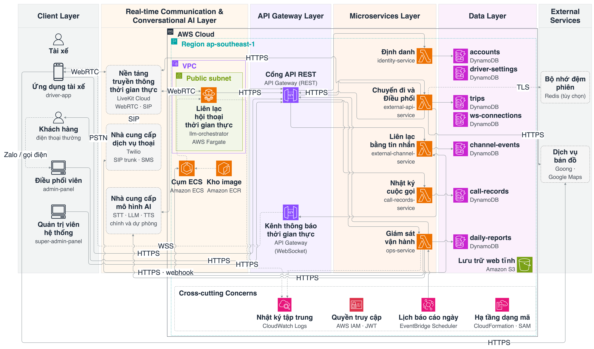

**Hình 4.1.** Kiến trúc tổng thể của hệ thống trên nền tảng AWS theo kiến trúc microservices

Mỗi lớp dưới đây nêu vai trò, thành phần và dịch vụ AWS được dùng, kèm giải thích ngắn cho dịch vụ đó.

- **Lớp máy khách (Client Layer)** — nơi người dùng thao tác. Gồm ứng dụng tài xế, trang quản trị điều hành và trang giám sát hệ thống; khách hàng không dùng ứng dụng mà liên lạc qua điện thoại thường, nên điện thoại của khách được vẽ ở lớp này như một điểm cuối bên ngoài hệ thống. Các trang web là tệp tĩnh (HTML, JavaScript) lưu trên Amazon S3, dịch vụ lưu trữ tệp của AWS, và được tải thẳng về trình duyệt.
- **Lớp truyền thông thời gian thực và hội thoại AI (Real-time Communication & Conversational AI Layer)** — nơi diễn ra cuộc nói chuyện. LiveKit Cloud truyền âm thanh giữa điện thoại người dùng và trợ lý (WebRTC), và quay số ra mạng điện thoại khi cần (SIP). Dịch vụ Liên lạc hội thoại thời gian thực nghe âm thanh, gọi các mô hình AI (STT, LLM, TTS; mỗi khâu có nhà cung cấp chính và dự phòng) và trả lời. Tác nhân chạy liên tục nên được đóng gói thành container và chạy trên Amazon ECS với AWS Fargate: ECS quản lý số bản sao đang chạy, còn Fargate cung cấp máy chủ, nhờ vậy nhóm phát triển không phải tự quản lý máy chủ.
- **Lớp cổng API (API Gateway Layer)** — cửa vào duy nhất của các dịch vụ nghiệp vụ. Amazon API Gateway nhận yêu cầu HTTPS từ ứng dụng hoặc từ tác nhân rồi chuyển tới đúng dịch vụ. Một cổng dạng WebSocket giữ kết nối mở với ứng dụng tài xế để máy chủ chủ động đẩy thông báo (ví dụ có chuyến mới).
- **Lớp microservices (Microservices Layer)** — nơi xử lý nghiệp vụ. Gồm năm dịch vụ: Định danh, Chuyến đi và Điều phối, Liên lạc bằng tin nhắn, Nhật ký cuộc gọi, Giám sát vận hành. Các dịch vụ này chạy trên AWS Lambda (Dịch vụ Chuyến đi và Điều phối có thêm hai hàm xử lý kết nối WebSocket): đoạn mã chỉ chạy khi có yêu cầu, AWS tự tăng số bản chạy song song khi tải tăng và chỉ tính phí theo thời gian chạy thực tế.
- **Lớp dữ liệu (Data Layer)** — nơi lưu dữ liệu. Mỗi dịch vụ có bảng riêng trên Amazon DynamoDB, cơ sở dữ liệu NoSQL do AWS quản lý; dịch vụ khác muốn đọc phải gọi API của dịch vụ sở hữu, không đọc thẳng bảng. Danh sách bảng của từng dịch vụ ở Bảng 4.5. Riêng bộ nhớ đệm Redis (dịch vụ bên ngoài, tùy chọn) lưu trạng thái phiên ngắn hạn của Dịch vụ Chuyến đi và Điều phối để các lần chạy Lambda dùng chung; khi không cấu hình, dịch vụ dùng bộ nhớ trong tiến trình.
- **Các mối quan tâm xuyên suốt (Cross-cutting Concerns)** — các chức năng dùng chung cho mọi lớp: ghi nhật ký tập trung (Amazon CloudWatch Logs); phân quyền truy cập tài nguyên AWS cho từng dịch vụ (AWS IAM) và xác thực người dùng bằng JWT; hẹn giờ chạy báo cáo ngày (Amazon EventBridge Scheduler); mô tả hạ tầng bằng mã để triển khai tự động (AWS CloudFormation, AWS SAM).

Các **hệ thống bên ngoài** không chạy trên AWS: LiveKit Cloud, Twilio (kết nối mạng điện thoại công cộng và gửi SMS) và các nhà cung cấp mô hình AI nằm trong cột Real-time Communication & Conversational AI; dịch vụ bản đồ và bộ nhớ đệm Redis nằm ở cột External Services bên phải, ngoài khung AWS Cloud, đặt ngang hàng với Dịch vụ Chuyến đi và Điều phối vì đây là dịch vụ backend duy nhất gọi tới chúng; ứng dụng tài xế cũng tải bản đồ nền trực tiếp từ dịch vụ bản đồ (luồng ㉕). Trong cột Real-time Communication & Conversational AI, Amazon ECS chạy tác vụ Fargate của tác nhân, còn Amazon ECR lưu image container mà ECS kéo về khi khởi chạy tác vụ. Amazon S3 lưu các trang web tĩnh (trang quản trị, trang giám sát) nên được đặt ở cột Data Layer.

**Giao thức kết nối.** Giao thức và mục đích của từng luồng giữa người dùng và hệ thống (HTTPS kèm JWT, WebRTC, WSS, SIP/PSTN) có ở Bảng 4.4. **Bên trong hệ thống**, các dịch vụ không gọi trực tiếp hàm Lambda của nhau. Mỗi dịch vụ có một API Gateway riêng; khi cần dữ liệu hoặc thao tác của dịch vụ khác, dịch vụ gọi bằng HTTPS tới địa chỉ API Gateway của dịch vụ đích (kịch bản `infra/deploy-all.sh` ghi địa chỉ này vào cấu hình của dịch vụ gọi) và gửi kèm JWT dịch vụ, tức token xác thực do chính dịch vụ gọi tạo ra và chỉ có hiệu lực trong thời gian ngắn (`services/serviceToken.ts`). Vì vậy lời gọi giữa các dịch vụ đi qua cùng cửa vào và cùng bước xác thực như lời gọi từ người dùng (luồng ⑫, ⑮, ⑳). Tác nhân hội thoại cũng gọi dịch vụ nghiệp vụ theo cách này (luồng ⑧, ⑭); các lời gọi khác giữa dịch vụ gồm đọc tài khoản và cài đặt từ Dịch vụ Định danh (㉖) và thăm dò tình trạng các dịch vụ (㉗). Mỗi dịch vụ đọc, ghi bảng DynamoDB của chính mình qua AWS SDK (HTTPS); Dịch vụ Chuyến đi và Điều phối gọi dịch vụ bản đồ qua HTTPS và Redis qua kết nối TLS.

Toàn bộ tài nguyên AWS nằm trong vùng ap-southeast-1 (Singapore). Lambda, API Gateway và DynamoDB là dịch vụ cấp vùng, không bắt buộc đặt trong mạng riêng ảo (VPC); các template không đặt hàm Lambda nào vào VPC. Dịch vụ Liên lạc hội thoại thời gian thực chạy trong subnet công khai của một VPC; nhóm bảo mật (security group) chỉ cho phép kết nối chiều ra, vì tác nhân chủ động kết nối tới LiveKit Cloud, các API nghiệp vụ và nhà cung cấp AI, không nhận kết nối từ ngoài vào. API Gateway không tự kiểm tra đăng nhập (không dùng tính năng authorizer của API Gateway); JWT được xác minh trong mã của từng dịch vụ bằng khóa bí mật dùng chung với Dịch vụ Định danh.

Bảng `ws-connections` cần thiết vì API Gateway WebSocket cấp cho mỗi ứng dụng đang kết nối một mã kết nối (connectionId), trong khi hàm Lambda không nhớ gì giữa các lần gọi. Khi ứng dụng kết nối, hàm Lambda lưu cặp mã kết nối và định danh người dùng (ví dụ `driver#<số điện thoại>`); khi cần đẩy thông báo, Dịch vụ Chuyến đi và Điều phối tra bảng này để biết gửi tới kết nối nào; khi ứng dụng ngắt kết nối, bản ghi bị xóa. Bảng này không chứa nội dung hội thoại; lời thoại giữa người dùng và trợ lý được lưu ở bảng `call-records` của Dịch vụ Nhật ký cuộc gọi.

### 4.3.2. Mô hình luồng hành vi theo nhóm người sử dụng

Các luồng được đánh số ① đến ㉙ (Bảng 4.4) và được tách thành bốn hình theo nhóm chức năng của từng chân dung người sử dụng: tài xế (Hình 4.2), khách hàng (Hình 4.3), điều phối viên (Hình 4.4) và quản trị viên hệ thống (Hình 4.5). Mỗi hình chỉ vẽ các luồng mà người dùng đó kích hoạt; các thành phần không nằm trên luồng của người dùng đó được làm mờ để người đọc tập trung vào đường đi của một yêu cầu. Một luồng dùng chung (ví dụ ⑥ giữa nền tảng truyền thông và tác nhân) xuất hiện ở nhiều hình. Số luồng khớp với số ghi ở các bước của sequence diagram (mục 4.5); mũi tên nét đứt là luồng phụ trợ.

**Bảng 4.4.** Các luồng hành vi trên Hình 4.2 đến Hình 4.5

| Số | Từ → Đến | Giao thức | Mục đích | Hình | Sequence |
|---|---|---|---|---|---|
| ① | Ứng dụng tài xế → API Gateway → Dịch vụ Định danh | HTTPS | Đăng nhập, làm mới token | 4.2 | S1 |
| ② | Dịch vụ Định danh → DynamoDB (accounts, driver-settings) | AWS SDK | Đọc tài khoản, lưu băm refresh token | 4.2, 4.4, 4.5 | S1 |
| ③ | Ứng dụng tài xế → API Gateway → Dịch vụ Chuyến đi và Điều phối | HTTPS | Xin token thoại, tra cứu chuyến | 4.2 | S2 |
| ④ | Dịch vụ Chuyến đi và Điều phối → LiveKit Cloud | HTTPS | Tạo phòng hội thoại, phân công tác nhân, quay số SIP | 4.2, 4.3, 4.4 | S2, S4, S5 |
| ⑤ | Ứng dụng tài xế ↔ LiveKit Cloud | WebRTC | Truyền âm thanh hai chiều | 4.2 | S2, S3 |
| ⑥ | LiveKit Cloud ↔ Dịch vụ Liên lạc hội thoại thời gian thực | WebRTC / WebSocket | Giao việc cho tác nhân; truyền âm thanh | 4.2, 4.3 | S2, S3 |
| ⑦ | Dịch vụ Liên lạc hội thoại thời gian thực → Nhà cung cấp AI (chính, dự phòng) | HTTPS / gRPC | Nhận dạng giọng nói, sinh phản hồi, tổng hợp giọng nói | 4.2, 4.3 | S3 |
| ⑧ | Dịch vụ Liên lạc hội thoại thời gian thực → API Gateway → Dịch vụ Chuyến đi và Điều phối | HTTPS | Đăng ký phiên, tải ngữ cảnh, gọi công cụ nghiệp vụ | 4.2, 4.3 | S2, S3, S4, S5 |
| ⑨ | Dịch vụ Chuyến đi và Điều phối → DynamoDB (trips, ws-connections) | AWS SDK | Đọc, ghi chuyến và kết nối WebSocket | 4.2, 4.3, 4.4 | S3, S4 |
| ⑩ | Dịch vụ Chuyến đi và Điều phối → API Gateway WebSocket → ứng dụng tài xế | WSS | Thông báo đẩy khi chuyến thay đổi | 4.2 | S4 |
| ⑪ | LiveKit Cloud → Twilio (SIP trunk) → điện thoại | SIP / PSTN | Gọi điện mời tài xế nhận chuyến; gọi khách hàng trên điện thoại thường | 4.2, 4.3, 4.4 | S4, S5 |
| ⑫ | Dịch vụ Chuyến đi và Điều phối → API Gateway → Dịch vụ Liên lạc bằng tin nhắn → Twilio → điện thoại khách | HTTPS / SMS | Gửi SMS cho khách | 4.2, 4.3 | S5 |
| ⑬ | Twilio → API Gateway → Dịch vụ Liên lạc bằng tin nhắn | HTTPS (webhook) | Trạng thái cuộc gọi; báo cáo giao tin SMS (queued, sent, delivered, failed) | 4.2, 4.3 | S5 |
| ⑭ | Dịch vụ Liên lạc hội thoại thời gian thực → API Gateway → Dịch vụ Nhật ký cuộc gọi | HTTPS | Ghi bản ghi và tóm tắt hội thoại khi kết thúc phiên | 4.2, 4.3 | S6 |
| ⑮ | Dịch vụ Chuyến đi và Điều phối → API Gateway → Dịch vụ Nhật ký cuộc gọi | HTTPS | Đọc tóm tắt cuộc gọi gần nhất | 4.2 | S6 |
| ⑯ | Dịch vụ Nhật ký cuộc gọi → DynamoDB (call-records) | AWS SDK | Lưu và đọc bản ghi cuộc gọi | 4.2, 4.3, 4.4, 4.5 | S6 |
| ⑰ | Trang quản trị, trang giám sát → API Gateway → các dịch vụ | HTTPS | Đăng nhập; điều phối chuyến, quản lý tài xế, khách hàng, xem nhật ký cuộc gọi (Hình 4.4); xem tình trạng dịch vụ, cấu hình tác nhân, nhật ký và báo cáo (Hình 4.5) | 4.4, 4.5 | S7 |
| ⑱ | Mọi dịch vụ và tác nhân → CloudWatch Logs | AWS SDK | Ghi nhật ký gắn mã phòng | 4.2, 4.3, 4.5 | Mọi sequence (CON-04) |
| ⑲ | EventBridge Scheduler → Dịch vụ Giám sát vận hành | AWS (Lambda invoke) | Kích hoạt lập báo cáo ngày lúc 00:15 giờ Việt Nam | 4.5 | S7 |
| ⑳ | Dịch vụ Giám sát vận hành → API Gateway → Dịch vụ Nhật ký cuộc gọi | HTTPS | Đọc bản ghi hội thoại của một ngày | 4.5 | S7 |
| ㉑ | Dịch vụ Giám sát vận hành → DynamoDB (daily-reports) | AWS SDK | Lưu báo cáo ngày | 4.5 | S7 |
| ㉒ | Dịch vụ Liên lạc bằng tin nhắn → DynamoDB (channel-events) | AWS SDK | Lưu sự kiện Twilio và kết quả gửi SMS | 4.2, 4.3 | S5 |
| ㉓ | Dịch vụ Chuyến đi và Điều phối → Dịch vụ bản đồ (Goong hoặc Google Maps) | HTTPS | Tìm địa chỉ, chỉ đường, thời gian đến có xét giao thông, ma trận khoảng cách để sắp xếp thứ tự ghé (mục 5.4.4) | 4.2, 4.4 | Không có sequence riêng; kết quả nằm trong ngữ cảnh tải ở S2 |
| ㉔ | Dịch vụ Chuyến đi và Điều phối → Redis (nét đứt: tùy chọn) | TLS (giao thức Redis) | Bộ nhớ đệm dùng chung giữa các lần chạy Lambda: phiên đang mở của tài xế, thông báo chờ phát, ngữ cảnh và thứ tự ghé đã tính. Chỉ dùng khi cấu hình `REDIS_URL`; nếu không, dịch vụ dùng bộ nhớ trong tiến trình (cách chạy trong thực nghiệm) | 4.2, 4.4 | S2 |
| ㉕ | Ứng dụng tài xế → Dịch vụ bản đồ | HTTPS | Tải lớp bản đồ nền để hiển thị bản đồ, vị trí xe và đường đi; dùng khóa riêng chỉ cho hiển thị | 4.2 | Không có sequence riêng (thao tác hiển thị) |
| ㉖ | Dịch vụ Chuyến đi và Điều phối → API Gateway → Dịch vụ Định danh | HTTPS, JWT dịch vụ | Đọc tài khoản tài xế, khách hàng và cài đặt tài xế (`authServiceClient.ts`) khi tải ngữ cảnh và khi điều phối viên quản lý tài xế, khách hàng | 4.2, 4.4 | S2 (tải ngữ cảnh) |
| ㉗ | Dịch vụ Giám sát vận hành → API Gateway → các dịch vụ | HTTPS | Thăm dò `/health` của từng dịch vụ khi trang giám sát mở trang tổng quan (`GET /api/v1/status`) | 4.5 | Không có sequence riêng |
| ㉘ | Dịch vụ Giám sát vận hành → Nhà cung cấp AI (OpenAI) | HTTPS | Mô hình chấm một mẫu câu trả lời của trợ lý khi lập báo cáo ngày (`reports/judge.ts`) | 4.5 | S7 bước 5–6 |
| ㉙ | Dịch vụ Giám sát vận hành → CloudWatch Logs, Amazon ECS | AWS SDK | Đọc nhật ký của các dịch vụ (`logs:FilterLogEvents`) và số tác vụ tác nhân đang chạy (`ecs:DescribeServices`) cho trang nhật ký và trang tổng quan | 4.5 | Không có sequence riêng |

**Luồng của tài xế.** Hình 4.2 gồm các luồng phục vụ yêu cầu chức năng của tài xế (mục 3.3.1): đăng nhập (①②), mở phiên trợ lý (③④⑤⑥), xử lý lượt hội thoại và gọi công cụ (⑦⑧⑨), thông báo đẩy (⑩), cuộc gọi mời nhận chuyến và gọi khách (⑪), gửi tin nhắn (⑫⑬㉒) và lưu, đọc nhật ký cuộc gọi (⑭⑮⑯). Ví dụ, khi tài xế đang có một chuyến chờ xác nhận và nói "nhận chuyến này":

1. Âm thanh đi từ ứng dụng tài xế qua LiveKit Cloud tới tác nhân (luồng ⑤, ⑥).
2. Tác nhân chuyển âm thanh thành chữ; mô hình ngôn ngữ chọn công cụ nhận chuyến (⑦).
3. Tác nhân gọi API qua API Gateway tới Dịch vụ Chuyến đi và Điều phối (⑧); hàm Lambda của dịch vụ ghi trạng thái `confirmed` vào bảng `trips` trên DynamoDB (⑨).
4. Dịch vụ tra bảng `ws-connections` rồi đẩy thông báo `trip_confirmed` qua API Gateway WebSocket tới ứng dụng tài xế (⑩) để màn hình cập nhật ngay.
5. Sau khi API trả về thành công, tác nhân mới đọc câu xác nhận cho tài xế. Mỗi bước đều ghi nhật ký lên CloudWatch Logs (⑱).

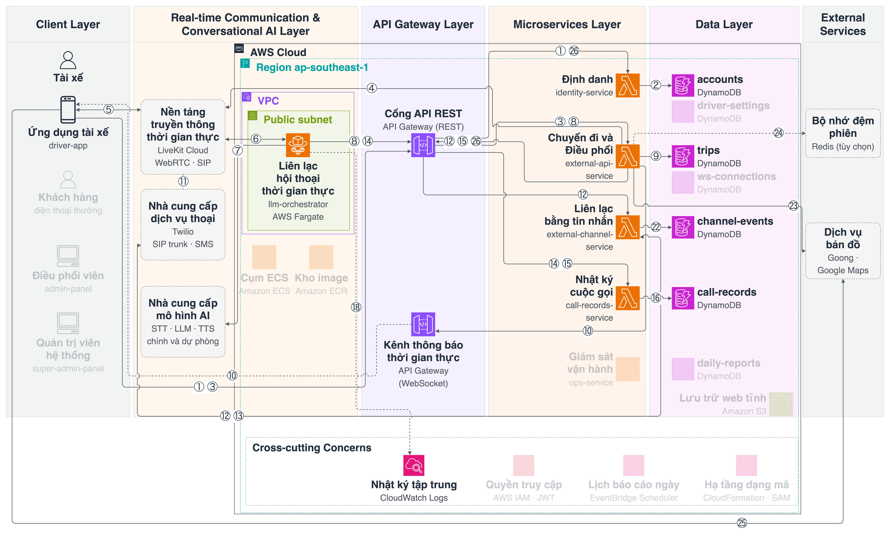

**Hình 4.2.** Mô hình luồng hành vi: nhóm chức năng của tài xế

**Luồng của khách hàng.** Hình 4.3 gồm các luồng phục vụ yêu cầu chức năng của khách hàng (mục 3.3.2). Khách đặt xe qua điện thoại hoặc nhóm Zalo của hãng; yêu cầu này đi tới điều phối viên ngoài hệ thống (mũi tên nét đứt không đánh số). Sau khi chuyến được tạo, khách chỉ dùng điện thoại thường. Khi tài xế nhờ trợ lý gọi khách, Dịch vụ Chuyến đi và Điều phối yêu cầu nền tảng truyền thông quay số (④), cuộc gọi đi qua Twilio tới điện thoại của khách (⑪); trong chế độ tác nhân gọi thay hoặc gọi nền, tác nhân tham gia cuộc gọi (⑥, ⑦), ghi nhận yêu cầu của khách qua API (⑧, ⑨) và lưu bản ghi cuộc gọi (⑭, ⑯). Tin nhắn xác nhận chuyến đi qua Dịch vụ Liên lạc bằng tin nhắn và Twilio (⑫, ⑬, ㉒).

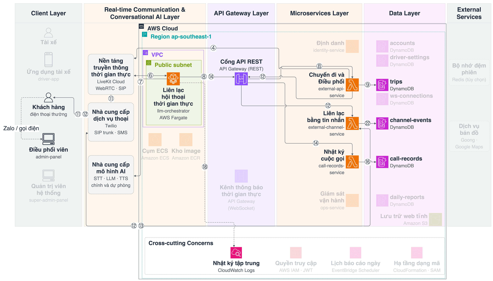

**Hình 4.3.** Mô hình luồng hành vi: nhóm chức năng của khách hàng

**Luồng của điều phối viên.** Hình 4.4 gồm các luồng phục vụ yêu cầu chức năng của điều phối viên (mục 3.3.3). Mọi thao tác trên trang quản trị điều hành đi qua ⑰ tới dịch vụ tương ứng: Dịch vụ Định danh (đăng nhập, khóa tài khoản tài xế, ② ghi vào bảng accounts), Dịch vụ Chuyến đi và Điều phối (bảng điều phối, tạo chuyến từ yêu cầu của khách, ⑨ ghi vào bảng trips) và Dịch vụ Nhật ký cuộc gọi (nhật ký và tóm tắt cuộc gọi, ⑯). Khi điều phối viên mời tài xế nhận chuyến, Dịch vụ Chuyến đi và Điều phối khởi tạo cuộc gọi qua ④ và ⑪; từ đó luồng tiếp tục ở phía tài xế (Hình 4.2, sequence S4).

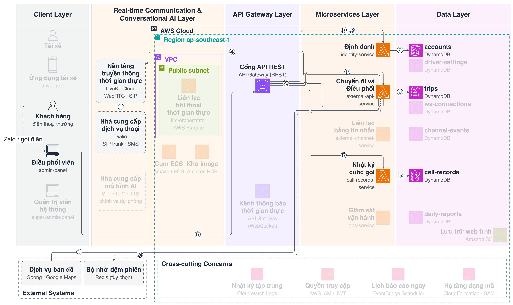

**Hình 4.4.** Mô hình luồng hành vi: nhóm chức năng của điều phối viên

**Luồng của quản trị viên hệ thống.** Hình 4.5 gồm các luồng phục vụ yêu cầu chức năng của quản trị viên hệ thống (mục 3.3.4). Trang giám sát hệ thống gọi qua ⑰ tới Dịch vụ Định danh để đăng nhập và tới Dịch vụ Giám sát vận hành để xem tình trạng dịch vụ, cấu hình tác nhân, nhật ký và báo cáo ngày. Báo cáo ngày được lập tự động: EventBridge Scheduler kích hoạt Dịch vụ Giám sát vận hành lúc 00:15 (⑲), dịch vụ này đọc bản ghi hội thoại của ngày trước (⑳, ⑯) và lưu báo cáo đã tổng hợp (㉑). Quản trị viên hệ thống không đi qua luồng hội thoại và không đọc trực tiếp dữ liệu chuyến.

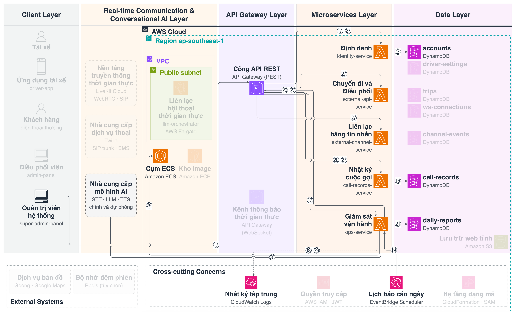

**Hình 4.5.** Mô hình luồng hành vi: nhóm chức năng của quản trị viên hệ thống

## 4.4. Phân chia hệ thống thành các dịch vụ

Bảng 4.5 mô tả năng lực nghiệp vụ, nhóm API, bảng dữ liệu sở hữu, nền tảng chạy và yêu cầu được đáp ứng của từng dịch vụ (cột Dịch vụ ghi tên rút gọn, bỏ chữ "Dịch vụ"). Dữ liệu nguồn của báo cáo ngày vẫn thuộc Dịch vụ Nhật ký cuộc gọi; Dịch vụ Giám sát vận hành chỉ lưu báo cáo đã tổng hợp. Ranh giới dịch vụ được xác định theo năng lực nghiệp vụ (Newman, 2021): mỗi dịch vụ sở hữu một năng lực và dữ liệu tương ứng, dịch vụ khác chỉ truy cập qua API.

**Bảng 4.5.** Phân chia dịch vụ

| Dịch vụ | Năng lực nghiệp vụ | Nhóm API | Dữ liệu sở hữu | Nền tảng | Yêu cầu |
|---|---|---|---|---|---|
| Định danh | Tài khoản, đăng nhập, cài đặt tài xế, khóa tài khoản | auth, accounts, settings | accounts, driver-settings | Lambda | FR-Q03; NFR-05; CON-03 |
| Chuyến đi và Điều phối | Chuyến đi, ngữ cảnh tài xế, phiên thoại, mời nhận chuyến, khởi tạo cuộc gọi, nhắc việc, thông báo đẩy | trips, drivers, voice, calls, sms, reminders, customers, places | trips, ws-connections; bộ nhớ đệm Redis | Lambda; API Gateway WebSocket | FR-T, FR-C, FR-W, FR-I, FR-E, FR-K, FR-Q01, FR-Q02, FR-Q04; NFR-02, NFR-03 |
| Liên lạc bằng tin nhắn | Liên lạc bằng tin nhắn (SMS); nhận sự kiện của nhà cung cấp thoại | sms, calls (webhook) | channel-events | Lambda | FR-C03; NFR-04 |
| Nhật ký cuộc gọi | Bản ghi hội thoại, tóm tắt, chỉ số phiên | records | call-records | Lambda | FR-C05, FR-Q05, FR-O01; NFR-04 |
| Giám sát vận hành | Tình trạng dịch vụ; cấu hình tác nhân; nhật ký thời gian thực; báo cáo vận hành ngày | status, logs, records, agent, reports | daily-reports (chỉ báo cáo đã tổng hợp) | Lambda; EventBridge Scheduler | FR-S01 đến FR-S03, FR-O01, FR-O02; CON-04 |
| Dịch vụ Liên lạc hội thoại thời gian thực | Liên lạc hội thoại thời gian thực: STT – LLM kèm gọi công cụ – TTS | Không có; nhận việc từ LiveKit | Không lưu bền vững (chỉ trạng thái phiên) | ECS Fargate | FR-T, FR-C, FR-F, FR-L, FR-K; NFR-01 đến NFR-04; CON-01 |

## 4.5. Sequence diagram cho các luồng chính

Mục này mô tả luồng hoạt động chính của từng dịch vụ bằng sequence diagram. Mỗi bước ghi thành phần tham gia, thông điệp (phương thức và đường dẫn API) và tham số chính; vị trí hiện thực trong mã nguồn của từng sequence ở Bảng 5.8. Số trong ngoặc tròn tương ứng với luồng trên Hình 4.2 đến Hình 4.5 (Bảng 4.4).

### 4.5.1. S1 — Đăng nhập (Dịch vụ Định danh)

**Hình 4.6.** Sequence S1: đăng nhập tài xế và phát hành JWT

**Bảng 4.6.** Các bước của sequence S1

| Bước | Từ → Đến | Thông điệp | Ghi chú |
|---|---|---|---|
| 1 ① | Ứng dụng tài xế → Cổng API REST | POST /api/v1/auth/login, thân gồm role = driver, phone, password | Thiếu trường bắt buộc: 400 |
| 2 ① | Cổng API REST → Dịch vụ Định danh | Chuyển tiếp yêu cầu | Mọi đường dẫn được chuyển nguyên cho dịch vụ (cấu hình ANY /{proxy+}); cổng không kiểm tra đăng nhập |
| 3 ② | Dịch vụ Định danh → DynamoDB accounts | Tìm tài khoản theo số điện thoại và vai trò | Cùng số điện thoại có thể có tài khoản tài xế và khách riêng |
| 4 | DynamoDB accounts → Dịch vụ Định danh | Bản ghi tài khoản | Không tìm thấy: trả 401 như sai mật khẩu, không tiết lộ tài khoản có tồn tại |
| 5 | Dịch vụ Định danh | So khớp mật khẩu với giá trị băm bcrypt | Sai thông tin: 401; tài khoản bị khóa: 403 |
| 6 | Dịch vụ Định danh | Ký access token và refresh token | Access token 15 phút, refresh token 30 ngày (mặc định) |
| 7 ② | Dịch vụ Định danh → DynamoDB accounts | Lưu giá trị băm và hạn của refresh token | Cho phép thu hồi token |
| 8 | Dịch vụ Định danh → Ứng dụng tài xế | 200: access_token, refresh_token | Ứng dụng lưu token cho các lời gọi sau |
| 9 ① | Ứng dụng tài xế → Cổng API REST | POST /api/v1/auth/refresh, thân gồm refresh_token | Ứng dụng tự gọi khi một API trả 401, rồi gửi lại yêu cầu ban đầu |
| 10 | Cổng API REST → Ứng dụng tài xế | 200: cặp token mới | Token bị thu hồi hoặc hết hạn: 401 |

Các dịch vụ khác xác minh access token bằng khóa bí mật dùng chung, không gọi lại Dịch vụ Định danh cho mỗi yêu cầu.

### 4.5.2. S2 — Khởi tạo phiên trợ lý trong ứng dụng (Dịch vụ Chuyến đi và Điều phối)

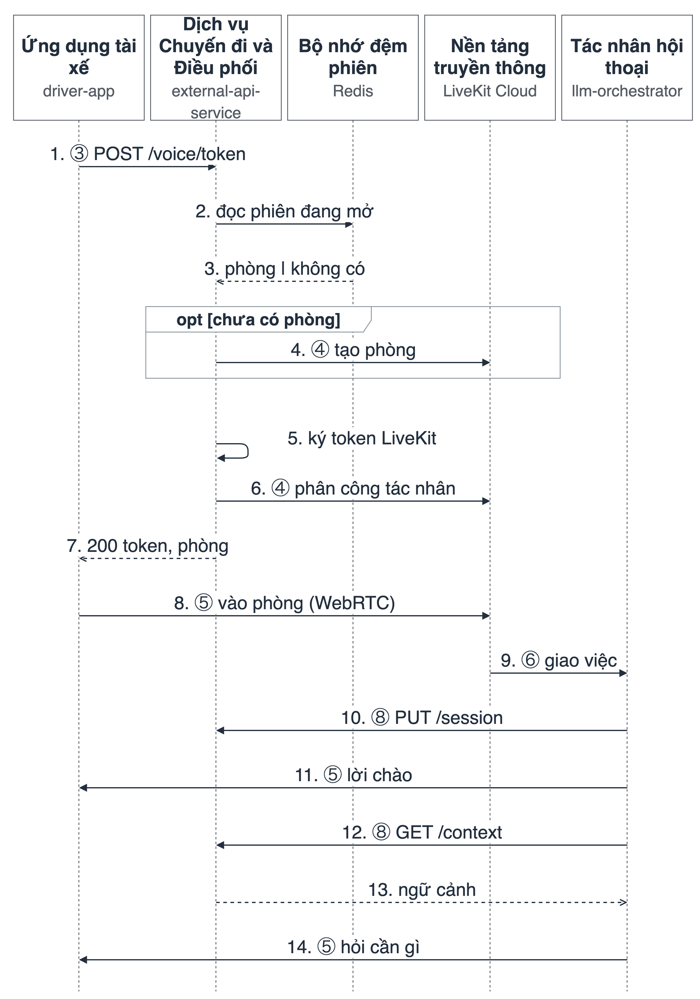

**Hình 4.7.** Sequence S2: khởi tạo phiên trợ lý trong ứng dụng

**Bảng 4.7.** Các bước của sequence S2

| Bước | Từ → Đến | Thông điệp | Ghi chú |
|---|---|---|---|
| 1 ③ | Ứng dụng tài xế → Dịch vụ Chuyến đi và Điều phối | POST /api/v1/voice/token với tham số driver_phone, lang; tiêu đề Authorization mang JWT | JWT không hợp lệ: 401 |
| 2 | Dịch vụ Chuyến đi và Điều phối → Redis | Đọc phiên đang mở của tài xế | Không cấu hình Redis: dùng bộ nhớ đệm trong tiến trình |
| 3 | Redis → Dịch vụ Chuyến đi và Điều phối | Tên phòng đang mở, hoặc không có | Có phòng: kiểm tra tác nhân còn trong phòng |
| 4 ④ | Dịch vụ Chuyến đi và Điều phối → LiveKit Cloud | Chỉ khi chưa có phòng: tạo phòng driver-{số điện thoại}-{UUID} với metadata ngôn ngữ | Phòng còn nhưng mất tác nhân: phân công lại |
| 5 | Dịch vụ Chuyến đi và Điều phối | Ký token LiveKit (thời hạn 3600 giây) | Quyền: vào phòng, phát và nhận âm thanh |
| 6 ④ | Dịch vụ Chuyến đi và Điều phối → LiveKit Cloud | Yêu cầu phân công tác nhân (agent dispatch) cho phòng | Lỗi phân công chỉ ghi nhật ký |
| 7 | Dịch vụ Chuyến đi và Điều phối → Ứng dụng tài xế | 200: token, room_name, livekit_url | Ứng dụng dùng token để vào đúng phòng vừa cấp |
| 8 ⑤ | Ứng dụng tài xế → LiveKit Cloud | Tham gia phòng qua WebRTC | Ứng dụng phát âm thanh micro và nhận âm thanh của tác nhân |
| 9 ⑥ | LiveKit Cloud → Dịch vụ Liên lạc hội thoại thời gian thực | Giao việc cho một bản sao tác nhân đang rảnh | Tác nhân phân loại phiên theo tên phòng và metadata |
| 10 ⑧ | Dịch vụ Liên lạc hội thoại thời gian thực → Dịch vụ Chuyến đi và Điều phối | PUT /api/v1/drivers/me/session, thân room_name | Chạy song song; lỗi chỉ ghi nhật ký |
| 11 ⑤ | Dịch vụ Liên lạc hội thoại thời gian thực → Ứng dụng tài xế | Phát lời chào ngắn cố định | Không chờ tải xong ngữ cảnh |
| 12 ⑧ | Dịch vụ Liên lạc hội thoại thời gian thực → Dịch vụ Chuyến đi và Điều phối | GET /api/v1/drivers/me/context | Thời gian chờ 10 giây; lỗi: tác nhân vẫn trả lời, tải lại khi cần |
| 13 | Dịch vụ Chuyến đi và Điều phối → Dịch vụ Liên lạc hội thoại thời gian thực | Ngữ cảnh: chuyến, thu nhập, cài đặt | Lưu vào trạng thái phiên |
| 14 ⑤ | Dịch vụ Liên lạc hội thoại thời gian thực → Ứng dụng tài xế | Hỏi tài xế cần hỗ trợ gì | Sẵn sàng nhận phát ngôn |

### 4.5.3. S3 — Xử lý một lượt hội thoại (Dịch vụ Liên lạc hội thoại thời gian thực)

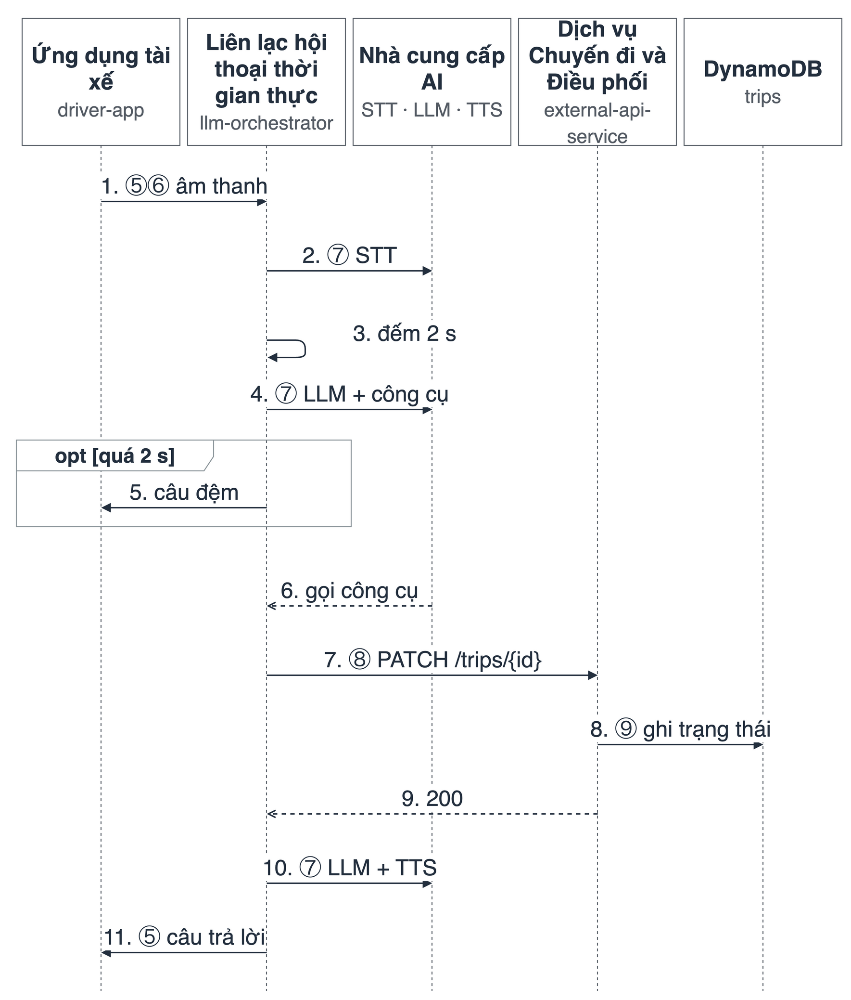

**Hình 4.8.** Sequence S3: xử lý một lượt hội thoại có gọi công cụ, câu đệm và dự phòng nhà cung cấp

**Bảng 4.8.** Các bước của sequence S3 (ví dụ tài xế yêu cầu cập nhật trạng thái đã đón khách)

| Bước | Từ → Đến | Thông điệp | Ghi chú |
|---|---|---|---|
| 1 ⑤⑥ | Ứng dụng tài xế → Dịch vụ Liên lạc hội thoại thời gian thực | Luồng âm thanh phát ngôn của tài xế | Truyền liên tục; tác nhân phát hiện tiếng nói và cho phép ngắt lời |
| 2 ⑦ | Dịch vụ Liên lạc hội thoại thời gian thực → Nhà cung cấp STT | Nhận dạng giọng nói; phát hiện kết thúc phát ngôn | Nhà cung cấp chính lỗi hoặc quá 5 giây: chuyển sang nhà cung cấp dự phòng |
| 3 | Dịch vụ Liên lạc hội thoại thời gian thực | Bắt đầu đếm thời gian cho câu đệm | Mốc 2 giây (bước 5) |
| 4 ⑦ | Dịch vụ Liên lạc hội thoại thời gian thực → Nhà cung cấp LLM | Gửi lịch sử hội thoại, lời nhắc hệ thống (system prompt: đoạn chỉ dẫn cố định về vai trò và quy tắc của trợ lý) và danh sách công cụ được phép trong loại phiên này | Cơ chế dự phòng như bước 2 |
| 5 | Dịch vụ Liên lạc hội thoại thời gian thực → Ứng dụng tài xế | Tùy chọn: sau 2 giây chưa có âm thanh trả lời thì phát câu đệm một lần | Hủy nếu câu trả lời thật đã bắt đầu |
| 6 | Nhà cung cấp LLM → Dịch vụ Liên lạc hội thoại thời gian thực | Yêu cầu gọi công cụ update_trip_status với tham số trạng thái | Câu hỏi không cần dữ liệu: mô hình trả lời thẳng, bỏ qua bước 7–9 |
| 7 ⑧ | Dịch vụ Liên lạc hội thoại thời gian thực → Dịch vụ Chuyến đi và Điều phối | PATCH /api/v1/trips/{tripId}, thân status (kèm enforce_arrival với các trạng thái cần có mặt tại chỗ); thời gian chờ 8 giây | API lỗi: tác nhân thông báo không cập nhật được, phiên tiếp tục |
| 8 ⑨ | Dịch vụ Chuyến đi và Điều phối → DynamoDB trips | Ghi trạng thái mới | Trước khi ghi: kiểm tra trạng thái hợp lệ và tài xế cách điểm cần đến (điểm đón cho đã đến, đã đón; điểm trả cho hoàn thành) không quá 200 m theo vị trí GPS mới nhất (mặc định); sai: 409 kèm khoảng cách còn lại |
| 9 | Dịch vụ Chuyến đi và Điều phối → Dịch vụ Liên lạc hội thoại thời gian thực | 200: chuyến sau cập nhật | Tác nhân cập nhật ngữ cảnh phiên bằng dữ liệu mới |
| 10 ⑦ | Dịch vụ Liên lạc hội thoại thời gian thực → Nhà cung cấp LLM, TTS | Sinh câu xác nhận ngắn và tổng hợp giọng nói | Chỉ xác nhận sau khi API thành công |
| 11 ⑤ | Dịch vụ Liên lạc hội thoại thời gian thực → Ứng dụng tài xế | Phát âm thanh trả lời | Độ trễ phản hồi đo từ bước 2 đến bước này |

### 4.5.4. S4 — Mời nhận chuyến qua cuộc gọi điện thoại (Dịch vụ Chuyến đi và Điều phối)

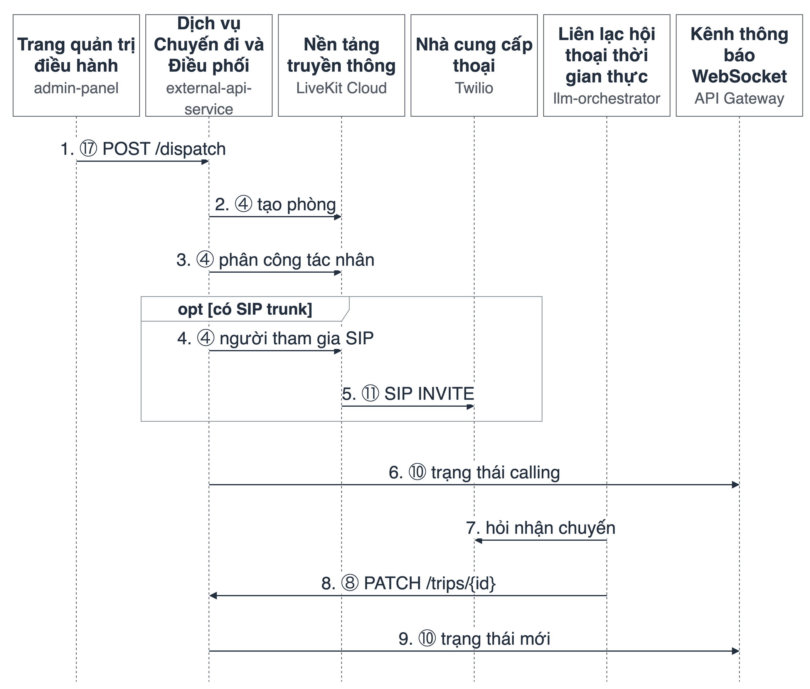

**Hình 4.9.** Sequence S4: mời tài xế nhận chuyến qua cuộc gọi điện thoại

**Bảng 4.9.** Các bước của sequence S4

| Bước | Từ → Đến | Thông điệp | Ghi chú |
|---|---|---|---|
| 1 ⑰ | Trang quản trị điều hành → Dịch vụ Chuyến đi và Điều phối | POST /api/v1/trips/{tripId}/dispatch | Trạng thái chuyến không hợp lệ: 409; thiếu số tài xế: 400 |
| 2 ④ | Dịch vụ Chuyến đi và Điều phối → LiveKit Cloud | Tạo phòng driver-{số}-{thời điểm} với metadata chuyến và sip_identity | Mốc thời điểm tránh trùng với phòng đang mở trong ứng dụng |
| 3 ④ | Dịch vụ Chuyến đi và Điều phối → LiveKit Cloud | Phân công tác nhân cho phòng | Lỗi phân công không làm dừng luồng |
| 4 ④ | Dịch vụ Chuyến đi và Điều phối → LiveKit Cloud | Tạo người tham gia SIP (đại diện cho cuộc gọi điện thoại bên trong phòng) | Chỉ khi đã cấu hình SIP trunk |
| 5 ⑪ | LiveKit Cloud → Twilio | SIP INVITE tới điện thoại tài xế | Chỉ khi đã cấu hình SIP trunk |
| 6 ⑩ | Dịch vụ Chuyến đi và Điều phối → Ứng dụng tài xế (WebSocket) | Trạng thái calling, thông báo đẩy | Ứng dụng hiển thị chuyến đang chờ tài xế trả lời |
| 7 | Dịch vụ Liên lạc hội thoại thời gian thực → điện thoại tài xế (qua Twilio) | Sau khi tài xế nhấc máy: đọc điểm đón, hỏi có nhận chuyến không | Phiên chỉ có confirm_trip, reject_trip |
| 8 ⑧ | Dịch vụ Liên lạc hội thoại thời gian thực → Dịch vụ Chuyến đi và Điều phối | PATCH /api/v1/trips/{tripId}, status = confirmed hoặc rejected | Không nghe rõ: hỏi lại |
| 9 ⑩ | Dịch vụ Chuyến đi và Điều phối → Ứng dụng tài xế (WebSocket) | Thông báo trạng thái mới | Ứng dụng cập nhật trạng thái chuyến trên màn hình |

Khi tài xế đang có phiên trợ lý mở trong ứng dụng, chuyến mới được thông báo vào phòng hiện có thay vì tạo cuộc gọi điện thoại; nếu không có phiên, thông báo được lưu tạm và phát khi tài xế mở trợ lý lần sau.

### 4.5.5. S5 — Gọi khách hàng và gửi tin nhắn (Dịch vụ Chuyến đi và Điều phối, Dịch vụ Liên lạc bằng tin nhắn)

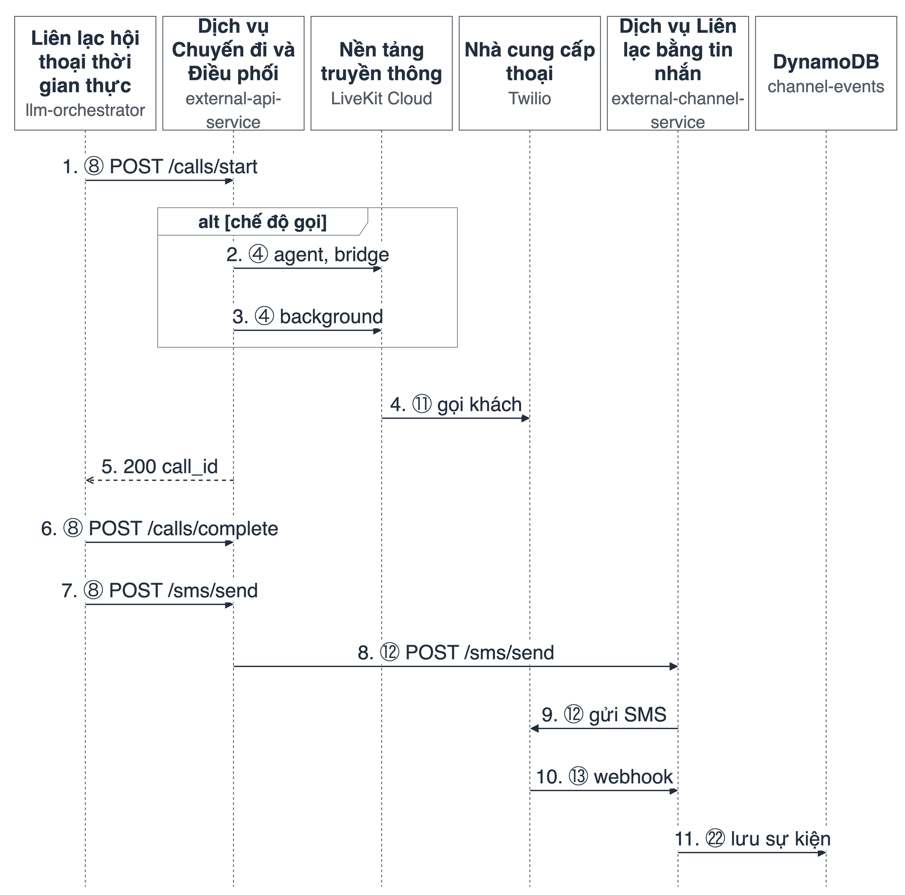

**Hình 4.10.** Sequence S5: gọi khách hàng theo ba chế độ và gửi tin nhắn SMS

**Bảng 4.10.** Các bước của sequence S5

| Bước | Từ → Đến | Thông điệp | Ghi chú |
|---|---|---|---|
| 1 ⑧ | Dịch vụ Liên lạc hội thoại thời gian thực → Dịch vụ Chuyến đi và Điều phối | POST /api/v1/calls/start, thân gồm driverId, tripId, mode, roomName, lang; thời gian chờ 25 giây | Số ngoài chuyến: xác nhận trước; chuyến không có số khách: 400 |
| 2 ④ | Dịch vụ Chuyến đi và Điều phối → LiveKit Cloud | Chế độ agent, bridge: tạo người tham gia SIP trong chính phòng của tài xế | Tài xế nghe được cuộc gọi |
| 3 ④ | Dịch vụ Chuyến đi và Điều phối → LiveKit Cloud | Chế độ background: tạo phòng riêng custcall-…, quay số SIP, phân công tác nhân riêng | Không chiếm kênh âm thanh của tài xế |
| 4 ⑪ | LiveKit Cloud → Twilio | Quay số SIP tới điện thoại khách | Số khách được chuẩn hóa sang dạng quốc tế (+84…) |
| 5 | Dịch vụ Chuyến đi và Điều phối → Dịch vụ Liên lạc hội thoại thời gian thực | 200: call_id, trạng thái, chế độ | Tác nhân báo tài xế là đang gọi khách |
| 6 ⑧ | Dịch vụ Liên lạc hội thoại thời gian thực → Dịch vụ Chuyến đi và Điều phối | POST /api/v1/calls/complete (kết thúc cuộc gọi nền) | Tóm tắt gửi về phòng của tài xế |
| 7 ⑧ | Dịch vụ Liên lạc hội thoại thời gian thực → Dịch vụ Chuyến đi và Điều phối | POST /api/v1/sms/send | Lỗi gửi: tác nhân thông báo thất bại (Bảng 5.3) |
| 8 ⑫ | Dịch vụ Chuyến đi và Điều phối → Dịch vụ Liên lạc bằng tin nhắn | POST /api/v1/sms/send | Số khách lấy từ chuyến theo trip_id; thêm nhãn người gửi vào nội dung |
| 9 ⑫ | Dịch vụ Liên lạc bằng tin nhắn → Twilio | Gửi SMS | Dùng tên người gửi TWILIO_SMS_FROM nếu có; lỗi trả kèm mã Twilio (ví dụ 21612) |
| 10 ⑬ | Twilio → Dịch vụ Liên lạc bằng tin nhắn | Webhook trạng thái (Twilio gọi ngược vào địa chỉ của dịch vụ để báo trạng thái gửi) | Chỉ đăng ký khi dịch vụ có địa chỉ HTTPS công khai; nhật ký không chứa số điện thoại |
| 11 ㉒ | Dịch vụ Liên lạc bằng tin nhắn → DynamoDB channel-events | Lưu sự kiện webhook và kết quả gửi SMS | Lỗi lưu chỉ ghi nhật ký, không làm hỏng webhook |

### 4.5.6. S6 — Ghi nhật ký và tóm tắt cuộc gọi (Dịch vụ Nhật ký cuộc gọi)

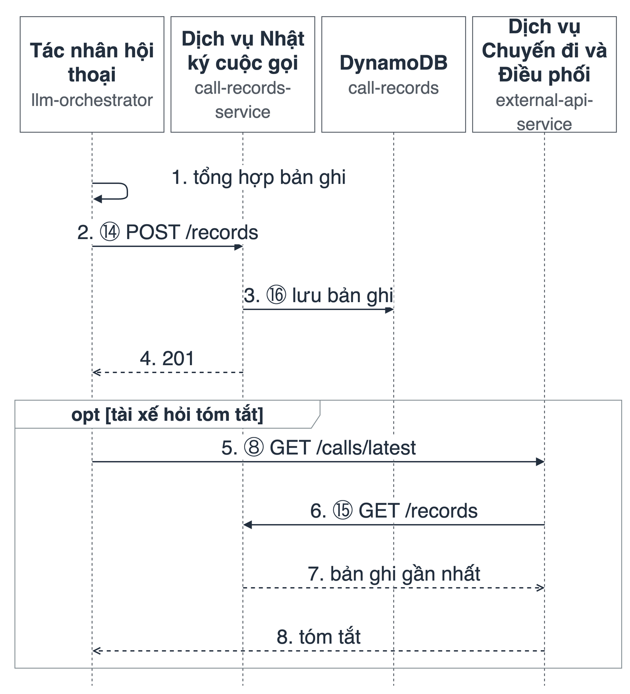

**Hình 4.11.** Sequence S6: lưu bản ghi hội thoại và tra cứu tóm tắt cuộc gọi

**Bảng 4.11.** Các bước của sequence S6

| Bước | Từ → Đến | Thông điệp | Ghi chú |
|---|---|---|---|
| 1 | Dịch vụ Liên lạc hội thoại thời gian thực | Khi phiên kết thúc: tổng hợp bản ghi hội thoại và tóm tắt | Tóm tắt do mô hình ngôn ngữ sinh; kèm chỉ số phiên (mục 5.3.6) |
| 2 ⑭ | Dịch vụ Liên lạc hội thoại thời gian thực → Dịch vụ Nhật ký cuộc gọi | POST /api/v1/records; thời gian chờ 10 giây, thử lại có giới hạn | Dịch vụ lỗi hoặc chưa cấu hình: bản ghi ghi vào nhật ký tác nhân, phiên không bị ảnh hưởng |
| 3 ⑯ | Dịch vụ Nhật ký cuộc gọi → DynamoDB call-records | Lưu bản ghi | Gán record_date theo giờ Việt Nam để truy vấn theo ngày |
| 4 | Dịch vụ Nhật ký cuộc gọi → Dịch vụ Liên lạc hội thoại thời gian thực | 201 | Lỗi ở bước 2–4 không ảnh hưởng phiên hội thoại |
| 5 ⑧ | Dịch vụ Liên lạc hội thoại thời gian thực → Dịch vụ Chuyến đi và Điều phối | Khi tài xế hỏi tóm tắt: GET /api/v1/calls/latest | Công cụ summarize_last_call |
| 6 ⑮ | Dịch vụ Chuyến đi và Điều phối → Dịch vụ Nhật ký cuộc gọi | GET /api/v1/records?caller={số tài xế}&limit=1 | Chỉ lấy bản ghi của chính tài xế đang hỏi |
| 7 | Dịch vụ Nhật ký cuộc gọi → Dịch vụ Chuyến đi và Điều phối | Bản ghi gần nhất | Chưa có bản ghi: thông báo chưa có |
| 8 | Dịch vụ Chuyến đi và Điều phối → Dịch vụ Liên lạc hội thoại thời gian thực | Tóm tắt cuộc gọi | Tác nhân đọc tóm tắt ngắn cho tài xế |

### 4.5.7. S7 — Lập báo cáo vận hành ngày (Dịch vụ Giám sát vận hành)

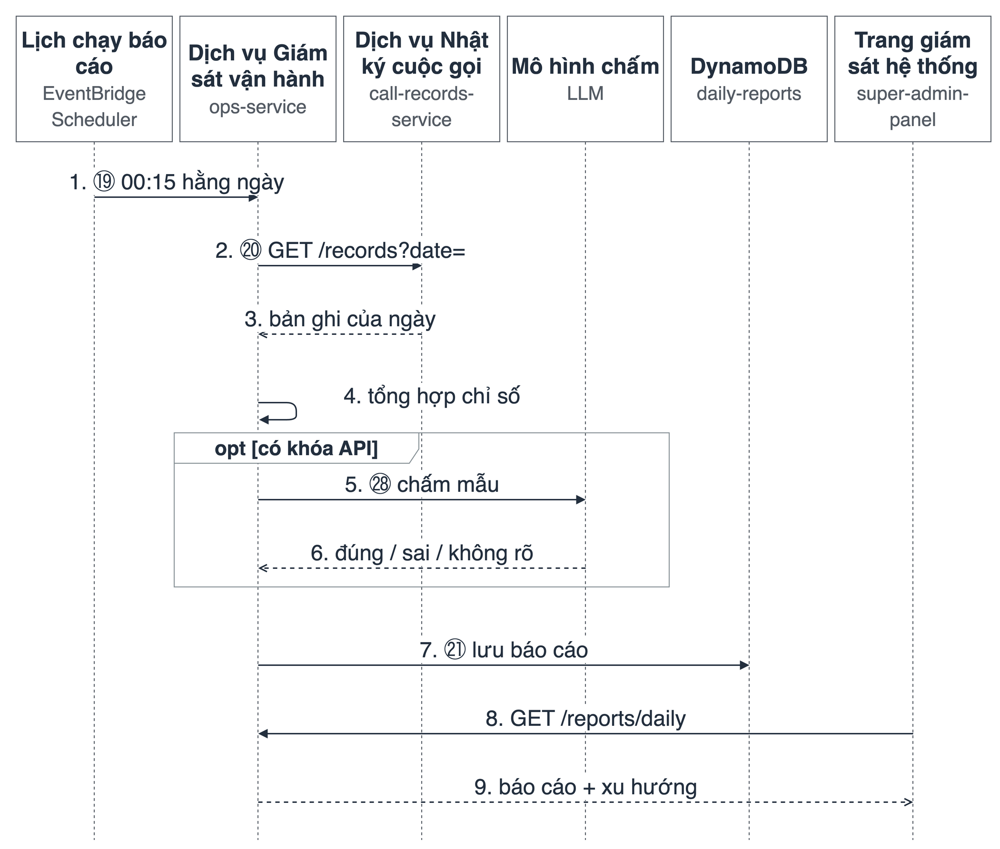

**Hình 4.12.** Sequence S7: lập báo cáo vận hành ngày từ bản ghi hội thoại và chỉ số phiên

**Bảng 4.12.** Các bước của sequence S7

| Bước | Từ → Đến | Thông điệp | Ghi chú |
|---|---|---|---|
| 1 ⑲ | EventBridge Scheduler → Dịch vụ Giám sát vận hành | Sự kiện theo lịch lúc 00:15 giờ Việt Nam (source = ops.schedule) | Người vận hành cũng có thể gọi POST /api/v1/reports/daily/{date}/rebuild |
| 2 ⑳ | Dịch vụ Giám sát vận hành → Dịch vụ Nhật ký cuộc gọi | GET /api/v1/records?date={ngày}&limit=500, lấy lần lượt từng trang 500 bản ghi cho tới hết | Dùng chỉ mục record_date-started_at-index |
| 3 | Dịch vụ Nhật ký cuộc gọi → Dịch vụ Giám sát vận hành | Bản ghi: lời thoại, loại phiên, chỉ số phiên | Bản ghi cũ thiếu loại phiên: suy ra từ tiền tố tên phòng |
| 4 | Dịch vụ Giám sát vận hành | Tổng hợp: số phiên, số tài xế, độ trễ trung bình/P50/P95, tỷ lệ công cụ thành công, tỷ lệ API lỗi, lỗi theo loại | Bản ghi cũ không có chỉ số phiên chỉ được tính vào nhóm hoạt động (số phiên, số tài xế, số lượt, thời lượng), không tính vào độ trễ và tỷ lệ công cụ |
| 5 ㉘ | Dịch vụ Giám sát vận hành → Mô hình chấm (LLM) | Chấm riêng từng cặp (câu tài xế, câu trả lời) trong một mẫu cố định theo ngày, kèm tên các công cụ đã trả dữ liệu trong phiên | Chỉ khi có khóa API; không có thì ghi chú trong báo cáo |
| 6 | Mô hình chấm → Dịch vụ Giám sát vận hành | Kết quả: correct, incorrect hoặc unclear | Mẫu được chọn cố định theo ngày, nên khi lập lại báo cáo, mô hình chấm lại đúng các cặp câu đó |
| 7 ㉑ | Dịch vụ Giám sát vận hành → DynamoDB daily-reports | Lưu báo cáo theo khóa report_date | Lập lại thì ghi đè |
| 8 | Trang giám sát hệ thống → Dịch vụ Giám sát vận hành | GET /api/v1/reports/daily?date= hoặc ?from=&to= | Chỉ tài khoản quản trị hệ thống |
| 9 | Dịch vụ Giám sát vận hành → Trang giám sát hệ thống | Báo cáo ngày và xu hướng 7 ngày | Hình 5.6 |

## 4.6. Thiết kế Dịch vụ Liên lạc hội thoại thời gian thực

Dịch vụ Liên lạc hội thoại thời gian thực là dịch vụ chạy tác nhân hội thoại. Mục này trình bày ba khía cạnh thiết kế của tác nhân: chuỗi xử lý một lượt hội thoại, trạng thái phiên và phân loại phiên.

### 4.6.1. Chuỗi xử lý và câu đệm

Mỗi phát ngôn của tài xế đi qua cùng một chuỗi xử lý: STT, LLM kèm gọi công cụ và TTS (Hình 4.13). Khi phản hồi chưa bắt đầu phát sau 2 giây kể từ lúc tài xế kết thúc phát ngôn, tác nhân phát một câu đệm ngắn như "Đợi mình một chút". Câu đệm không chứa dữ liệu nghiệp vụ và bị hủy nếu câu trả lời thật đã bắt đầu. Để lượt đầu tiên không bị chậm, tác nhân tải trước ngữ cảnh phiên, và nạp sẵn các thành phần (gói ngôn ngữ, mô hình phát hiện giọng nói) ngay khi tiến trình khởi động.

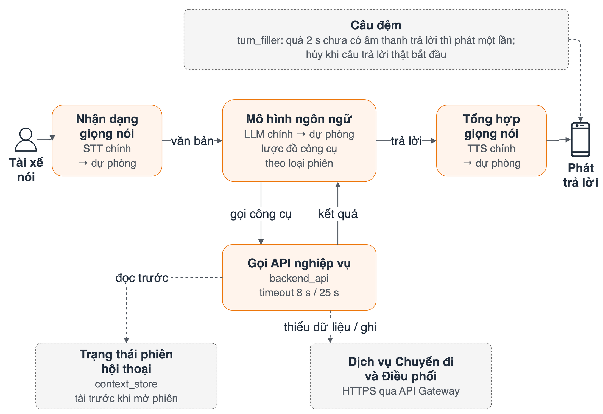

**Hình 4.13.** Chuỗi xử lý một lượt hội thoại: STT, LLM kèm gọi công cụ, TTS, câu đệm và dự phòng nhà cung cấp

### 4.6.2. Trạng thái phiên hội thoại

Trạng thái phiên (session state) là dữ liệu tác nhân giữ trong bộ nhớ của mình suốt một phiên hội thoại và bị xóa khi phiên kết thúc; dữ liệu gốc vẫn nằm ở các dịch vụ nghiệp vụ. Sau bước tải trước, trạng thái phiên gồm các nhóm thông tin trong Bảng 4.13. Khi trả lời, công cụ đọc dữ liệu trong trạng thái phiên trước; nếu thiếu thì gọi API để làm mới. Tác nhân không được tự tạo dữ liệu nghiệp vụ không có trong trạng thái phiên hoặc trong kết quả API.

**Bảng 4.13.** Nội dung trạng thái phiên hội thoại

| Nhóm | Nội dung | Mục đích |
|---|---|---|
| Hồ sơ và cài đặt | Chế độ gọi khách mặc định, tùy chọn nhắc khách khi gần điểm đón | Chọn chế độ gọi; cá nhân hóa |
| Chuyến đi | Chuyến sắp tới, chuyến hiện tại, lịch sử gần | Trả lời câu hỏi về chuyến; cập nhật tiến độ |
| Thu nhập | Thu nhập trong ngày, tóm tắt theo kỳ | Trả lời câu hỏi thu nhập |
| Cuộc gọi | Trạng thái đang gọi, cuộc gọi gần nhất | Tránh mở cuộc gọi chồng; tóm tắt cuộc gọi |
| Hành động chờ xác nhận | Hủy chuyến đang chờ xác nhận; số điện thoại chờ xác nhận; hành động tác nhân vừa đề xuất | Thực hiện xác nhận hai bước |

### 4.6.3. Phân loại phiên và tập công cụ

Tác nhân xác định loại phiên từ tên phòng và metadata, mỗi loại phiên có tập công cụ riêng (Bảng 4.14). Thiết kế này hiện thực FR-L03 và giảm rủi ro chọn nhầm công cụ, chẳng hạn trong phiên mời nhận chuyến qua điện thoại, tác nhân không có công cụ hủy chuyến đang chạy.

**Bảng 4.14.** Loại phiên và tập công cụ

| Loại phiên | Nhận biết | Tập công cụ |
|---|---|---|
| Tài xế trong ứng dụng | Phòng driver-… không có metadata chuyến | 39 công cụ của tài xế |
| Mời nhận chuyến | Phòng driver-… có metadata chuyến và sip_identity | confirm_trip, reject_trip |
| Gọi khách nền | Phòng custcall-… | Tác nhân riêng trao đổi với khách hàng |
| Khách hàng qua ứng dụng (ngoài phạm vi) | Phòng customer-… | 7 công cụ dành cho ứng dụng khách hàng; có trong mã nguồn nhưng không thuộc mô hình nghiệp vụ của luận văn |

Với ba chế độ gọi khách (Bảng 3.3): ở chế độ tác nhân gọi thay, khách được kết nối vào phòng của tài xế và tác nhân trao đổi với khách; ở chế độ nói trực tiếp, tác nhân ngừng phát âm cho tới khi tài xế nói cụm từ kết thúc; ở chế độ gọi nền, cuộc gọi diễn ra trong phòng riêng và tóm tắt được gửi về phòng của tài xế khi kết thúc (sequence S5).

## 4.7. Thiết kế cho khả năng phục hồi, bảo mật và khả năng quan sát

Bảng 4.15 tổng hợp các cơ chế thiết kế đáp ứng NFR-04, NFR-05, ràng buộc CON-04 và yêu cầu FR-O01, kèm chiến thuật kiến trúc mà mỗi cơ chế hiện thực (Bảng 3.18).

**Bảng 4.15.** Cơ chế thiết kế cho khả năng phục hồi, bảo mật và khả năng quan sát

| Cơ chế | Mô tả | Chiến thuật | Yêu cầu |
|---|---|---|---|
| Thời gian chờ khi gọi API | Mọi lời gọi HTTP của tác nhân có thời gian chờ (8 giây với API chuyến, 25 giây với khởi tạo cuộc gọi); lỗi được chuyển thành câu thông báo ngắn | Giới hạn thời gian thực thi; phát hiện ngoại lệ | NFR-04 |
| Dự phòng nhà cung cấp AI | STT, LLM, TTS được cấu hình dưới dạng chuỗi nhà cung cấp chính và dự phòng; nhà cung cấp chính lỗi hoặc quá thời gian chờ thì chuyển sang dự phòng; sự kiện chuyển đổi được ghi nhật ký | Dự phòng thay thế | NFR-04 |
| Cô lập dịch vụ phụ trợ | Lỗi ghi bản ghi cuộc gọi, lỗi gửi tin nhắn hoặc lỗi phân công tác nhân không làm dừng luồng hội thoại chính | Suy giảm có kiểm soát; xử lý ngoại lệ | NFR-04 |
| Tự khôi phục bản sao tác nhân | ECS duy trì số bản sao mong muốn, tự thay thế tác vụ bị dừng; phòng còn nhưng mất tác nhân thì được phân công lại khi tài xế kết nối | Nhịp tim; dự phòng thay thế | NFR-04 |
| Xử lý im lặng | Sau khoảng 15 giây im lặng, tác nhân hỏi tài xế còn đó không; tối đa hai lần rồi kết thúc lịch sự để giải phóng phiên | Giám sát (theo dõi hoạt động của phiên) | FR-L02, NFR-04 |
| Định danh tập trung | Chỉ Dịch vụ Định danh phát hành JWT; các dịch vụ xác minh bằng khóa bí mật dùng chung; tác nhân dùng token dịch vụ riêng | Nhận diện, xác thực, phân quyền đối tượng truy cập | NFR-05, CON-03 |
| Bảo vệ bí mật | Tham số bí mật trong hạ tầng dạng mã được đánh dấu ẩn, không ghi vào mã nguồn; vai trò IAM riêng từng dịch vụ | Giới hạn truy cập; giới hạn phơi lộ | NFR-05 |
| Nhật ký gắn mã phòng | Mọi dòng nhật ký gắn mã phòng và mã hội thoại để theo dõi một yêu cầu xuyên qua các dịch vụ; mức độ che dữ liệu cá nhân trong nhật ký được kiểm tra ở Chương 6 | Lưu vết để kiểm tra lại; giới hạn phơi lộ | CON-04, NFR-05 |
| Chỉ số phiên và báo cáo ngày | Tác nhân gửi chỉ số chất lượng của phiên kèm bản ghi hội thoại; Dịch vụ Giám sát vận hành tổng hợp theo ngày để phát hiện suy giảm độ trễ, lỗi và tỷ lệ trả lời đúng | Giám sát | NFR-04, FR-O01 |

## 4.8. Thiết kế cho tính khả dụng

Tính khả dụng (NFR-01) được thiết kế ở hai mức. Ở mức kiến trúc, tác nhân hiện thực các chiến thuật khả dụng đã chọn ở Bảng 3.18: hủy bỏ, duy trì mô hình tác vụ, mô hình người dùng và mô hình hệ thống. Ở mức tương tác, thiết kế được đối chiếu với 10 nguyên tắc khả dụng của Nielsen (Nielsen, 1994). Các nguyên tắc này thường được dùng để đánh giá giao diện màn hình; với trợ lý giọng nói, phần lớn được hiện thực bằng lời thoại, phần còn lại bằng giao diện ứng dụng tài xế. Bảng 4.16 trình bày đối chiếu; Hình 4.14 minh họa các phần giao diện liên quan.

**Bảng 4.16.** Đối chiếu thiết kế trợ lý với 10 nguyên tắc khả dụng của Nielsen

| STT | Nguyên tắc | Thiết kế tương ứng trong hệ thống | Yêu cầu |
|---|---|---|---|
| 1 | Hiển thị trạng thái hệ thống (visibility of system status) | Biểu tượng trợ lý thể hiện trạng thái đang kết nối, đang nghe, đang xử lý, đang nói (Hình 4.14a); câu đệm khi phản hồi chưa sẵn sàng sau khoảng 2 giây | NFR-01, NFR-02 |
| 2 | Tương thích giữa hệ thống và thế giới thực (match between system and the real world) | Lời thoại dùng từ ngữ của nghiệp vụ tài xế ("đón khách", "chuyến", "khách không có mặt"); hội thoại bằng tiếng Việt hoặc tiếng Anh theo cài đặt (Hình 4.14c) | FR-L01 |
| 3 | Quyền kiểm soát và tự do của người dùng (user control and freedom) | Tài xế có thể từ chối ở bước xác nhận, kết thúc phiên bằng lời nói và thoát chế độ nói trực tiếp bằng cụm từ quy định | FR-T05, FR-L02, FR-A02 |
| 4 | Nhất quán và tuân theo chuẩn (consistency and standards) | Cùng logic nghiệp vụ trên kênh WebRTC và SIP; cùng tập chức năng của tài xế ở hai ngôn ngữ; cùng mẫu xác nhận hai bước cho mọi thao tác rủi ro | FR-L01, NFR-01 |
| 5 | Ngăn ngừa lỗi (error prevention) | Xác nhận hai bước khi hủy chuyến, báo khách không có mặt, gọi hoặc nhắn tới số ngoài chuyến; tập công cụ giới hạn theo loại phiên để tránh chọn nhầm | FR-T05, FR-I01, FR-C02, FR-L03 |
| 6 | Nhận biết thay vì phải nhớ (recognition rather than recall) | Trạng thái phiên giữ chuyến hiện tại và khách của chuyến để tài xế không phải đọc mã chuyến hay số điện thoại; lời thoại được hiển thị lại để xem khi dừng xe (Hình 4.14b) | NFR-01 |
| 7 | Linh hoạt và hiệu quả khi sử dụng (flexibility and efficiency of use) | Mở trợ lý bằng từ khóa đánh thức (Hình 4.14d); chế độ gọi khách mặc định được cài sẵn để trợ lý không phải hỏi lại (Hình 4.14c) | FR-A01, FR-C01 |
| 8 | Thiết kế thẩm mỹ và tối giản (aesthetic and minimalist design) | Mỗi lượt phản hồi một ý chính; khi tra lịch, trợ lý mặc định chỉ nói số chuyến rồi hỏi tài xế muốn nghe chi tiết chuyến nào | NFR-01 |
| 9 | Giúp người dùng nhận biết, chẩn đoán và khôi phục khi có lỗi (help users recognize, diagnose, and recover from errors) | Khi API lỗi, trợ lý nói ngắn gọn thao tác chưa thực hiện được và không tạo dữ liệu thay thế; khi không nghe rõ thì hỏi lại | NFR-04, FR-L02 |
| 10 | Trợ giúp và tài liệu (help and documentation) | Tài xế và khách hàng hỏi cách sử dụng bằng giọng nói; câu trả lời lấy từ sổ tay hướng dẫn | FR-F01, FR-K04 |

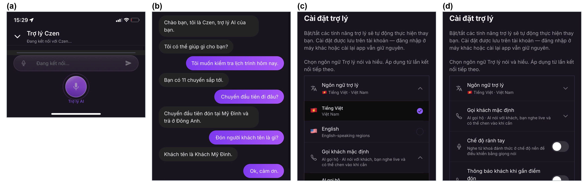

**Hình 4.14.** Giao diện trợ lý trên ứng dụng tài xế: (a) trạng thái kết nối của trợ lý; (b) lời thoại hiển thị đồng bộ; (c) cài đặt ngôn ngữ và chế độ gọi khách mặc định; (d) bật chế độ rảnh tay bằng từ khóa đánh thức và chọn bán kính gọi nhắc khách khi gần điểm đón

## 4.9. Đối chiếu yêu cầu với thiết kế

Bảng 4.17 liên kết từng yêu cầu phi chức năng (và yêu cầu giám sát vận hành) với quyết định thiết kế và vị trí trên các mô hình kiến trúc (Hình 4.1 đến Hình 4.5), làm căn cứ cho các kịch bản đánh giá ở Chương 6.

**Bảng 4.17.** Đối chiếu yêu cầu phi chức năng với thiết kế

| Yêu cầu | Quyết định thiết kế | Thành phần / luồng | Kịch bản đánh giá |
|---|---|---|---|
| NFR-01 Tính khả dụng | Phân loại phiên; xác nhận hai bước; phản hồi ngắn; đối chiếu 10 nguyên tắc Nielsen (Bảng 4.16) | Dịch vụ Liên lạc hội thoại thời gian thực; ứng dụng tài xế | Danh mục kiểm tra hành vi khi lái |
| NFR-02 Hiệu năng | ADR-02; tải trước ngữ cảnh; tác nhân chạy dài hạn trên Fargate | Luồng ⑤⑥⑦⑧ | Đo P50, P95 độ trễ phản hồi |
| NFR-03 Khả năng mở rộng | ADR-01; nhân bản tác nhân; Lambda và DynamoDB tự mở rộng | Dịch vụ Liên lạc hội thoại thời gian thực (ECS), các Lambda | SC-01 đến SC-03 |
| NFR-04 Khả năng phục hồi | Cô lập dịch vụ; dự phòng nhà cung cấp; thời gian chờ; tự khôi phục | Luồng ⑦⑧⑭ | RS-01 đến RS-05 |
| NFR-05 Bảo mật | Định danh tập trung; bí mật ẩn; IAM riêng | Luồng ①②; Cross-cutting | Danh mục kiểm tra bảo mật |
| FR-O01, FR-O02 | Báo cáo ngày do Dịch vụ Giám sát vận hành sở hữu; lịch chạy EventBridge | Luồng ⑲⑳㉑ | UC11 |

## 4.10. Đánh giá kiến trúc theo ATAM rút gọn

Để làm rõ các đánh đổi của kiến trúc đã chọn trước khi đo thực nghiệm, luận văn áp dụng phương pháp phân tích đánh đổi kiến trúc ATAM (Architecture Tradeoff Analysis Method) ở dạng rút gọn (Kazman et al., 2000; Bass et al., 2021). Dạng rút gọn giữ ba sản phẩm chính của ATAM: cây tiện ích (utility tree) xếp hạng các kịch bản thuộc tính chất lượng; các điểm nhạy (sensitivity point) và điểm đánh đổi (tradeoff point); danh sách rủi ro (risk) và không rủi ro (non-risk). Phần được lược bỏ là các buổi làm việc với nhiều bên liên quan, vì luận văn do một người thực hiện.

**Cây tiện ích.** Bảng 4.18 liệt kê các kịch bản thuộc tính chất lượng lấy từ Bảng 3.16, mỗi kịch bản được xếp hạng theo hai chiều: mức quan trọng đối với người sử dụng và mức khó đạt được về kỹ thuật (C – cao, T – trung bình, Th – thấp).

**Bảng 4.18.** Cây tiện ích của hệ thống

| Thuộc tính chất lượng | Kịch bản | Quan trọng | Khó đạt |
|---|---|---|---|
| Hiệu năng | NFR-02: tài xế kết thúc phát ngôn, hệ thống bắt đầu trả lời với P95 ≤ 2 giây | C | C |
| Khả năng phục hồi | NFR-04: nhà cung cấp LLM chính lỗi, lượt vẫn được trả lời nhờ nhà cung cấp dự phòng | C | T |
| Khả năng phục hồi | NFR-04: Dịch vụ Chuyến đi và Điều phối trả lỗi, phiên vẫn tiếp tục và tác nhân thông báo rõ | C | Th |
| Khả năng mở rộng | NFR-03: số phiên đồng thời tăng từ 1 lên 20, P95 tăng không quá 20% | T | T |
| Bảo mật | NFR-05: chỉ dịch vụ định danh phát hành JWT; nhật ký không chứa số điện thoại đầy đủ | C | Th |
| Tính khả dụng | NFR-01: 100% thao tác rủi ro có bước xác nhận | C | Th |

**Điểm nhạy, điểm đánh đổi, rủi ro.** Điểm nhạy là một tham số kiến trúc mà một thuộc tính chất lượng phụ thuộc mạnh vào nó; điểm đánh đổi là điểm nhạy ảnh hưởng ngược chiều tới hai thuộc tính trở lên (Bass et al., 2021). Bảng 4.19 tổng hợp kết quả phân tích.

**Bảng 4.19.** Điểm nhạy, điểm đánh đổi, rủi ro và không rủi ro

| Mã | Loại | Nội dung | Thuộc tính liên quan | Cách xử lý trong luận văn |
|---|---|---|---|---|
| SP-1 | Điểm nhạy | Thời gian mô hình ngôn ngữ sinh token đầu | Hiệu năng | Đo riêng chặng này (Bảng 6.5); chọn mô hình theo kết quả đo |
| SP-2 | Điểm nhạy | Ngưỡng phát hiện kết thúc phát ngôn | Hiệu năng, tính khả dụng | Ngưỡng ngắn giảm độ trễ nhưng dễ ngắt lời tài xế; giữ cấu hình mặc định của nền tảng và đo riêng chặng này |
| TP-1 | Điểm đánh đổi | Mọi lượt đi qua LLM (ADR-02) | Tính đúng chức năng ↔ hiệu năng | Ưu tiên tính đúng nghiệp vụ; bù độ trễ cảm nhận bằng câu đệm |
| TP-2 | Điểm đánh đổi | Thời gian chờ khi gọi API (8 giây, 25 giây) | Khả năng phục hồi ↔ hiệu năng | Thời gian chờ ngắn trả lời lỗi sớm nhưng dễ báo lỗi giả khi mạng chậm; giá trị hiện tại ưu tiên tránh báo lỗi giả |
| TP-3 | Điểm đánh đổi | Nhà cung cấp AI dự phòng | Khả năng phục hồi ↔ chi phí, hiệu năng khi chuyển đổi | Chấp nhận chi phí cấu hình thêm nhà cung cấp; đo độ trễ tăng thêm khi chuyển đổi (RS-05) |
| TP-4 | Điểm đánh đổi | API nghiệp vụ chạy trên FaaS | Khả năng mở rộng, chi phí ↔ hiệu năng (khởi động nguội) | Tải trước ngữ cảnh khi mở phiên để khởi động nguội không rơi vào lượt hội thoại |
| R-1 | Rủi ro | Độ trễ sinh token đầu của nhà cung cấp LLM bên ngoài vượt ngân sách 2 giây | Hiệu năng | Rủi ro đã xảy ra trong đợt đo 05–06/09/2026 (mục 6.4); hướng xử lý ở mục 6.12 |
| R-2 | Rủi ro | Các dịch vụ dùng chung một khóa bí mật để xác minh JWT; lộ khóa ở một dịch vụ ảnh hưởng mọi dịch vụ | Bảo mật | Ghi nhận là hạn chế; hướng phát triển là chuyển sang khóa bất đối xứng |
| R-3 | Rủi ro | Nền tảng truyền thông thời gian thực chỉ có một nhà cung cấp, không có dự phòng | Khả năng phục hồi | Ghi nhận là hạn chế; ngoài phạm vi nguyên mẫu |
| R-4 | Rủi ro | Toàn bộ tài nguyên nằm trong một vùng AWS | Khả năng phục hồi | Chấp nhận ở quy mô nguyên mẫu |
| NR-1 | Không rủi ro | Mỗi dịch vụ sở hữu dữ liệu riêng; tác nhân chỉ gọi API | Khả năng phục hồi, khả năng bảo trì | Lỗi của dịch vụ phụ trợ không lan sang luồng hội thoại chính (kiểm chứng ở RS-01, RS-02) |
| NR-2 | Không rủi ro | Bảo mật tác nhân bằng nhóm bảo mật chỉ cho kết nối chiều ra | Bảo mật | Tác nhân không nhận kết nối từ ngoài vào |

Phân tích cho thấy rủi ro lớn nhất của kiến trúc (R-1) không nằm ở cách chia dịch vụ mà ở thành phần bên ngoài: thời gian sinh token đầu của mô hình ngôn ngữ. Kiến trúc microservices cho phép thay nhà cung cấp mô hình mà không ảnh hưởng các dịch vụ khác, nhưng không tự rút ngắn được thời gian này. Chương 6 kiểm chứng các điểm nhạy và rủi ro trên bằng số liệu đo.

## Kết luận chương

Chương 4 đã lập luận việc chọn kiến trúc microservices từ các yêu cầu phi chức năng và chiến thuật kiến trúc tương ứng. Kiến trúc được trình bày bằng một mô hình tổng thể trên AWS và bốn mô hình luồng hành vi theo bốn nhóm người sử dụng; hệ thống được chia thành các dịch vụ theo năng lực nghiệp vụ, và luồng hoạt động chính được mô tả bằng bảy sequence diagram. Chương cũng trình bày thiết kế của Dịch vụ Liên lạc hội thoại thời gian thực, các cơ chế bảo đảm khả năng phục hồi, bảo mật và khả năng quan sát, thiết kế cho tính khả dụng theo 10 nguyên tắc của Nielsen, và đánh giá kiến trúc theo ATAM rút gọn để xác định các điểm đánh đổi và rủi ro. Chương 5 trình bày hiện thực các thiết kế này.
