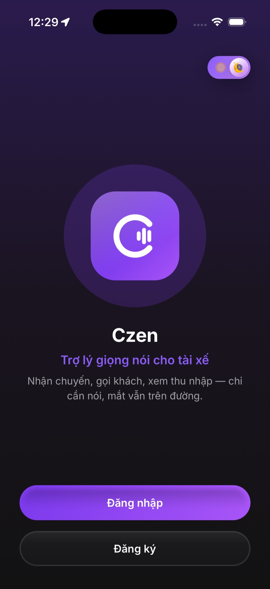
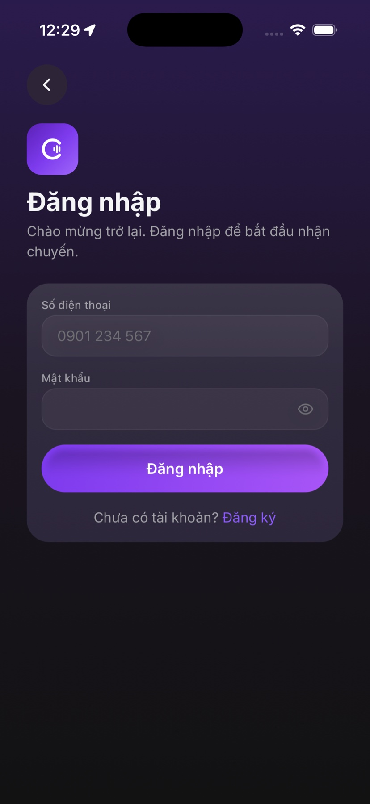
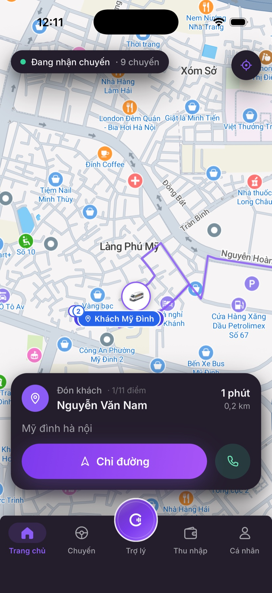
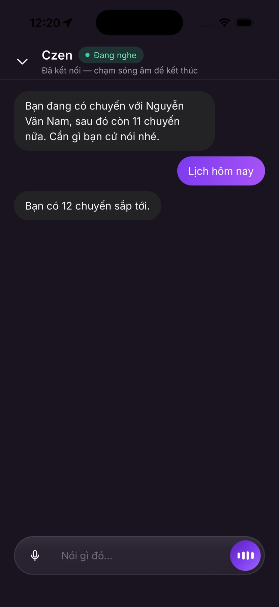
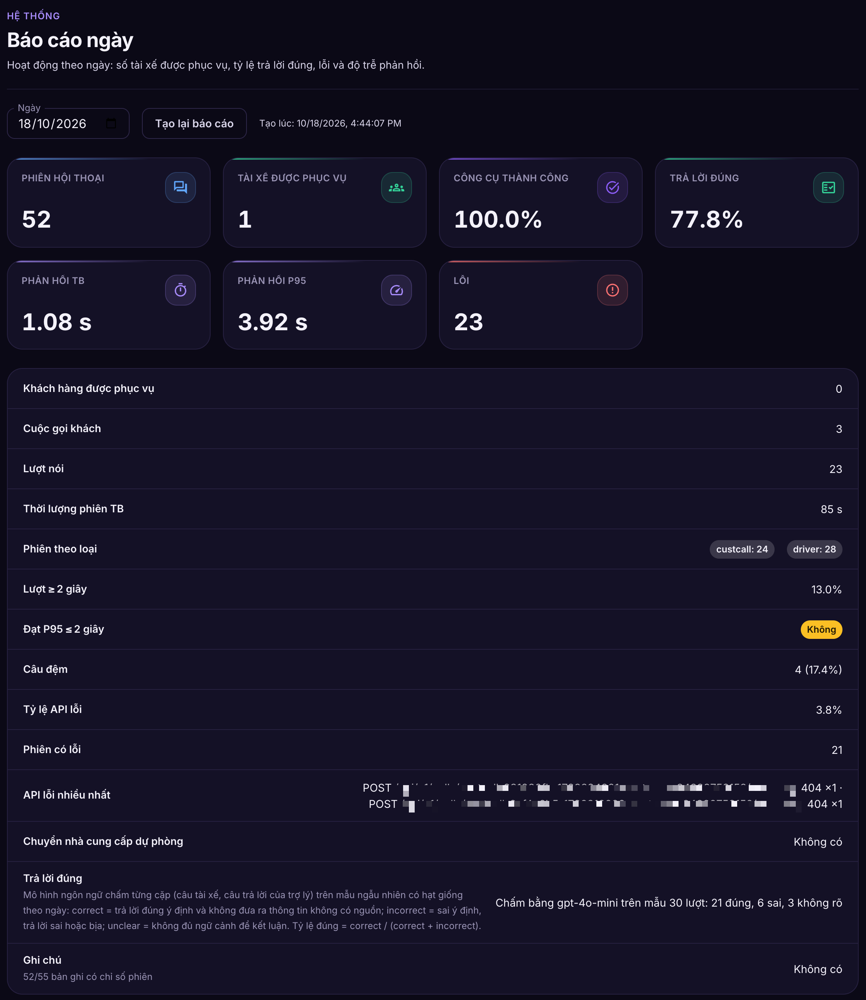
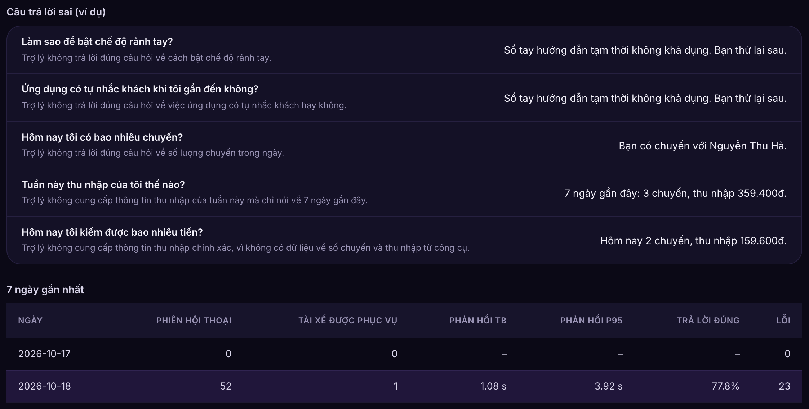

# Chương 5. Triển khai

Chương này trình bày hiện thực nguyên mẫu theo thiết kế ở Chương 4: công nghệ sử dụng, tổ chức mã nguồn, hiện thực tác nhân hội thoại, các dịch vụ backend và ứng dụng tài xế, cấu hình triển khai trên AWS, và bảng đối chiếu quyết định thiết kế với vị trí mã nguồn để phục vụ phân tích kết quả ở Chương 6.

## 5.1. Công nghệ sử dụng

Công nghệ được chọn theo vai trò của từng lớp trong kiến trúc (Bảng 5.1).

**Bảng 5.1.** Công nghệ sử dụng theo lớp kiến trúc

| Lớp | Công nghệ | Vai trò |
|---|---|---|
| Máy khách | React Native (Expo), TypeScript, Tamagui; React (Vite) cho trang web | Ứng dụng tài xế, trang quản trị (ứng dụng khách hàng có trong mã nguồn nhưng ngoài phạm vi luận văn) |
| Hội thoại AI | Python, LiveKit Agents | Dịch vụ Liên lạc hội thoại thời gian thực: STT, LLM kèm gọi công cụ, TTS |
| Microservices | Node.js 20, TypeScript, Express, serverless-http | Các dịch vụ nghiệp vụ, chạy cục bộ bằng Express và trên AWS Lambda |
| Truyền thông thời gian thực | LiveKit Cloud (WebRTC, SIP), Twilio (SIP trunk, SMS) | Phòng hội thoại, cuộc gọi ra mạng điện thoại |
| Bản đồ | Goong Maps API, Google Maps Platform (chọn bằng biến `MAPS_PROVIDER`) | Tìm địa chỉ, tính lộ trình, thời gian đến dự kiến có xét giao thông, ma trận khoảng cách cho sắp xếp điểm dừng |
| Dữ liệu | Amazon DynamoDB; Redis (tùy chọn) | Dữ liệu nghiệp vụ; trạng thái phiên ngắn hạn |
| Truy xuất tri thức | LlamaIndex, tài liệu hướng dẫn dạng Markdown | Trả lời câu hỏi về cách sử dụng ứng dụng |
| Hạ tầng dạng mã | AWS SAM, AWS CloudFormation, Docker | Định nghĩa và triển khai tài nguyên AWS |

Nhà cung cấp STT, LLM và TTS được chọn bằng cấu hình thông qua lớp trừu tượng nhà cung cấp của tác nhân (mục 5.3.4), nên việc thay nhà cung cấp không làm thay đổi kiến trúc.

## 5.2. Tổ chức mã nguồn

Toàn bộ mã nguồn của nguyên mẫu được lưu trong kho GitHub https://github.com/nexgenspeak-max/AI-Powered-Driver-Assistant (phiên bản dùng cho luận văn: commit aa05ba7, ngày 11/10/2026). Mã nguồn được tổ chức thành một kho đơn (monorepo) gồm ba nhánh: `src/backend/` chứa các dịch vụ, `src/frontend/` chứa ứng dụng và trang quản trị, `src/e2e/` chứa kịch bản kiểm thử đầu cuối; thư mục `infra/` chứa hạ tầng dạng mã. Bảng 5.2 liệt kê các thư mục chính; bảng ánh xạ tên thư mục với tên thành phần dùng trong luận văn ở Phụ lục G.

**Bảng 5.2.** Tổ chức mã nguồn

| Nhánh | Thư mục | Thành phần |
|---|---|---|
| Backend | `llm-orchestrator` | Dịch vụ Liên lạc hội thoại thời gian thực |
| Backend | `identity-service` | Dịch vụ Định danh |
| Backend | `external-api-service` | Dịch vụ Chuyến đi và Điều phối |
| Backend | `external-channel-service` | Dịch vụ Liên lạc bằng tin nhắn |
| Backend | `call-records-service` | Dịch vụ Nhật ký cuộc gọi |
| Backend | `ops-service` | Dịch vụ Giám sát vận hành |
| Frontend | `driver-app` | Ứng dụng tài xế |
| Frontend | `customer-app`, `customer-web` | Ứng dụng khách hàng (có trong mã nguồn, ngoài phạm vi luận văn) |
| Frontend | `admin-panel` | Trang quản trị điều hành |
| Frontend | `super-admin-panel` | Trang giám sát hệ thống |
| Kiểm thử | `e2e` | Kịch bản kiểm thử đầu cuối và dữ liệu mẫu |
| Hạ tầng | `infra` | Template SAM/CloudFormation và kịch bản triển khai cho từng dịch vụ |

Mỗi dịch vụ Node.js có hai điểm vào: `src/local.ts` chạy máy chủ Express khi phát triển cục bộ và `src/index.ts` bọc cùng ứng dụng Express thành hàm Lambda. Nhờ đó, cùng một mã nguồn chạy được ở cả hai môi trường.

## 5.3. Hiện thực Dịch vụ Liên lạc hội thoại thời gian thực

### 5.3.1. Khởi tạo phiên và phân loại phòng

Điểm vào của tác nhân (`app/agent/session.py`) phân loại phiên theo tên phòng và metadata (Bảng 4.14): phòng `driver-…` là phiên tài xế, có metadata chuyến thì là phiên mời nhận chuyến; phòng `custcall-…` là cuộc gọi khách nền; phòng `customer-…` là phiên của ứng dụng khách hàng (ngoài phạm vi luận văn, mục 3.5). Tập công cụ tương ứng được định nghĩa trong gói ngôn ngữ (`voicebot/locales/vn/agent.py`, `voicebot/locales/en/agent.py`).

Với phiên tài xế trong ứng dụng, tác nhân đăng ký phiên với Dịch vụ Chuyến đi và Điều phối (chạy song song, lỗi chỉ ghi nhật ký), phát lời chào cố định, sau đó tải trước ngữ cảnh tài xế vào trạng thái phiên (`processors/context_store.py`) rồi hỏi tài xế cần hỗ trợ gì (sequence S2). Khi tiến trình khởi động, tác nhân nạp trước gói ngôn ngữ và mô hình phát hiện giọng nói để giảm độ trễ của phiên đầu tiên.

### 5.3.2. Xử lý lượt hội thoại và câu đệm

Mọi phát ngôn của tài xế được đưa qua mô hình ngôn ngữ kèm lược đồ công cụ của loại phiên. Mô-đun nhận dạng ý định (`processors/intent_classify.py`, `processors/spoken_intent.py`) chỉ gán nhãn cho phát ngôn để loại bỏ mảnh nhận dạng thừa ở cuối câu và nhận biết câu xác nhận cho hành động đang chờ; mô-đun này không gọi công cụ và không quyết định câu trả lời. Nhánh gọi thẳng công cụ theo ý định từng được dùng trong đợt đo 05–06/09/2026 (Chương 6) đã bị loại khỏi mã nguồn.

Gọi khách là thao tác ra bên ngoài và không hoàn tác được, nên có thêm một lớp chặn riêng. Công cụ `call_customer` có tham số bắt buộc `intent_clarity` nhận giá trị `explicit` hoặc `ambiguous`. Mô hình chỉ điền `explicit` khi ở lượt vừa rồi tài xế nói rõ muốn gọi, nhắn hoặc báo khách, hoặc vừa đồng ý câu hỏi gọi của trợ lý. Mọi trường hợp khác, kể cả khi thiếu tham số, tác nhân không quay số mà hỏi lại "Bạn muốn mình gọi cho {tên khách} không?" và ghi một hành động chờ (`processors/call_intent.py`). Hành động chờ chỉ chạy khi lượt kế tiếp là câu đồng ý; nó bị hủy khi tài xế nói sang chuyện khác hoặc sau 30 giây. Lớp chặn được bổ sung sau một phiên thử ngày 18/10/2026: câu hỏi gợi ý của trợ lý ("xem chuyến đang chạy hay cần gọi khách…?") bị bộ nhận dạng coi là lời hứa gọi, và câu "Ok." của tài xế cho một chủ đề khác đã khởi động cuộc gọi. Ngoài ra, các dòng nhận dạng không phải tiếng nói như "Nhạc chuông" (âm báo chờ của cuộc gọi đi) bị bỏ qua để tác nhân không trả lời chúng (`processors/stt_noise.py`).

Câu đệm được hiện thực trong `processors/turn_filler.py` với ngưỡng `FILLER_DELAY_S = 2.0` giây tính từ lúc tài xế kết thúc phát ngôn; câu đệm phát tối đa một lần mỗi lượt và bị hủy nếu câu trả lời thật đã bắt đầu. Hành động chờ xác nhận (`processors/pending_action.py`) lưu thao tác tác nhân vừa đề xuất; khi tài xế xác nhận ("được", "gọi đi"), tác nhân thực thi thao tác đó.

### 5.3.3. Gọi API nghiệp vụ

Mọi thao tác đọc và ghi dữ liệu nghiệp vụ đi qua mô-đun `services/backend_api.py`. Mô-đun dùng một HTTP client dùng chung trong mỗi phiên (tối đa 20 kết nối giữ sống), đặt thời gian chờ cho từng lời gọi (8 giây với API chuyến đi, 25 giây với khởi tạo cuộc gọi), gắn token dịch vụ vào tiêu đề và ghi nhật ký thời gian, mã trạng thái của mỗi lời gọi. Lỗi API được công cụ chuyển thành câu thông báo ngắn; tác nhân chỉ xác nhận thao tác sau khi API trả về thành công. Tác nhân không có kết nối cơ sở dữ liệu (CON-01).

Bảng 5.3 minh họa một lượt thực tế trích từ nhật ký tác nhân ngày 06/09/2026, trong đó yêu cầu gửi SMS thất bại ở phía máy chủ. Lượt này cho thấy cách một câu nói đi qua các khâu, và cách lỗi của một dịch vụ phụ trợ được xử lý mà không làm dừng phiên.

**Bảng 5.3.** Một lượt thực tế: tài xế nhờ nhắn tin cho khách khi dịch vụ gửi SMS gặp lỗi

| Bước | Khâu | Dữ liệu thực tế trong nhật ký |
|---|---|---|
| 1 | Nhận dạng giọng nói (STT) | "Nhắn cho khách là 15 phút nữa tôi đến đón."; phát hiện kết thúc câu sau 1,54 giây |
| 2 | Mô hình ngôn ngữ (LLM) | Chọn công cụ `send_sms_to_customer` với nội dung "Tôi sẽ đến đón bạn trong khoảng 15 phút nữa."; thời gian sinh token đầu 3,48 giây |
| 3 | Gọi API nghiệp vụ | `POST /api/v1/sms/send` tới Dịch vụ Chuyến đi và Điều phối; việc chuyển tiếp sang Dịch vụ Liên lạc bằng tin nhắn thất bại nên dịch vụ trả mã 503 sau 1,31 giây |
| 4 | Xử lý lỗi trong công cụ | Công cụ bắt lỗi HTTP, ghi nhật ký `ok=false`, trả câu thông báo lỗi soạn sẵn (`ERR_SMS_SEND_FAILED`) thay vì để mô hình tự diễn đạt |
| 5 | Tổng hợp giọng nói (TTS) | Tác nhân nói "Không thể gửi tin nhắn lúc này. Vui lòng thử lại."; âm thanh đầu tiên sau 0,17 giây |
| 6 | Tiếp tục phiên | Phiên không bị ngắt; tài xế tiếp tục cập nhật trạng thái chuyến, báo khách không có mặt, hỏi thu nhập và đặt nhắc việc trong các lượt sau |

Lượt này chậm (khoảng 5 giây từ lúc tài xế dứt câu) chủ yếu do thời gian mô hình ngôn ngữ sinh token đầu; nhật ký được ghi khi nguyên mẫu còn nhánh rút gọn theo ý định, nhưng riêng lượt này đã đi qua mô hình ngôn ngữ như thiết kế hiện hành.

### 5.3.4. Lớp trừu tượng và dự phòng nhà cung cấp AI

Nhà cung cấp STT, LLM, TTS được tạo qua hàm factory trong `app/providers/__init__.py` theo biến cấu hình `STT_PROVIDER`, `LLM_PROVIDER`, `TTS_PROVIDER`. Khi cấu hình thêm nhà cung cấp dự phòng (`STT_FALLBACK`, `LLM_FALLBACK`, `TTS_FALLBACK`), factory tạo chuỗi nhà cung cấp và bọc bằng `FallbackAdapter` của LiveKit Agents (`app/providers/fallback.py`): mỗi lần thử với STT và LLM có thời gian chờ 5 giây, nhà cung cấp lỗi được đánh dấu không khả dụng và yêu cầu chuyển sang nhà cung cấp kế tiếp; sự kiện chuyển đổi và phục hồi được ghi nhật ký với nhãn `provider_fallback`. Nhà cung cấp dự phòng dùng mô hình và giọng mặc định của chính nó để tránh gửi tên mô hình không tương thích.

### 5.3.5. Xử lý im lặng và kết thúc phiên

Tác nhân theo dõi thời gian im lặng của tài xế: sau 15 giây im lặng, tác nhân hỏi tài xế còn đó không; sau hai lần liên tiếp không có phản hồi, tác nhân chào kết thúc và gọi API kết thúc phiên thoại. Khi phiên kết thúc, tác nhân gửi bản ghi và tóm tắt hội thoại tới Dịch vụ Nhật ký cuộc gọi với thời gian chờ 10 giây và số lần thử lại giới hạn; nếu dịch vụ không khả dụng, bản ghi được ghi vào nhật ký thay vì làm lỗi phiên (sequence S6).

### 5.3.6. Chỉ số chất lượng của phiên

Mô-đun `services/session_metrics.py` thu chỉ số của từng phiên để phục vụ báo cáo vận hành ngày (FR-O01). Bộ thu được tạo khi phiên bắt đầu và gắn vào biến ngữ cảnh (ContextVar), nên mọi tác vụ phát sinh sau đó trong phiên đều ghi vào cùng một bộ thu. Nguồn dữ liệu là các sự kiện có cấu trúc sẵn có của tác nhân: độ trễ từng lượt, lời gọi HTTP (mã trạng thái), câu đệm, chuyển nhà cung cấp dự phòng, mọi sự kiện lỗi, và sự kiện `function_tools_executed` của LiveKit Agents (công cụ đã chạy, có lỗi hay không). Khi phiên kết thúc, ảnh chụp chỉ số (loại phiên, số lượt, mẫu độ trễ, trung bình, P50, P95, số lượt chậm, công cụ thành công và lỗi theo tên, lỗi HTTP theo đường dẫn, số lần dự phòng) được gửi kèm bản ghi hội thoại tới Dịch vụ Nhật ký cuộc gọi. Mẫu độ trễ được gửi nguyên để phân vị của cả ngày được tính đúng, không lấy trung bình của các phân vị.

## 5.4. Hiện thực các dịch vụ backend

### 5.4.1. Dịch vụ Chuyến đi và Điều phối

Dịch vụ là nguồn dữ liệu chuẩn cho chuyến đi và là điểm khởi tạo phiên thoại, cuộc gọi. Bảng 5.4 liệt kê các nhóm API phục vụ trợ lý.

**Bảng 5.4.** Nhóm API của Dịch vụ Chuyến đi và Điều phối phục vụ trợ lý

| Nhóm | API | Mục đích |
|---|---|---|
| Phiên thoại | `POST /api/v1/voice/token`, `POST /api/v1/voice/end-session`, `PUT` và `DELETE /api/v1/drivers/me/session` | Cấp token LiveKit, kết thúc phiên, đăng ký phiên đang mở |
| Ngữ cảnh | `GET /api/v1/drivers/me/context` | Tải trước chuyến, thu nhập, cài đặt |
| Chuyến đi | `GET /api/v1/drivers/me/trips/upcoming`, `GET /api/v1/drivers/me/trips/current`, `PATCH /api/v1/trips/{tripId}`, `POST /api/v1/trips/{tripId}/dispatch` | Tra cứu, cập nhật trạng thái, mời nhận chuyến |
| Sự cố và chờ đón | `POST /api/v1/trips/{tripId}/no-show`, `/issues`, `/extend-wait` | Báo khách không có mặt, báo sự cố, gia hạn chờ |
| Cuộc gọi, tin nhắn | `POST /api/v1/calls/start`, `POST /api/v1/calls/complete`, `GET /api/v1/calls/latest`, `POST /api/v1/sms/send` | Gọi khách, kết thúc cuộc gọi nền, tra cứu cuộc gọi, gửi SMS |
| Thu nhập, trạng thái | `GET /api/v1/drivers/me/earnings/today`, `/earnings/summary`; `PATCH /api/v1/drivers/me/status` | Thu nhập, bật/tắt nhận chuyến |
| Nhắc việc | `POST /api/v1/reminders` | Tạo nhắc việc |

Các trạng thái đòi tài xế có mặt tại chỗ (`arrived_pickup`, `picked_up`, `completed`) chỉ được ghi khi tài xế cách điểm đón, hoặc điểm trả với `completed`, không quá 200 m (`ARRIVAL_RADIUS_METERS`), đủ để trừ sai số GPS và sai số tra địa chỉ. Ngoài bán kính, API trả 409 kèm khoảng cách còn lại, ví dụ "Bạn còn cách điểm đón khoảng 1,4 km…", còn việc gọi khách vẫn được phép ở mọi khoảng cách. Khi tác nhân cập nhật trạng thái thay tài xế, nó gửi `enforce_arrival` để dịch vụ áp cùng quy tắc với vị trí GPS mới nhất mà ứng dụng đã gửi; chuyến chỉ có địa chỉ dạng văn bản được tra tọa độ ngay lúc kiểm.

Dịch vụ cũng nhắc khách khi tài xế sắp đến. Mỗi lần ứng dụng gửi vị trí, dịch vụ xét điểm dừng đầu tiên của lộ trình tối ưu; nếu tài xế đã bật tùy chọn và vừa vào bán kính đã chọn (500 m đến 3 km, mặc định 1 km), dịch vụ mở một cuộc gọi nền tới khách với lời nhắn có khoảng cách thật, ví dụ "Tài xế còn khoảng 1 km nữa là tới Đền Quán Thánh, anh chị ra điểm đón giúp tài xế nhé". Mỗi chuyến chỉ nhắc một lần; không ai nghe máy thì gọi lại tối đa hai lần, cách nhau 60 giây. Để mốc 1 km không bị bỏ qua, ứng dụng gửi vị trí theo khoảng cách tới điểm dừng: 10 phút một lần khi không có chuyến, 60 giây hoặc 500 m khi đang có chuyến, 15 giây hoặc 150 m khi còn dưới 3 km. Trên trình giả lập, một chuyến đi mô phỏng ở 43 km/h kích hoạt cuộc nhắc ở mốc 996 m.

Cuộc gọi thoại được khởi tạo qua SIP của LiveKit Cloud (`services/telephony/livekit.ts`) với SIP trunk nối tới Twilio; tin nhắn SMS được chuyển tiếp tới Dịch vụ Liên lạc bằng tin nhắn (`services/smsService.ts`). Tại thời điểm đánh giá, tin SMS chưa giao được tới thuê bao Việt Nam vì chưa có tên người gửi đã đăng ký với nhà mạng; mã nguồn đã hỗ trợ cấu hình tên người gửi qua biến `TWILIO_SMS_FROM` (mục 6.13). Khi có chuyến mới và tài xế đang mở phiên, thông báo được gửi vào phòng hiện có (`services/driverReachService.ts`); nếu không, thông báo được lưu tạm và phát khi tài xế mở trợ lý. Thông báo đẩy tới ứng dụng dùng thư viện WebSocket khi chạy cục bộ và API Gateway WebSocket khi chạy trên AWS.

### 5.4.2. Dịch vụ Định danh

Tài xế đăng nhập bằng số điện thoại và mật khẩu (vai trò `driver`); mật khẩu được lưu dưới dạng băm bcrypt. Dịch vụ phát hành access token và refresh token; giá trị băm của refresh token được lưu để có thể thu hồi. Cài đặt tài xế, trong đó có trường `default_customer_call_mode` (chế độ gọi khách mặc định), được lưu ở bảng riêng và đưa vào ngữ cảnh phiên.

### 5.4.3. Dịch vụ Liên lạc bằng tin nhắn, Dịch vụ Nhật ký cuộc gọi và Dịch vụ Giám sát vận hành

- **Dịch vụ Liên lạc bằng tin nhắn:** gửi SMS qua Twilio và tiếp nhận webhook trạng thái, tin nhắn đến từ Twilio. Các webhook của Twilio không yêu cầu JWT; các API còn lại yêu cầu JWT. Sự kiện nhà cung cấp (webhook, lượt quay số, kết quả gửi SMS) được lưu qua một cổng lưu trữ (`services/events/store.ts`) có hai bộ điều hợp: bảng DynamoDB `channel-events` khi cấu hình `EVENTS_TABLE` (môi trường triển khai), tệp JSONL cục bộ khi chạy phát triển. Việc ghi được chờ xong trước khi trả lời webhook vì trên Lambda, tác vụ còn chạy sau khi trả lời có thể bị dừng; lỗi ghi chỉ được ghi nhật ký.
- **Dịch vụ Nhật ký cuộc gọi:** lưu và truy vấn bản ghi hội thoại (`/api/v1/records`) trên bảng DynamoDB riêng. Mỗi bản ghi được gán trường `record_date` (ngày theo giờ Việt Nam) khi lưu; truy vấn `GET /api/v1/records?date=` dùng chỉ mục phụ `record_date-started_at-index`, có phân trang bằng con trỏ, và tự chuyển sang quét có lọc khi bảng cũ chưa có chỉ mục. Cấu trúc một bản ghi được trình bày ở Bảng 5.5.
- **Dịch vụ Giám sát vận hành:** thăm dò tình trạng các dịch vụ qua điểm cuối `/health`, cung cấp nhật ký, cấu hình tác nhân và báo cáo ngày cho trang giám sát hệ thống; chỉ tài khoản quản trị hệ thống được truy cập. Mô-đun báo cáo (`services/reports/`) gồm hàm tổng hợp thuần, bộ chấm LLM trên mẫu cố định theo ngày (xáo trộn có hạt giống là ngày báo cáo nên lập lại cho cùng kết quả), cổng lưu trữ với bộ điều hợp DynamoDB `daily-reports` hoặc tệp JSON cục bộ, và API `GET /api/v1/reports/daily`, `POST /api/v1/reports/daily/{date}/rebuild`. Trên AWS, hàm Lambda của dịch vụ nhận hai loại sự kiện: yêu cầu HTTP qua API Gateway và sự kiện theo lịch từ EventBridge Scheduler. Vì không đọc được tệp của các dịch vụ khác, trên AWS dịch vụ đọc nhật ký từ CloudWatch Logs, kiểm tra tác nhân qua số tác vụ ECS đang chạy, và dùng ảnh chụp cấu hình tác nhân được đóng gói lúc triển khai.

**Bảng 5.5.** Cấu trúc một bản ghi trong bảng `call-records` (giá trị ví dụ lấy từ phiên ngày 06/09/2026, số điện thoại đã che)

| Trường | Ý nghĩa | Giá trị ví dụ |
|---|---|---|
| `call_id` | Mã phiên, trùng tên phòng hội thoại; khóa chính | `driver-0888xxx798-509f5d25-…` |
| `caller` | Số điện thoại tài xế hoặc khách | `0888xxx798` |
| `started_at`, `ended_at`, `duration_seconds` | Thời điểm bắt đầu, kết thúc và thời lượng phiên | 06/09/2026 19:07:45–19:13:41, 355 giây |
| `record_date` | Ngày theo giờ Việt Nam, dùng cho chỉ mục truy vấn theo ngày | `2026-09-06` (bản ghi ví dụ tạo trước khi có trường này; dịch vụ tính từ `started_at` khi truy vấn) |
| `turns` | Danh sách lượt nói theo thứ tự: vai (`user`/`assistant`), nội dung, thời điểm | 61 lượt, ví dụ `user`: "Hôm nay tôi có bao nhiêu chuyến?" – `assistant`: "Bạn có 13 chuyến sắp tới." |
| `summary` | Tóm tắt hội thoại do mô hình ngôn ngữ sinh khi kết thúc phiên | "Trong cuộc hội thoại, tài xế yêu cầu trợ lý AI kiểm tra lịch trình chuyến đi, thông tin khách hàng, và thực hiện gọi điện cho khách hàng…" |
| `stt_provider`, `llm_provider`, `llm_model` | Nhà cung cấp và mô hình đã dùng trong phiên | `google`, `openai`, `gpt-5.6-luna` |
| `mode`, `metrics` | Loại phiên và chỉ số chất lượng phiên (mục 5.3.6); chỉ có ở bản ghi tạo sau khi triển khai chỉ số phiên | Không có ở bản ghi ví dụ này |
| `ttl` | Thời điểm DynamoDB tự xóa bản ghi | Tùy chọn |

### 5.4.4. Tích hợp dịch vụ bản đồ

Dữ liệu vị trí và lộ trình do Dịch vụ Chuyến đi và Điều phối lấy từ dịch vụ bản đồ bên ngoài (khối "Dịch vụ bản đồ" trên Hình 4.1); tác nhân hội thoại không gọi nhà cung cấp bản đồ; ứng dụng tài xế chỉ tải lớp bản đồ nền trực tiếp từ Goong bằng một khóa riêng dành cho hiển thị (luồng ㉕ ở Bảng 4.4), còn mọi lời gọi tìm địa chỉ, chỉ đường và ma trận khoảng cách đi qua backend (luồng ㉓), nên khóa API dịch vụ bản đồ chỉ nằm ở backend. Mô-đun `services/mapsService.ts` là một lớp trừu tượng nhà cung cấp, cùng ý tưởng với lớp trừu tượng nhà cung cấp AI ở mục 5.3.4: hai bộ điều hợp `services/maps/goong.ts` (Goong, dữ liệu bản đồ Việt Nam) và `services/maps/google.ts` (Google Maps Platform) cùng trả về một kiểu dữ liệu chung, và biến `MAPS_PROVIDER` chọn bộ điều hợp; môi trường thực nghiệm dùng Goong. Tích hợp bản đồ phục vụ bốn chức năng:

- **Tìm và chuẩn hóa địa chỉ:** API `GET /api/v1/places/autocomplete`, `/places/detail` và `/places/reverse` gợi ý địa chỉ khi nhập, lấy tọa độ của địa chỉ được chọn và đổi tọa độ thành địa chỉ (`services/maps/goongPlaces.ts`). Khi đã có tọa độ chính xác từ bước chọn địa chỉ, dịch vụ dùng thẳng tọa độ thay vì tìm lại theo chuỗi địa chỉ.
- **Lộ trình và tình trạng giao thông của chuyến:** khi tạo chuyến (kể cả chuyến vãng lai, UC16), dịch vụ gọi API chỉ đường để lấy quãng đường, thời gian đến dự kiến có xét giao thông, tọa độ điểm đón, trả và đường đi mã hóa (polyline). Độ chậm so với lúc thông thoáng được đổi thành câu ngắn như "Giao thông chậm, thêm khoảng 6 phút", lưu cùng chuyến để công cụ `get_trip_traffic` đọc lại cho tài xế mà không phải gọi lại nhà cung cấp (FR-T07).
- **Sắp xếp thứ tự ghé các điểm dừng:** `services/routeOptimizationService.ts` lấy ma trận khoảng cách đường bộ từ vị trí hiện tại của tài xế tới mọi điểm đón, trả đang chờ, rồi tìm thứ tự ghé bằng heuristic láng giềng gần nhất kết hợp cải tiến 2-opt (`utils/twoOpt.ts`). Thuật toán có ràng buộc thứ tự: điểm đón của một chuyến luôn đứng trước điểm trả của chính chuyến đó, nên bài toán là bài toán đón và trả khách (pickup and delivery) chứ không phải bài toán người du lịch thông thường. Kết quả được lưu đệm và chỉ tính lại khi trạng thái chuyến thay đổi. Goong từ chối yêu cầu ma trận lớn hơn 100 ô, nên ma trận của tài xế có nhiều điểm dừng (ví dụ 11 x 10 khi có 10 điểm) được chia thành các khối không quá 100 ô, gửi song song rồi ghép lại; thứ tự ghé dùng thời gian di chuyển khi có số liệu. Các yêu cầu tính lại đồng thời của cùng một tài xế dùng chung một lần tính, và hình dạng đường của từng chặng được lưu đệm 30 phút để tránh bị nhà cung cấp giới hạn tần suất. Kết quả được đưa vào ngữ cảnh phiên để công cụ `get_optimal_route` của trợ lý đọc thứ tự ghé cho tài xế; công cụ `suggest_next_stop` chỉ gợi ý một điểm gần nhất tiếp theo (FR-T07, UC16).
- **Hiển thị bản đồ và chỉ đường trong ứng dụng:** ứng dụng tài xế vẽ bản đồ, vị trí xe, điểm đón, trả và đường đi (Hình 5.3); API `GET /api/v1/drivers/me/navigation` trả về chỉ dẫn từng chặng cho khung điều hướng trên màn hình (`features/home/components/NavigationHud.tsx`). Trợ lý giọng nói không đọc chỉ dẫn rẽ từng bước; phần này chỉ hiển thị trên màn hình (mục 3.5).

Lỗi của dịch vụ bản đồ không làm dừng nghiệp vụ, phù hợp chiến thuật suy giảm có kiểm soát của NFR-04: nếu không lấy được ma trận khoảng cách, thứ tự ghé được tính theo khoảng cách đường chim bay với tốc độ trung bình giả định 25 km/h, và kết quả được gắn nhãn nguồn `haversine_fallback` để trợ lý nói rõ đây là ước lượng; nếu không lấy được chỉ đường, API điều hướng trả mã 502 kèm thông báo thử lại, còn chuyến vẫn được tạo với quãng đường và thời gian bằng 0. Chất lượng thứ tự ghé so với lời giải tối ưu được đánh giá ở Bảng 6.16; độ chính xác thời gian đến dự kiến trên đường thật chưa được đo.

## 5.5. Hiện thực ứng dụng tài xế

Ứng dụng tài xế hiện thực các yêu cầu thiết kế ở mục 4.8 dưới thương hiệu Czen. Giao diện dùng một bộ biểu tượng SVG riêng (`src/components/icons`): 57 biểu tượng vẽ trên cùng lưới 24 đơn vị với nét bo tròn thống nhất; ở thanh điều hướng, mục đang chọn dùng biểu tượng tô đặc vẽ riêng và có nhãn chữ cho cả năm mục, theo quy ước của các ứng dụng gọi xe. Màn hình chào giới thiệu vai trò trợ lý và hai lối vào đăng nhập, đăng ký (Hình 5.1); tài xế đăng nhập bằng số điện thoại và mật khẩu (Hình 5.2).

**Hình 5.1.** Màn hình chào của ứng dụng tài xế

**Hình 5.2.** Màn hình đăng nhập tài xế bằng số điện thoại và mật khẩu

Sau khi đăng nhập, màn hình chính hiển thị bản đồ, vị trí xe, lộ trình tối ưu và thẻ điểm dừng kế tiếp gồm tên khách, khoảng cách và thời gian còn lại cập nhật theo GPS, kèm nút chỉ đường và nút gọi (Hình 5.3). Khi có chuyến mới, ứng dụng hiện bảng mời nhận chuyến toàn màn hình với cước ước tính, vòng đếm ngược 20 giây và hai nút Từ chối, Nhận chuyến (Hình C.2); bảng này luôn nằm trên cùng, kể cả khi khung trợ lý đang mở. Khi mở trợ lý, ứng dụng xin token thoại và tham gia phòng hội thoại (`features/home/stores/voiceSessionStore.ts`). Khung trò chuyện có một thanh nhập duy nhất: nút micro bên trái để tắt, bật micro mà vẫn giữ phiên; nút bên phải là nút gửi khi có chữ, còn khi ô trống là nút Czen để kết nối, chuyển thành sóng âm khi đang nói và chạm để kết thúc phiên. Các câu gợi ý nhanh nằm ngay dưới lời chào cho tới lượt nói đầu tiên của tài xế (Hình 5.4).

**Hình 5.3.** Màn hình bản đồ sau khi đăng nhập và bật trạng thái hoạt động

**Hình 5.4.** Phiên trợ lý giọng nói: tài xế chọn câu gợi ý nhanh, trợ lý đang xử lý

Bản ghi hội thoại được hiển thị đồng bộ với lời nói để tài xế đối chiếu khi dừng xe (Hình 5.5).

**Hình 5.5.** Hội thoại mẫu: tra cứu lịch trình trong ngày

Trang giám sát hệ thống có thêm trang "Báo cáo ngày" (`super-admin-panel/src/pages/ReportsPage.tsx`) hiển thị các nhóm chỉ số (Hình 5.6), ví dụ câu trả lời bị chấm sai và bảng xu hướng 7 ngày (Hình 5.7). Ảnh chụp dùng dữ liệu thật của ngày 06/09/2026 trong bảng nhật ký cuộc gọi của môi trường phát triển: 15 phiên, 4 tài xế, 133 lượt nói; mô hình chấm đánh giá mẫu 30 lượt với 16 đúng và 14 sai (tỷ lệ 53,3%). Các ô độ trễ và tỷ lệ công cụ thành công để trống vì những bản ghi này được tạo trước khi tác nhân gửi kèm chỉ số phiên (mục 5.3.6); báo cáo nêu rõ điều này ở dòng "Ghi chú" thay vì ước lượng. Với bản ghi cũ chưa có trường loại phiên, dịch vụ suy ra loại phiên từ tiền tố tên phòng trong mã cuộc gọi (`driver-`, `trip-`, `customer-`, `custcall-`), cùng quy ước với tác nhân hội thoại (`app/agent/session.py`).

**Hình 5.6.** Trang báo cáo vận hành ngày: các chỉ số tổng hợp (dữ liệu ngày 06/09/2026)

**Hình 5.7.** Trang báo cáo vận hành ngày: ví dụ câu trả lời bị chấm sai và xu hướng 7 ngày (dữ liệu ngày 06/09/2026)

Trang cài đặt trợ lý (`app/(app)/assistant-settings.tsx`) cho phép chọn ngôn ngữ, chế độ gọi khách mặc định, bật nhắc khách khi gần điểm đón và chọn bán kính nhắc. Từ khóa đánh thức được nhận dạng trên thiết bị bằng thư viện Vosk (`features/assistant-wakeword/wakeWordService.ts`); khi khớp từ khóa, ứng dụng mở phiên theo cùng luồng như khi bấm nút và không gửi đoạn âm thanh đánh thức tới mô hình ngôn ngữ. Các ảnh giao diện khác đặt ở Phụ lục C.

## 5.6. Triển khai trên AWS

### 5.6.1. Hạ tầng dạng mã

Mỗi dịch vụ có một stack hạ tầng dạng mã riêng trong thư mục `infra/<tên dịch vụ>/`, triển khai độc lập với các dịch vụ khác. Tài nguyên được đặt tên theo quy ước `<môi trường>-driver-assistant-<tên dịch vụ>-<vai trò>` và gắn các thẻ `app`, `env`, `service`, `layer`, `component`; giá trị thẻ `layer` trùng tên lớp trên Hình 4.1 để đối chiếu sơ đồ với tài nguyên thực tế. API Gateway chuyển mọi đường dẫn (`ANY /{proxy+}`) tới ứng dụng Express của dịch vụ, nên thêm API mới không phải sửa template. Bảng 5.6 tóm tắt tài nguyên của từng stack.

**Bảng 5.6.** Tài nguyên AWS theo stack

| Stack | Tài nguyên AWS | Cấu hình chính | Yêu cầu đáp ứng |
|---|---|---|---|
| identity-service | API Gateway REST; Lambda; DynamoDB (accounts, driver-settings); CloudWatch Logs | Node.js 20, 256 MB; DynamoDB PAY_PER_REQUEST | NFR-03, NFR-05 |
| external-api-service | API Gateway REST và WebSocket; Lambda (API, kết nối và ngắt kết nối WebSocket); DynamoDB (trips, ws-connections); CloudWatch Logs | Node.js 20, 256 MB; DynamoDB PAY_PER_REQUEST | NFR-02, NFR-03 |
| external-channel-service | API Gateway REST; Lambda; DynamoDB (channel-events, TTL 90 ngày); CloudWatch Logs | Node.js 20, 256 MB | NFR-04 |
| call-records-service | API Gateway REST; Lambda; DynamoDB (call-records, chỉ mục theo người gọi và theo ngày, TTL); CloudWatch Logs | Node.js 20, 256 MB | NFR-04, FR-O01 |
| ops-service | API Gateway REST; Lambda; DynamoDB (daily-reports); EventBridge Scheduler (00:15, múi giờ Asia/Ho_Chi_Minh); quyền đọc CloudWatch Logs và ECS; CloudWatch Logs | Node.js 20, 512 MB, thời gian chạy tối đa 120 giây | FR-O01, NFR-04 |
| llm-orchestrator | Amazon ECR; ECS cluster, task definition, service trên Fargate; security group; vai trò IAM; CloudWatch Logs | 1 vCPU, 2 GB; `DesiredCount` điều chỉnh số bản sao; public subnet, chỉ kết nối chiều ra | NFR-02, NFR-03, NFR-04 |
| frontend | Amazon S3 | Lưu trữ tĩnh trang quản trị, trang giám sát và bản web (`infra/frontend/deploy.sh`) | FR-Q, FR-S (giao diện cho điều phối viên, quản trị viên hệ thống) |

Tham số bí mật (khóa API, khóa JWT, thông tin LiveKit, Twilio) được khai báo với thuộc tính `NoEcho` trong template và nạp từ tệp môi trường cục bộ không nằm trong kho mã nguồn (NFR-05). Kịch bản `infra/deploy-all.sh` triển khai các stack theo thứ tự phụ thuộc (Dịch vụ Định danh, Dịch vụ Nhật ký cuộc gọi, Dịch vụ Liên lạc bằng tin nhắn, Dịch vụ Chuyến đi và Điều phối, tác nhân hội thoại, Dịch vụ Giám sát vận hành) và ghi địa chỉ API của stack trước vào tệp môi trường của stack sau; phần xây dựng, triển khai và gỡ bỏ dùng chung thư viện `infra/lib/sam.sh`; `infra/scale-ecs.sh` điều chỉnh số bản sao tác nhân.

**Trạng thái triển khai tại thời điểm đánh giá.** Mã hạ tầng của các stack trong Bảng 5.6 đã hoàn chỉnh, nhưng nguyên mẫu dùng trong thực nghiệm chưa chạy trên kiến trúc AWS đầy đủ. Kiểm tra tài khoản AWS (vùng ap-southeast-1) ngày 13/10/2026 cho thấy: (1) dữ liệu nằm trên Amazon DynamoDB thật, trong bộ bảng dành cho môi trường phát triển (tiền tố `local-driver-assistant-`, ví dụ bảng nhật ký cuộc gọi có 774 bản ghi); (2) chỉ có hai stack Lambda của một phiên bản cũ, trước khi đổi tên dịch vụ (Dịch vụ Định danh và Dịch vụ Chuyến đi), và nhóm nhật ký CloudWatch của chúng không có dữ liệu; (3) chưa có cụm ECS, nghĩa là tác nhân hội thoại chưa chạy trên Fargate. Như vậy, các dịch vụ Node.js và tác nhân trong thực nghiệm chạy trên máy phát triển, kết nối DynamoDB trên AWS và LiveKit Cloud (mục 5.6.2). Hệ quả là các kết quả ở Chương 6 phản ánh tính chất của kiến trúc và mã nguồn, chưa phản ánh hành vi của Lambda, API Gateway và Fargate trên AWS; giới hạn này được tính trong các mối đe dọa độ tin cậy ở mục 6.13.

### 5.6.2. Môi trường phát triển và thử nghiệm

Trong quá trình phát triển và thực nghiệm, các dịch vụ Node.js chạy cục bộ bằng Express và đọc, ghi các bảng DynamoDB của môi trường phát triển trên AWS; tác nhân hội thoại chạy cục bộ và kết nối LiveKit Cloud; ứng dụng tài xế trỏ tới địa chỉ dịch vụ qua biến môi trường `EXPO_PUBLIC_*`. Cấu hình không bí mật của tác nhân (nhà cung cấp, mô hình, giọng đọc, địa chỉ dịch vụ) nằm trong tệp `envs/config.<môi trường>.toml`; khóa bí mật nằm trong tệp `.env` không đưa vào kho mã nguồn. Tệp mẫu `envs/.env.example` và `envs/config.example.toml` được cung cấp để tái lập môi trường (Phụ lục D). Bảng 5.7 liệt kê các thành phần tối thiểu để chạy nguyên mẫu đầu cuối.

**Bảng 5.7.** Thành phần tối thiểu để chạy nguyên mẫu đầu cuối

| Thành phần | Cần cho | Ghi chú |
|---|---|---|
| Dịch vụ Định danh, Dịch vụ Chuyến đi và Điều phối | Đăng nhập, token thoại, ngữ cảnh | Bắt buộc |
| Dịch vụ Liên lạc hội thoại thời gian thực, LiveKit Cloud | Hội thoại trong ứng dụng | Tác nhân phải đăng ký thành công với LiveKit |
| Ứng dụng tài xế | Giao diện, micro, loa | Thiết bị thật hoặc trình giả lập |
| SIP trunk (Twilio) | Mời nhận chuyến qua điện thoại, gọi khách | Có thể bỏ qua nếu chỉ thử trong ứng dụng |
| Dịch vụ bản đồ (khóa API Goong hoặc Google) | Tạo chuyến có lộ trình, thời gian đến dự kiến, thứ tự ghé, tìm địa chỉ | Thiếu khóa thì thứ tự ghé dùng khoảng cách đường chim bay |
| Dịch vụ Liên lạc bằng tin nhắn | Gửi SMS | Có thể bỏ qua |
| Dịch vụ Nhật ký cuộc gọi | Lưu và tóm tắt cuộc gọi | Tắt không ảnh hưởng hội thoại |

## 5.7. Đối chiếu thiết kế và hiện thực

Bảng 5.8 đối chiếu các quyết định thiết kế ở Chương 4 với vị trí hiện thực trong mã nguồn, làm căn cứ khoanh vùng lỗi khi phân tích kết quả ở Chương 6.

**Bảng 5.8.** Đối chiếu quyết định thiết kế và hiện thực

| Quyết định thiết kế | Hiện thực |
|---|---|
| Tác nhân chỉ gọi API (CON-01) | `llm-orchestrator/app/services/backend_api.py` |
| Khởi tạo phiên, lời chào, tải trước ngữ cảnh (S2) | `llm-orchestrator/app/agent/session.py`; `processors/prefetch.py`; `processors/context_store.py` |
| Cấp token và tái sử dụng phòng (S2) | `external-api-service/src/routes/voice.ts` |
| Luồng xử lý đơn (ADR-02) | `llm-orchestrator/app/voicebot/processors/spoken_intent.py`, `intent_classify.py` |
| Câu đệm 2 giây | `llm-orchestrator/app/voicebot/processors/turn_filler.py` |
| Dự phòng nhà cung cấp AI | `llm-orchestrator/app/providers/__init__.py`, `fallback.py` |
| Phân loại phiên và tập công cụ | `session.py` (`_parse_room`); `voicebot/locales/{vn,en}/agent.py` |
| Mời nhận chuyến (S4) | `external-api-service/src/services/dispatchService.ts` |
| Gọi khách ba chế độ (S5) | `external-api-service/src/services/callService.ts`; `services/telephony/livekit.ts` |
| Nhật ký cuộc gọi (S6) | `llm-orchestrator/app/services/conversation_service.py`; `call-records-service/src/routes` |
| Đăng nhập, JWT (S1) | `identity-service/src/routes/auth.ts` |
| Từ khóa đánh thức | `driver-app/src/features/assistant-wakeword/wakeWordService.ts` |
| Trả lời câu hỏi thường gặp | Công cụ `answer_app_faq`; `llm-orchestrator/app/rag/`; `requirements/knowledge/` |
| Chỉ số phiên | `llm-orchestrator/app/services/session_metrics.py`; `app/devlog.py` |
| Lưu sự kiện nhà cung cấp thoại | `external-channel-service/src/services/events/` |
| Truy vấn bản ghi theo ngày | `call-records-service/src/services/recordService.ts` (`listByDate`) |
| Báo cáo vận hành ngày (S7) | `ops-service/src/services/reports/`; `ops-service/src/routes/reports.ts`; `super-admin-panel/src/pages/ReportsPage.tsx` |
| Hạ tầng AWS | `infra/<tên dịch vụ>/sam.yaml`, `infra/llm-orchestrator/cfn.yaml`, `infra/lib/sam.sh`, `infra/deploy-all.sh` |

## Kết luận chương

Chương 5 đã trình bày công nghệ, tổ chức mã nguồn, hiện thực tác nhân hội thoại với lớp trừu tượng và dự phòng nhà cung cấp AI, các dịch vụ backend kèm tích hợp dịch vụ bản đồ, ứng dụng tài xế, hạ tầng dạng mã trên AWS cùng trạng thái triển khai thực tế và bảng đối chiếu thiết kế với hiện thực. Chương 6 đánh giá nguyên mẫu theo từng yêu cầu đã đặc tả ở Chương 3.
