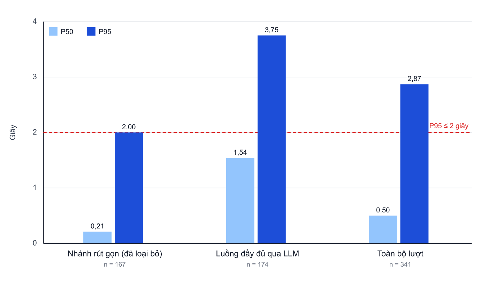
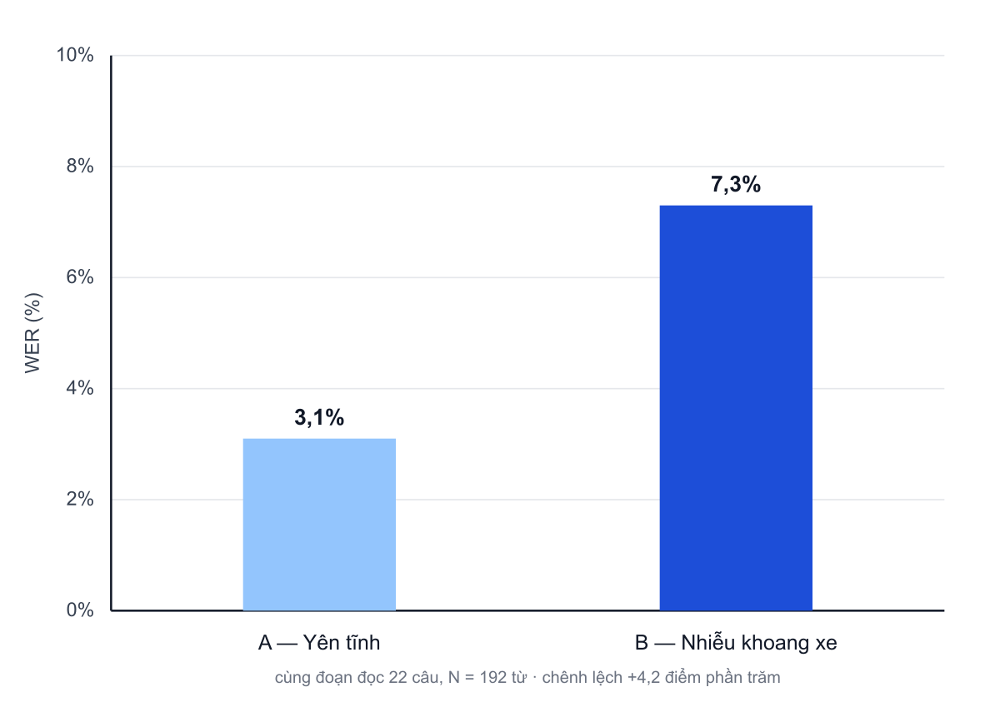

# Chương 6. Thực nghiệm và đánh giá

Chương này đánh giá nguyên mẫu đã triển khai ở Chương 5 theo từng yêu cầu đã đặc tả ở Chương 3 và trả lời các câu hỏi nghiên cứu RQ1–RQ4. Mỗi yêu cầu được đánh giá theo tiêu chí chấp nhận dạng Given – When – Then đã xác định trước (Bảng 3.19 và Bảng 3.20). Chương trình bày ma trận đánh giá, môi trường thực nghiệm, định nghĩa chỉ số, kết quả theo từng yêu cầu, tổng hợp và thảo luận theo câu hỏi nghiên cứu, và các yếu tố ảnh hưởng đến độ tin cậy của kết luận.

## 6.1. Mục tiêu và ma trận đánh giá

Bảng 6.1 liên kết từng yêu cầu với câu hỏi nghiên cứu, tiêu chí chấp nhận, kịch bản, chỉ số, ngưỡng và mục trình bày kết quả.

**Bảng 6.1.** Ma trận đánh giá theo yêu cầu

| Yêu cầu | Câu hỏi nghiên cứu | Tiêu chí chấp nhận | Kịch bản | Chỉ số | Ngưỡng | Mục |
|---|---|---|---|---|---|---|
| NFR-02 Hiệu năng | RQ2 | AC-15 | Phiên hội thoại UC01, UC03, UC04, UC07 | P50, P95 độ trễ phản hồi | P95 ≤ 2 giây | 6.4 |
| Nhận dạng giọng nói | RQ3 | AC-19 | Bộ câu tham chiếu, hai điều kiện âm thanh | Tỷ lệ lỗi từ | So sánh tương đối | 6.5 |
| FR-T, FR-C, FR-E, FR-F | RQ4 | AC-01 đến AC-08 | UC01–UC08 | Độ chính xác gọi công cụ; tỷ lệ hoàn thành nghiệp vụ | Báo cáo theo nhóm | 6.6 |
| NFR-01 Tính khả dụng | RQ4 | AC-14 | UC01–UC06, UC09 | Danh mục kiểm tra hành vi khi lái | 100% thao tác rủi ro có xác nhận | 6.7 |
| NFR-03 Khả năng mở rộng | RQ1 | AC-16 | SC-01, SC-02, SC-03 | P95 và tỷ lệ lỗi theo số phiên đồng thời | Tăng P95 ≤ 20%; lỗi < 1% | 6.8 |
| NFR-04 Khả năng phục hồi | RQ1 | AC-17 | RS-01 đến RS-05 | Tỷ lệ phiên duy trì; thời gian khôi phục | 100% phiên duy trì | 6.9 |
| NFR-05 Bảo mật | Ngoài RQ (kiểm tra tuân thủ) | AC-18 | Kiểm tra mã nguồn, cấu hình, nhật ký | Danh mục kiểm tra bảo mật | 100% mục đạt | 6.10 |
| Luồng khách hàng (FR-K) | RQ4 | AC-10, AC-11 | Bộ trường hợp kiểm thử khách hàng | Tỷ lệ trường hợp kiểm thử đạt | Đạt / không đạt | 6.11 |
| FR-T07 Sắp xếp thứ tự ghé | RQ4 | Không có tiêu chí riêng (đánh giá bổ sung) | 600 bộ điểm dừng mô phỏng | Chênh lệch quãng đường so với lời giải tối ưu | Báo cáo | 6.11 |
| FR-O01, FR-O02 | Ngoài RQ (kiểm tra tuân thủ) | AC-13 | Kiểm thử tự động mô-đun chỉ số phiên và báo cáo ngày | Tỷ lệ trường hợp kiểm thử đạt | Đạt / không đạt | 6.11 |

Ngoài phạm vi đánh giá: khảo sát trải nghiệm của khách hàng thật; đo an toàn giao thông thực địa; so sánh quy mô lớn giữa các nhà cung cấp STT, LLM, TTS; thử tải trên hạ tầng AWS thực tế.

## 6.2. Môi trường thực nghiệm

Số liệu của chương lấy từ ba nguồn: (1) nhật ký phiên hội thoại thật trên nguyên mẫu trong hai ngày 05 và 06 tháng 9 năm 2026; (2) bộ kiểm thử tự động của các dịch vụ; (3) các thí nghiệm có kiểm soát trên môi trường mô phỏng cục bộ (mục 6.2.2). Mỗi bảng kết quả ghi rõ nguồn và cỡ mẫu; ô chưa có số liệu được ghi "Chưa đo" kèm lý do, luận văn không ước đoán giá trị cho các ô này.

**Đạo đức và dữ liệu cá nhân.** Mọi phiên hội thoại dùng tài khoản thử nghiệm nội bộ và chuyến thử nghiệm; không có dữ liệu của khách hàng thật. Người đọc kịch bản là tác giả. Số điện thoại trong bảng, hình và phụ lục được che một phần. Bộ dữ liệu thử tải dùng số điện thoại trong dải giả lập không có thật. Nhật ký thô chỉ lưu trên máy phát triển và không được công bố kèm mã nguồn.

### 6.2.1. Môi trường đo hội thoại

Bảng 6.2 mô tả môi trường dùng để đo độ trễ, tỷ lệ lỗi từ và độ chính xác gọi công cụ.

**Bảng 6.2.** Môi trường đo hội thoại

| Thành phần | Cấu hình | Ghi chú |
|---|---|---|
| Ứng dụng tài xế | Thiết bị thật hoặc trình giả lập | Ưu tiên thiết bị thật khi đo micro, loa |
| Dịch vụ Liên lạc hội thoại thời gian thực | Chạy cục bộ, kết nối LiveKit Cloud | Nhật ký gắn mã phòng |
| Dịch vụ backend | Dịch vụ Định danh, Dịch vụ Chuyến đi và Điều phối chạy cục bộ | Cấu hình không chứa bí mật ở Phụ lục D |
| Truyền thông | LiveKit Cloud, WebRTC; SIP khi đo UC02, UC04 | SIP qua Twilio SIP trunk, gọi tới số thử nghiệm nội bộ |
| Mô hình AI | LLM gpt-5.6-luna; STT Google chirp_3 (vi-VN); TTS Google vi-VN-Chirp3-HD-Kore | Cố định trong suốt cửa sổ đo |
| Dữ liệu | Tài khoản và chuyến thử nghiệm nội bộ | Che thông tin cá nhân trên nhật ký và ảnh |
| Kiểm thử tự động | pytest trong thư mục kiểm thử của tác nhân | Bổ trợ trường hợp kiểm thử khách hàng |

Số liệu độ trễ được trích từ nhật ký `turn_metrics` của tác nhân trong hai ngày 2026-09-05 và 2026-09-06 (n = 341 lượt), kênh WebRTC trong ứng dụng. gpt-5.6-luna là tên mô hình họ GPT ghi trong cấu hình của dự án, truy cập qua giao diện tương thích OpenAI; kết luận về thời gian sinh token đầu gắn với mô hình này. Kịch bản do tác giả đọc; script trích xuất `extract_ch6_metrics.py` đi kèm để tái lập.

### 6.2.2. Môi trường mô phỏng thử tải và tiêm lỗi

Khả năng mở rộng và khả năng phục hồi được đánh giá trên một máy phát triển (Apple M4 Pro 14 nhân, 48 GB RAM, macOS 27.0.1, Node.js 26.10, k6 2.3), trong môi trường cô lập: mỗi thành phần bên ngoài được thay bằng một bộ giả lập (Bảng 6.3), thông tin đăng nhập AWS là giá trị giả và dữ liệu dùng số điện thoại trong dải giả lập. Nhờ vậy kết quả phản ánh hành vi của mã nguồn và kiến trúc, không phụ thuộc biến động của mạng hay nhà cung cấp bên ngoài, và thí nghiệm không tác động tới tài nguyên thật.

**Bảng 6.3.** Ánh xạ thành phần trên AWS sang môi trường thí nghiệm

| Trên AWS | Môi trường thí nghiệm | Dùng cho |
|---|---|---|
| API Gateway và Lambda của Dịch vụ Chuyến đi và Điều phối | Một tiến trình Node.js của dịch vụ, chạy với cấu hình thí nghiệm riêng | SC-03 |
| Amazon DynamoDB | Bộ giả lập DynamoDB (moto) với bảng và chỉ mục giống template SAM; 200 tài xế giả lập × 3 chuyến | SC-03 |
| Dịch vụ Định danh | Bộ giả lập HTTP trả tài khoản tài xế | SC-03 |
| Dịch vụ Chuyến đi và Điều phối, Dịch vụ Nhật ký cuộc gọi (khi bị lỗi) | Máy chủ tiêm lỗi: trả 503, treo quá thời gian chờ, hoặc từ chối kết nối | RS-01, RS-02, RS-04 |
| Nhà cung cấp LLM chính và dự phòng | Nhà cung cấp giả lập có độ trễ và kiểu lỗi cấu hình được, đặt trong `FallbackAdapter` của LiveKit Agents với cấu hình như mã nguồn (`attempt_timeout` = 5 giây, không thử lại) | RS-05 |
| LiveKit Cloud | Máy chủ LiveKit mã nguồn mở 1.13.9 chạy cục bộ trong Docker | SC-01, SC-02, RS-03 |
| Bản sao tác nhân trên ECS Fargate | 1, 2 hoặc 4 tiến trình tác nhân dùng mã nguồn hiện hành, cùng cấu hình chế độ chạy thật (`start`) | SC-01, SC-02, RS-03 |
| Nhà cung cấp STT, LLM, TTS | Máy chủ giả lập tương thích API OpenAI với độ trễ cố định: STT 0,3 giây, LLM sinh token đầu 0,8 giây, TTS 0,2 giây; TTS trả một câu giọng nói tiếng Việt dài 5,2 giây | SC-01, SC-02, RS-03 |
| Tài xế nói chuyện với trợ lý | Công cụ `lk perf agent-load-test` (LiveKit CLI 2.19): mỗi phòng có một người tham gia phát lại giọng của tác nhân sau 2 giây như một lượt nói mới, tạo vòng hội thoại liên tục | SC-01, SC-02 |

Công cụ tạo tải là k6. Các thí nghiệm tiêm lỗi gọi trực tiếp công cụ thật của tác nhân (gói tiếng Việt) và hàm ghi bản ghi cuộc gọi, nên kết quả phản ánh đúng câu mà tác nhân sẽ nói với tài xế khi gặp lỗi. Script và lệnh chạy được liệt kê ở Phụ lục F.

Ba kịch bản cần nhiều tác nhân cùng tham gia phòng hội thoại (SC-01, SC-02, RS-03) chạy trên máy chủ LiveKit cục bộ với tác nhân thật và nhà cung cấp AI giả lập (bốn dòng cuối của Bảng 6.3). Vì độ trễ của STT, LLM và TTS được cố định, mọi thay đổi độ trễ phản hồi theo số phiên đều đến từ phần kiến trúc (định tuyến phòng, tiến trình phiên, phát hiện giọng nói và kết thúc lượt), không đến từ nhà cung cấp. Độ trễ phản hồi lấy từ dòng nhật ký `user_stop_to_agent_speak` của tác nhân, tức từ lúc người dùng ngừng nói tới lúc tác nhân bắt đầu nói.

## 6.3. Định nghĩa chỉ số

**Độ trễ phản hồi.** Thời gian từ lúc tài xế kết thúc phát ngôn đến lúc tác nhân bắt đầu phát âm thanh trả lời, ghi trong nhật ký với tên `user_stop_to_agent_speak`. Các mốc phụ trong một lượt (phát hiện kết thúc phát ngôn, thời gian sinh token đầu của LLM, thời gian đến âm thanh đầu của TTS) dùng để phân tích điểm nghẽn. Báo cáo P50 và P95 theo giây.

**Tỷ lệ lỗi từ.** WER = (S + D + I) / N, trong đó S, D, I là số từ bị thay thế, bị xóa, bị chèn so với câu tham chiếu và N là số từ của câu tham chiếu.

**Độ chính xác gọi công cụ.** Một lượt được tính là đúng khi tên công cụ thuộc tập kỳ vọng của trường hợp sử dụng, tham số chính đúng và không có lời gọi công cụ gây sai nghiệp vụ.

**Tỷ lệ hoàn thành nghiệp vụ.** Một trường hợp sử dụng được tính là hoàn thành khi thỏa điều kiện thành công ở Bảng 3.10; câu trả lời trôi chảy nhưng dữ liệu phía backend không thay đổi đúng vẫn tính là không hoàn thành.

**Chỉ số khả năng mở rộng.** Mức tăng tương đối của P95 độ trễ phản hồi và tỷ lệ phiên lỗi khi tăng số phiên đồng thời, với số bản sao tác nhân tương ứng.

**Chỉ số khả năng phục hồi.** Tỷ lệ phiên không bị kết thúc bất thường khi tiêm lỗi; tỷ lệ lượt vẫn được phản hồi; thời gian từ khi bản sao tác nhân bị dừng đến khi phiên mới được phục vụ.

**Quy tắc xử lý dữ liệu và thống kê.** Các quy tắc sau được cố định trước khi tính số liệu và áp dụng cho mọi bảng trong chương:

1. **Đơn vị phân tích.** Độ trễ tính theo lượt hội thoại; tỷ lệ lỗi từ tính theo câu rồi gộp theo tổng số từ; độ chính xác gọi công cụ tính theo lượt; tỷ lệ hoàn thành tính theo trường hợp sử dụng.
2. **Làm sạch.** Loại các lượt không do người dùng nói (lời chào tự động của tác nhân, lượt kiểm thử nội bộ có đánh dấu trong nhật ký). Không loại giá trị ngoại lai chỉ vì lớn; một lượt chỉ bị loại khi có lỗi đo được ghi nhận, và mọi lượt bị loại được nêu kèm lý do. Cỡ mẫu n trong bảng là cỡ mẫu sau làm sạch.
3. **Phân vị.** P50, P90, P95 tính bằng nội suy tuyến tính giữa hai giá trị kề nhau trong dãy đã sắp xếp (cách tính mặc định của script `extract_ch6_metrics.py`).
4. **Khoảng tin cậy.** Tỷ lệ (độ chính xác gọi công cụ, tỷ lệ hoàn thành, tỷ lệ phiên duy trì) kèm khoảng tin cậy 95% theo phương pháp Wilson. Mỗi mức tải trong thí nghiệm thử tải chỉ chạy một lần, nên P95 của các thí nghiệm này không kèm khoảng tin cậy (mục 6.13).
5. **Đạt hay không đạt.** Một tiêu chí chấp nhận được kết luận "đạt" khi giá trị đo thỏa ngưỡng ở Bảng 3.19 hoặc Bảng 3.20; khi cỡ mẫu nhỏ hơn mức dự kiến, kết luận được ghi kèm "mẫu nhỏ".

## 6.4. Kết quả hiệu năng — NFR-02 (RQ2)

Số liệu độ trễ hiện có thuộc đợt đo ngày 05–06/09/2026, khi nguyên mẫu còn nhánh xử lý rút gọn theo ý định (Bảng 6.4). Sau đợt đo, nhánh này đã bị loại bỏ theo ADR-02 (mục 4.2.2); các con số của nhánh rút gọn không còn là kết quả của thiết kế hiện hành mà là bằng chứng cho thấy thời gian sinh token đầu của LLM là điểm nghẽn chính.

**Bảng 6.4.** Độ trễ phản hồi theo nhánh xử lý (giây, nhật ký 05–06/09/2026, gpt-5.6-luna)

| Nhánh xử lý | n | P50 | P90 | P95 | Tỷ lệ lượt ≥ 2 giây | Đạt P95 ≤ 2 giây |
|---|---|---|---|---|---|---|
| Nhánh rút gọn theo ý định (không qua LLM) | 167 | 0,21 | 1,48 | 2,00 | 5,4% | Đạt (sát ngưỡng) |
| Luồng đầy đủ qua LLM | 174 | 1,54 | 2,78 | 3,75 | 30,5% | Không đạt |
| Toàn bộ lượt | 341 | 0,50 | 2,29 | 2,87 | 18,2% | Không đạt |

Nhánh xử lý được gán theo việc mô-đun nhận dạng ý định có kích hoạt trong lượt hay không (cách gán xấp xỉ, xem mục 6.13). Nhóm UC03 và UC07 không đủ mẫu để tách riêng.

**Bảng 6.5.** Phân tích điểm nghẽn độ trễ trong một lượt (mili-giây)

| Chặng | P50 | P95 | Nhận xét |
|---|---|---|---|
| Phát hiện kết thúc phát ngôn | 935 | 1 700 | Phụ thuộc mô hình phát hiện lượt và độ dài câu |
| LLM sinh token đầu | 1 249 | 2 487 | Chi phí lớn nhất của mọi lượt qua LLM |
| TTS đến âm thanh đầu | 161 | 288 | Không đáng kể |

**Hình 6.1.** P50 và P95 độ trễ phản hồi theo nhánh xử lý, đợt đo 05–06/09/2026 (n = 341 lượt)

Kết quả cho thấy: nhánh rút gọn đạt ngưỡng sát biên (P95 = 2,00 giây); luồng đầy đủ qua LLM không đạt (P95 = 3,75 giây), với thời gian sinh token đầu (P95 ≈ 2,5 giây) là nguyên nhân chính. Trong thiết kế hiện hành, mọi lượt đều đi qua LLM, vì vậy câu đệm sau 2 giây được dùng để báo hiệu hệ thống đang xử lý; tải trước ngữ cảnh được dùng để giảm thời gian thực thi công cụ, nhưng tác động của nó chưa được đo riêng.

**Bảng 6.6.** Độ trễ phản hồi trên thiết kế hiện hành (nhật ký ngày 11/10/2026)

| Nguồn | n | Độ trễ phản hồi từng lượt (giây) | Số lượt vượt 2 giây | Thời gian sinh token đầu (giây) | Kết luận |
|---|---|---|---|---|---|
| Phiên trong ứng dụng, thiết kế hiện hành (mọi lượt qua LLM, có câu đệm) | 4 | 0,18; 0,50; 1,73; 2,49 | 1/4 | 0,99–2,23 | Chưa đủ mẫu để tính P95 |

Bốn lượt trên là toàn bộ lượt có ghi độ trễ trong nhật ký hiện còn trên máy phát triển; nhật ký gốc của đợt đo 05–06/09/2026 không còn lưu trên máy này, nên số liệu Bảng 6.4 và 6.5 được giữ nguyên như đã trích bằng script ở thời điểm đo. Bốn lượt chỉ cho thấy thời gian sinh token đầu của thiết kế hiện hành vẫn nằm trong cùng khoảng với đợt đo trước (Bảng 6.5) và vẫn có lượt vượt 2 giây; để kết luận AC-15 cho thiết kế hiện hành cần ít nhất 200 lượt theo đúng quy trình ở mục 6.3.

## 6.5. Kết quả nhận dạng giọng nói (RQ3)

**Bảng 6.7.** Tỷ lệ lỗi từ theo điều kiện âm thanh (một người đọc, một lượt mỗi điều kiện)

| Điều kiện | Số câu / số từ | S / D / I | WER |
|---|---|---|---|
| A — Yên tĩnh | 22 câu / 192 từ | 1 / 5 / 0 | 3,1% |
| B — Nhiễu mô phỏng khoang xe | 22 câu / 192 từ | 3 / 5 / 6 | 7,3% |
| Chênh lệch B − A | Cùng bộ câu | +2 / 0 / +6 | +4,2 điểm phần trăm |

**Thiết lập.** Cùng một bộ 22 câu (tra cứu chuyến, xác nhận, gọi và nhắn tin cho khách, hai địa chỉ có số nhà, mốc giờ) được đọc một lượt ở mỗi điều kiện, cùng thiết bị và micro. Ở điều kiện B, tiếng ồn nền mô phỏng khoang xe được phát từ một thiết bị khác, vì nếu phát từ chính điện thoại thì bộ khử tiếng vọng (echo cancellation) của điện thoại sẽ lọc mất tiếng ồn. Văn bản nhận dạng lấy từ sự kiện `stt_final` trong nhật ký, chuẩn hóa chữ số và dấu câu trước khi so sánh bằng script `compute_wer.py`.

**Hình 6.2.** Tỷ lệ lỗi từ ở điều kiện yên tĩnh và điều kiện nhiễu mô phỏng khoang xe

Tỷ lệ lỗi từ tăng hơn gấp đôi khi có nhiễu, từ 3,1% lên 7,3%. Ở điều kiện nhiễu xuất hiện các lỗi thay từ mang nghĩa ("thu nhập" thành "phim Nhật"), sai chữ số trong địa chỉ và mất các từ phụ ngắn (hư từ). Nhận dạng vẫn dùng được cho câu lệnh ngắn nhưng độ tin cậy giảm. Vì luận văn không huấn luyện lại mô hình nhận dạng (mục 1.5.3), mức suy giảm này là của mô hình có sẵn, chưa được điều chỉnh cho tiếng ồn khoang xe.

## 6.6. Kết quả tính đúng chức năng (RQ4)

**Bảng 6.8.** Độ chính xác gọi công cụ và tỷ lệ hoàn thành nghiệp vụ (chấm thủ công, một người chấm, 43 lượt trong 13 phiên, nhật ký 05–06/09/2026)

| Kết quả chấm | Số lượt | Tỷ lệ |
|---|---|---|
| Đúng công cụ, hoàn thành đúng ngay lần đầu | 32 | 74,4% |
| Đúng công cụ, hoàn thành sau khi trợ lý tự sửa | 5 | 11,6% |
| Sai công cụ hoặc sai tham số | 6 | 14,0% |
| Tổng | 43 | 100% |

Từ Bảng 6.8, tỷ lệ chọn đúng công cụ là 37/43 = 86,0% (khoảng tin cậy 95% theo phương pháp Wilson: 72,7%–93,4%), tỷ lệ hoàn thành đúng ngay lần đầu là 32/43 = 74,4% (59,8%–85,1%). Khoảng tin cậy rộng cho thấy cần mẫu lớn hơn trước khi so sánh giữa các nhóm nghiệp vụ. Các lượt được chấm không gắn nhãn theo use case, nên luận văn không báo cáo tỷ lệ riêng cho từng use case; các lượt chủ yếu thuộc xem lịch và chuyến (UC01), nhận chuyến (UC02), gọi khách (UC04), hỏi cách sử dụng (UC07) và thu nhập (UC08), và các lượt sai tập trung ở gọi khách và thu nhập (Bảng 6.9).

Lỗi E-INTENT ở UC04 phát sinh từ nhánh rút gọn theo ý định; nhánh này đã bị loại bỏ và kiểm thử `test_spoken_intent` xác nhận câu hỏi cách gọi khách không còn kích hoạt công cụ gọi. Số liệu theo từng trường hợp sử dụng UC03, UC05, UC06 cần một đợt đánh giá có gắn nhãn sẵn, người chấm không được biết trước kết quả mong đợi, và ít nhất hai người chấm.

**Bảng 6.9.** Phân loại lỗi quan sát trong mẫu chấm (43 lượt)

| Mã | Nhóm lỗi | Ví dụ | Khâu nghi ngờ | Số lần ghi nhận |
|---|---|---|---|---|
| E-INTENT | Nhận dạng đúng nhưng chọn sai thao tác | Hỏi cách gọi khách bị hiểu thành lệnh gọi | Nhánh rút gọn (đã loại bỏ) | 4 |
| E-PARAM | Đúng công cụ, sai tham số | Thu nhập "tháng vừa rồi" trả về thu nhập hôm nay | Ngữ cảnh, LLM | 2 |
| E-UX | Hoàn thành nghiệp vụ nhưng câu nói khó nghe khi lái | Địa chỉ bị cắt; lời nhắn chuyển sai nghĩa | Lời nhắc hệ thống, TTS | 3 |
| E-CONFIRM | Đáp lời nhưng chưa gọi công cụ | Trả lời "Vâng" nhưng không thực hiện cho tới khi tài xế hỏi lại | Lời nhắc hệ thống, hành động chờ xác nhận | 2 |
| E-STT | Nhận dạng sai tên riêng | "NexGen Speak" thành "Nick Jan Speed" | STT, nhiễu | 2 |
| E-API | Đúng công cụ nhưng API lỗi | Không có trong mẫu chấm; một lần ở phiên khác cùng ngày 06/09/2026: gửi SMS trả mã 503, tác nhân báo không gửi được, phiên tiếp tục (Bảng 5.3) | Dịch vụ Liên lạc bằng tin nhắn, backend | 0 |

Số lần ghi nhận lấy từ ghi chú của người chấm; một lượt có thể mang nhiều mã lỗi, nên tổng số lần không bằng số lượt sai ở Bảng 6.8.

## 6.7. Kết quả tính khả dụng — NFR-01

**Bảng 6.10.** Danh mục kiểm tra hành vi khi lái

| STT | Tiêu chí | Trường hợp sử dụng | Kết quả | Bằng chứng |
|---|---|---|---|---|
| 1 | Hoàn thành nghiệp vụ cốt lõi không cần chạm màn hình | UC01–UC04 | Đạt (mẫu) | Phiên 2026-09-06: hỏi lịch, số chuyến, điểm đón, tên khách không thao tác màn hình |
| 2 | Mỗi câu trả lời một ý chính | UC01, UC03 | Đạt | Độ dài câu TTS trên toàn nhật ký: trung vị 44 ký tự, 93% câu ≤ 120 ký tự (n = 2 638 câu) |
| 3 | Thao tác rủi ro có bước xác nhận | UC05, UC06 | Đạt | Kiểm thử `test_confirm_trip`, `test_pending_action` đạt |
| 4 | Không đưa ra dữ liệu chuyến, thu nhập, vị trí không có nguồn | UC01, UC08 | Đạt (mẫu) | Câu trả lời khớp dữ liệu ngữ cảnh từ API; không quan sát thấy dữ liệu không có nguồn |
| 5 | Im lặng được nhắc, sau đó kết thúc phiên | UC09 | Đạt | Phiên mẫu: tác nhân hỏi "Bạn còn đó không?", chào kết thúc và gọi API kết thúc phiên (mã 200) |
| 6 | Câu báo lỗi dùng ngôn ngữ của người dùng, không chứa thông tin kỹ thuật | UC04, UC09 | Không đạt (11/10/2026); đạt sau khi sửa (13/10/2026) | Lần đánh giá đầu, thí nghiệm RS-04 (Bảng 6.13): khi khởi tạo cuộc gọi thất bại, tác nhân nói "Không thể gọi An lúc này. Kiểm tra trip-service (:8002) và SIP_TRUNK_ID.". Sau khi sửa bốn công cụ gọi điện, câu nói là "Không thể gọi An lúc này. Bạn thử lại sau ít phút nhé."; chi tiết kỹ thuật chỉ còn trong nhật ký. Kiểm tra lại: kiểm thử `test_call_error_message` (tiếng Việt và tiếng Anh, bốn công cụ) đạt; chạy lại RS-04 đạt 20/20 với câu mới |

Kết luận cho AC-14: ở lần đánh giá ngày 11/10/2026, phần định lượng của tiêu chí đạt (100% thao tác rủi ro trong các kiểm thử có bước xác nhận) nhưng danh mục kiểm tra chỉ đạt 5/6 mục do câu báo lỗi khi gọi khách thất bại chứa thông tin kỹ thuật, nên NFR-01 được đánh giá là đạt một phần. Lỗi nằm ở một chuỗi văn bản trong các công cụ gọi điện, không ở kiến trúc. Theo vòng lặp xây dựng – đánh giá của nghiên cứu khoa học thiết kế (Peffers et al., 2007), lỗi được sửa và mục 6 được kiểm tra lại ngày 13/10/2026 với cùng kịch bản; danh mục đạt 6/6, vì vậy AC-14 **đạt sau một vòng sửa**. Phạm vi của kết luận vẫn là danh mục kiểm tra thiết kế, chưa phải nghiên cứu người dùng (mục 6.13).

## 6.8. Kết quả khả năng mở rộng — NFR-03 (RQ1)

**Bảng 6.11.** Kết quả thử tải (thí nghiệm ngày 11/10/2026)

| Mã | Kịch bản | Số người dùng ảo | Số yêu cầu | Thông lượng (yêu cầu/giây) | API ngữ cảnh P50 / P95 (ms) | API cập nhật chuyến P50 / P95 (ms) | Tỷ lệ yêu cầu lỗi |
|---|---|---|---|---|---|---|---|
| SC-03 | Mỗi người dùng ảo lặp: đọc ngữ cảnh tài xế rồi cập nhật trạng thái chuyến, 45 giây | 10 | 5.040 | 112 | 123 / 177 | 51 / 92 | 0% |
| SC-03 | Như trên | 50 | 4.800 | 105 | 350 / 437 | 488 / 1.221 | 0% |
| SC-03 | Như trên | 100 | 9.200 | 203 | 703 / 796 | 259 / 392 | 0% |
| SC-03 | Như trên | 200 | 9.764 | 212 | 1.351 / 1.577 | 627 / 1.053 | 7,95% |

Mỗi mức tải SC-03 chạy một lần sau khi môi trường thí nghiệm ổn định. Hai lần chạy đầu tiên bị loại vì lỗi của môi trường chứ không phải của hệ thống: bộ giả lập cơ sở dữ liệu ban đầu đóng kết nối sau mỗi yêu cầu, làm cạn số cổng mạng tạm thời (ephemeral port) của máy (khoảng 16.300 kết nối ở trạng thái chờ đóng) và sinh lỗi 500 giả. Sau khi chuyển bộ giả lập sang máy chủ giữ kết nối, lần chạy kiểm tra 50 người dùng ảo trong 30 giây đạt 100% yêu cầu thành công.

**Diễn giải.** Thông lượng dừng ở khoảng 200 yêu cầu/giây và độ trễ tăng gần tuyến tính theo số người dùng ảo, dấu hiệu của một thành phần bị bão hòa. Đo CPU dưới tải 100 người dùng ảo cho thấy thành phần bão hòa là bộ giả lập cơ sở dữ liệu (106–113% CPU, tức trọn một nhân), trong khi tiến trình Dịch vụ Chuyến đi và Điều phối chỉ dùng 19–28% một nhân. Vì vậy SC-03 cho hai kết luận có giới hạn:

1. Trong toàn bộ phép thử, dịch vụ không phải là nút thắt và không có yêu cầu lỗi cho tới 100 người dùng ảo đồng thời (khoảng 200 yêu cầu/giây). Lỗi ở mức 200 người dùng ảo xảy ra khi bộ giả lập đã bão hòa.
2. SC-03 **không** đo được giới hạn tải của dịch vụ, cũng không đo khả năng tự mở rộng của Lambda và DynamoDB trên AWS, vì bộ giả lập trên một máy đã quá tải trước khi chạm tới các giới hạn đó.

SC-01 và SC-02 kiểm chứng trực tiếp ngưỡng của NFR-03 ở mức phiên hội thoại (Bảng 6.12). Mỗi mức tải chạy 90 giây; SC-01 dùng một bản sao tác nhân với 1, 5, 10, 20 phiên và thêm mức 40 phiên để tìm giới hạn; SC-02 dùng 2 và 4 bản sao với 20 và 40 phiên.

**Bảng 6.12.** Kết quả phiên hội thoại đồng thời (thí nghiệm ngày 13/10/2026, nhà cung cấp AI giả lập)

| Mã | Bản sao tác nhân | Phiên đồng thời | Phiên được phục vụ | Số lượt | Độ trễ phản hồi P50 / P95 (giây) | Thời gian tác nhân vào phiên P50 / lớn nhất (giây) | CPU tác nhân trung bình / đỉnh (% một nhân) | RAM tác nhân đỉnh (MB) |
|---|---|---|---|---|---|---|---|---|
| SC-01 | 1 | 1 | 1/1 | 13 | 1,53 / 1,54 | 0,42 / 0,42 | 16 / 26 | 1.315 |
| SC-01 | 1 | 5 | 5/5 | 62 | 1,51 / 1,52 | 1,27 / 1,37 | 44 / 145 | 2.820 |
| SC-01 | 1 | 10 | 10/10 | 115 | 1,50 / 1,51 | 1,37 / 1,44 | 77 / 143 | 4.965 |
| SC-01 | 1 | 20 | 20/20 | 208 | 1,50 / 1,51 | 1,44 / 1,61 | 125 / 213 | 7.173 |
| SC-01 (mở rộng) | 1 | 40 | 40/40 | 337 | 1,50 / 1,51 | 1,53 / 1,80 | 230 / 374 | 10.139 |
| SC-02 | 2 | 20 | 20/20 | 221 | 1,50 / 1,51 | 0,89 / 1,53 | 120 / 309 | 8.599 |
| SC-02 | 2 | 40 | 40/40 | 394 | 1,50 / 1,51 | 1,22 / 1,90 | 252 / 444 | 11.375 |
| SC-02 | 4 | 20 | 20/20 | 229 | 1,50 / 1,51 | 0,48 / 1,51 | 131 / 398 | 10.062 |
| SC-02 | 4 | 40 | 40/40 | 419 | 1,50 / 1,51 | 0,47 / 1,77 | 278 / 587 | 13.309 |

CPU đỉnh của máy chủ LiveKit tăng từ 6% một nhân (1 phiên) lên 36% (40 phiên, 1 bản sao) và 46–48% (40 phiên, 2 hoặc 4 bản sao). Kết quả cho bốn nhận xét:

1. **Độ trễ không tăng theo số phiên.** P95 ở 20 phiên là 1,51 giây so với 1,54 giây ở 1 phiên, và giữ nguyên tới 40 phiên; mọi phiên đều được phục vụ. Ngưỡng của AC-16 (P95 tăng không quá 20%, tỷ lệ phiên lỗi dưới 1%) vì vậy **đạt trong môi trường mô phỏng**. Mức 1,5 giây gần bằng tổng độ trễ cố định của STT, LLM, TTS giả lập cộng thời gian phát hiện kết thúc lượt, nghĩa là phần kiến trúc gần như không thêm độ trễ hàng đợi khi tải tăng trên máy thí nghiệm.
2. **Thêm bản sao rút ngắn thời gian tác nhân vào phiên.** Với 20 phiên, thời gian vào phiên P50 giảm từ 1,44 giây (1 bản sao) xuống 0,89 giây (2 bản sao) và 0,48 giây (4 bản sao), vì mỗi bản sao giữ sẵn một tiến trình chờ (`num_idle_processes` = 1) nên phiên mới ít phải chờ tạo tiến trình. Đây là bằng chứng cho chiến thuật duy trì nhiều bản sao tính toán (Bảng 3.18).
3. **Bộ nhớ là tài nguyên giới hạn.** Mỗi phiên chạy trong một tiến trình riêng nên RAM tăng khoảng 225 MB cho mỗi phiên ((10.139 − 1.315) / 39), trong khi CPU ở đỉnh chỉ khoảng 9% một nhân cho mỗi phiên (374% / 40). Với cấu hình tác vụ Fargate 1 vCPU, 2 GB ở Bảng 5.6, một bản sao chỉ chứa khoảng 7 phiên trước khi hết bộ nhớ, dù CPU đủ cho khoảng 10 phiên. Hệ quả cho thiết kế: số bản sao cần xấp xỉ số phiên đồng thời chia 7, và chính sách tự mở rộng nên dựa trên bộ nhớ hoặc số phiên đang chạy chứ không chỉ dựa trên CPU.
4. **Số lượt mỗi phiên giảm khi một bản sao phục vụ nhiều phiên** (từ 13 lượt ở 1 phiên xuống khoảng 8 lượt ở 40 phiên) và tăng lại khi thêm bản sao (khoảng 10 lượt ở 40 phiên với 4 bản sao). Nhịp lượt phụ thuộc cách bộ tạo tải phát lại giọng nói; độ trễ của các lượt được trả lời không đổi. Nguyên nhân giảm số lượt chưa được phân tích riêng.

Các kết quả này kiểm chứng tính chất mở rộng của kiến trúc trên một máy thí nghiệm với nhà cung cấp AI giả lập, chưa phải năng lực tải của hệ thống trên AWS (mục 6.13).

## 6.9. Kết quả khả năng phục hồi — NFR-04 (RQ1)

Bảng 6.13 tổng hợp kết quả tiêm lỗi ở mức thành phần và ở mức bản sao tác nhân (mục 6.2.2). Mỗi kiểu lỗi được lặp 20 lần (RS-05: 30 lần; RS-03: 10 lần). Một lượt "đạt" khi lỗi không lọt ra khỏi công cụ dưới dạng ngoại lệ (exception, loại lỗi làm dừng đoạn mã đang chạy) và câu cuối cùng tác nhân nói là câu báo thao tác không thực hiện được; với RS-01, lượt đạt khi việc ghi bản ghi thất bại mà không ném ngoại lệ ra luồng hội thoại; với RS-05, lượt đạt khi tác nhân vẫn nhận được câu trả lời từ nhà cung cấp dự phòng.

**Bảng 6.13.** Kết quả tiêm lỗi (RS-01, RS-02, RS-04, RS-05 ngày 11/10/2026; RS-03 ngày 13/10/2026)

| Mã | Lỗi được tiêm | Kỳ vọng | Số lượt đạt (KTC 95%) | Thời gian đến khi xử lý xong lỗi | Đạt |
|---|---|---|---|---|---|
| RS-01 | Dịch vụ Nhật ký cuộc gọi từ chối kết nối | Phiên không bị ảnh hưởng; lỗi ghi vào nhật ký | 20/20 (84%–100%) | Trung vị 4,01 s (2 lần thử lại cách 1 s và 3 s) | Đạt |
| RS-01 | Dịch vụ Nhật ký cuộc gọi trả 503 | Như trên | 20/20 (84%–100%) | Trung vị 4,02 s | Đạt |
| RS-02 | Dịch vụ Chuyến đi và Điều phối trả 503 | Tác nhân báo không thực hiện được; phiên tiếp tục | 20/20 (84%–100%) | < 0,01 s | Đạt |
| RS-02 | Dịch vụ Chuyến đi và Điều phối treo | Như trên | 20/20 (84%–100%) | Trung vị 8,01 s, lớn nhất 8,05 s (bằng thời gian chờ 8 s) | Đạt |
| RS-02 | Dịch vụ Chuyến đi và Điều phối từ chối kết nối | Như trên | 20/20 (84%–100%) | < 0,01 s | Đạt |
| RS-03 | Dừng đột ngột một bản sao tác nhân (SIGKILL) khi đang có phiên, hai bản sao, ngày 13/10/2026 | Phiên mới được phục vụ bởi bản sao khác | Phiên mới: 10/10 (72%–100%); phiên đang chạy trên bản sao bị dừng: 0/10 được giữ | Phiên mới: dưới 1 s; bản sao khởi động lại đăng ký sau trung vị 4,1 s | Đạt một phần |
| RS-04 | Gửi SMS: kênh tin nhắn trả lỗi | Tác nhân báo không gửi được | 20/20 (84%–100%) | < 0,01 s | Đạt |
| RS-04 | Gọi khách: khởi tạo cuộc gọi trả lỗi | Tác nhân báo không gọi được | 20/20 (84%–100%) | < 0,01 s | Đạt (có lỗi tính khả dụng, xem dưới) |
| RS-05 | Nhà cung cấp LLM chính trả lỗi ngay | Chuyển sang dự phòng; lượt vẫn được trả lời | 30/30 (89%–100%) | Token đầu sau 1,05 s (đường cơ sở không lỗi: 1,00 s) | Đạt |
| RS-05 | Nhà cung cấp LLM chính treo | Như trên | 30/30 (89%–100%) | Token đầu sau 6,00 s (5 s thời gian chờ + 1 s của nhà cung cấp dự phòng) | Đạt (vượt ngân sách độ trễ, xem dưới) |

KTC: khoảng tin cậy 95% theo phương pháp Wilson. Thời gian của nhà cung cấp giả lập được đặt bằng 1,0 s cho cả nhà cung cấp chính và dự phòng.

Kết quả cho thấy cô lập lỗi hoạt động đúng thiết kế: trong 200 lượt tiêm lỗi, không có lượt nào làm ngoại lệ thoát ra luồng hội thoại, và mọi lỗi của dịch vụ phụ trợ hoặc API nghiệp vụ đều được chuyển thành câu thông báo ngắn. Điều này xác nhận điểm không rủi ro NR-1 ở Bảng 4.19. Thí nghiệm đồng thời làm lộ ba điểm cần cải thiện:

1. **Lỗi dạng treo tốn thời gian bằng thời gian chờ.** Khi API nghiệp vụ treo, tài xế phải chờ 8 giây mới nghe câu báo lỗi; khi nhà cung cấp LLM chính treo, câu trả lời đến sau 6 giây. Cả hai đều vượt ngân sách 2 giây của NFR-02 (câu đệm sau 2 giây vẫn báo hiệu hệ thống đang xử lý). Đây chính là điểm đánh đổi TP-2 và TP-3 ở Bảng 4.19; rút ngắn thời gian chờ sẽ giảm thời gian này nhưng tăng nguy cơ báo lỗi giả khi mạng chậm.
2. **Lỗi dạng trả mã lỗi được xử lý gần như tức thì** (dưới 0,01 s với API, thêm 0,05 s với LLM), nên rủi ro chính về độ trễ khi có lỗi nằm ở lỗi dạng treo, không ở lỗi trả mã.
3. **Câu báo lỗi khi gọi khách lộ thông tin kỹ thuật.** Câu tác nhân nói là "Không thể gọi An lúc này. Kiểm tra trip-service (:8002) và SIP_TRUNK_ID." Phần sau của câu là thông tin dành cho nhà phát triển, vi phạm nguyên tắc dùng ngôn ngữ của người dùng (nguyên tắc 2 và 9 ở Bảng 4.16). Lỗi đã được sửa thành câu chỉ báo không gọi được và gợi ý thử lại, và đã kiểm tra lại (mục 6.7).

Kết quả mức thành phần khớp với một lỗi thật quan sát được trong nhật ký phát triển: ngày 06/09/2026, trong khoảng 235 lời gọi HTTP của tác nhân có một lời gọi gửi SMS trả mã 503 (Bảng 5.3). Tác nhân thông báo "Không thể gửi tin nhắn lúc này", phiên không bị ngắt và tài xế tiếp tục thực hiện thêm các nghiệp vụ khác trong cùng phiên.

RS-03 chạy trên máy chủ LiveKit cục bộ với hai bản sao tác nhân (mục 6.2.2). Mỗi lượt thử mở một phiên, chờ tác nhân trả lời, dừng đột ngột bản sao đang phục vụ phiên đó, rồi mở ngay một phiên mới; bản sao bị dừng được khởi động lại sau mỗi lượt, mô phỏng ECS thay tác vụ. Kết quả có hai mặt. Phiên mới luôn được bản sao còn lại phục vụ, trong vòng dưới 1 giây (10/10 lượt; nhật ký chỉ ghi thời gian chính xác tới giây), và bản sao khởi động lại đăng ký với LiveKit sau trung vị 4,1 giây (13 lần; chưa gồm thời gian khởi động container trên Fargate). Ngược lại, phiên đang chạy trên bản sao bị dừng bị mất: máy chủ LiveKit không tự giao lại phiên đó cho bản sao còn lại (0/10). Mã nguồn có đường khôi phục ở tầng ứng dụng: khi tài xế mở lại trợ lý, API cấp token phát hiện phòng không còn tác nhân và phân công lại (`routes/voice.ts`, sequence S2 bước 4), nhưng đường này chưa được đo đầu cuối. Một lượt bổ sung cho thấy khi không còn bản sao nào lúc phiên mới được mở, phiên đó không được phục vụ kể cả sau khi một bản sao mới đăng ký. Vì vậy cấu hình triển khai cần giữ tối thiểu hai bản sao tác nhân, và ứng dụng nên tự xin token lại khi tác nhân không vào phòng sau vài giây. Với RS-03, AC-17 chỉ **đạt một phần**: phiên mới đạt, phiên đang chạy trên bản sao bị dừng thì không.

## 6.10. Kết quả bảo mật — NFR-05

**Bảng 6.14.** Danh mục kiểm tra bảo mật

| STT | Kiểm tra | Kỳ vọng | Kết quả | Bằng chứng |
|---|---|---|---|---|
| 1 | JWT đăng nhập chỉ do Dịch vụ Định danh phát hành | Dịch vụ khác chỉ xác minh | Đạt | Chỉ `identity-service/src/services/tokenService.ts` ký access token và refresh token của người dùng; Dịch vụ Chuyến đi và Điều phối, Dịch vụ Giám sát vận hành và tác nhân chỉ ký token dịch vụ cho lời gọi giữa các dịch vụ |
| 2 | Tham số bí mật không nằm trong mã nguồn | Khai báo NoEcho, nạp từ tệp môi trường ngoài kho mã | Đạt | Template SAM/CloudFormation; tệp `.env` nằm trong danh sách bỏ qua của git |
| 3 | Nhật ký không chứa token hoặc mật khẩu | Chỉ mã phòng và mã lỗi | Đạt | Tìm kiếm trong nhật ký không thấy Bearer, chuỗi JWT, password, khóa API |
| 4 | Nhật ký không chứa số điện thoại đầy đủ | Số điện thoại được che | Không đạt (11/10/2026); đạt sau khi sửa (13/10/2026) | Lần đánh giá đầu: quét 19 tệp nhật ký của tác nhân và 5 tệp nhật ký dịch vụ trên máy phát triển bằng biểu thức chính quy cho số điện thoại Việt Nam; 5 tệp nhật ký của tác nhân chứa tổng cộng 2.350 lần xuất hiện số điện thoại đầy đủ, nhật ký Dịch vụ Chuyến đi và Điều phối chứa 10 lần. Kiểm tra lại sau khi sửa: (1) chạy lại RS-01, RS-02, RS-04 với nhật ký mức DEBUG, 5.335 dòng nhật ký, 0 số đầy đủ; (2) đưa lại 19 tệp nhật ký cũ qua hàm che của bộ định dạng mới, 2.352 lần xuất hiện trước khi che, 0 sau khi che; (3) kiểm thử `test_log_phone_mask` (4 ca) và `npm run verify:logger` đạt |
| 5 | Tác nhân không truy cập cơ sở dữ liệu (CON-01) | Chỉ gọi HTTP | Đạt | Mã tác nhân không có trình điều khiển cơ sở dữ liệu |
| 6 | Vị trí khách chỉ lấy từ dữ liệu chuyến | Không đưa ra vị trí không có nguồn | Đạt (mẫu) | Câu trả lời vị trí trong phiên mẫu lấy từ API chuyến |

Kết luận cho AC-18: ở lần đánh giá ngày 11/10/2026, danh mục chỉ đạt 5/6 mục vì nhật ký của tác nhân và của Dịch vụ Chuyến đi và Điều phối ghi số điện thoại đầy đủ, nên AC-18 **không đạt**. Đây là lỗi hiện thực, không phải lỗi kiến trúc: chiến thuật giới hạn phơi lộ (Bảng 3.18) đã được chọn nhưng chưa được áp dụng nhất quán ở tầng ghi nhật ký. Cách sửa là che số điện thoại ngay trong bộ định dạng nhật ký dùng chung (`app/services/logger/format.py` của tác nhân và `services/logger/format.ts` của năm dịch vụ Node.js): mọi dòng nhật ký, kể cả tên phòng và nội dung ngoại lệ, đi qua hàm che trước khi ghi, ví dụ 0888123798 thành 0888xxx798, đủ để phân biệt phiên mà không lộ số. Kiểm tra lại ngày 13/10/2026 theo cùng biểu thức chính quy cho kết quả 0 số đầy đủ (Bảng 6.14), nên AC-18 **đạt sau một vòng sửa**. Các tệp nhật ký ghi trước ngày sửa vẫn chứa số đầy đủ; chúng chỉ nằm trên máy phát triển, không được công bố, và cần được xóa theo chính sách lưu giữ. Sự kiện Twilio lưu trong bảng `channel-events` có số điện thoại vì là dữ liệu nghiệp vụ, không phải nhật ký; bảng này chỉ Dịch vụ Liên lạc bằng tin nhắn truy cập được (CON-02).

## 6.11. Kết quả luồng khách hàng, giám sát vận hành và sắp xếp điểm dừng

**Bảng 6.15.** Kết quả trường hợp kiểm thử phía khách hàng và giám sát vận hành

| Nhóm trường hợp kiểm thử | Nội dung kiểm tra | Trường hợp kiểm thử | Kết quả |
|---|---|---|---|
| Gọi khách từ tài xế | Đúng chế độ; không quay số khi thiếu chuyến | `test_call_customer`, `test_outbound_call_modes` | Đạt |
| Tác nhân trao đổi với khách | Mở đầu đúng; không đưa ra thời gian đến hoặc giá khi thiếu dữ liệu; tóm tắt về tài xế | `test_customer_outbound_opening`, `test_customer_call_faq` | Đạt |
| Ghi nhận yêu cầu khách | Yêu cầu chờ thêm, ghi chú được lưu và gửi tóm tắt | `test_record_customer_request`, `test_resolve_customer_trip` | Đạt |
| Chỉ số phiên (FR-O01) | Đếm độ trễ, câu đệm, công cụ, lỗi HTTP, dự phòng; không lỗi khi chưa có bộ thu | `test_session_metrics` (4 ca) | Đạt |
| Báo cáo ngày (FR-O01) | Số phiên, số tài xế, độ trễ trung bình/P95, tỷ lệ công cụ thành công, tỷ lệ API lỗi, lỗi hàng đầu, mẫu chấm lặp lại được, đếm kết quả chấm, suy ra loại phiên của bản ghi cũ | `ops-service` selfcheck báo cáo (npm run verify:ops) | Đạt |
| Báo cáo ngày trên dữ liệu thật (FR-O01, FR-O02) | Dựng lại báo cáo 5 ngày có dữ liệu (30/08–10/09/2026) từ bảng nhật ký cuộc gọi; trang giám sát hiển thị đúng số liệu (Hình 5.6) | Chạy cục bộ ops-service + call-records-service | Đạt; độ trễ chưa có vì bản ghi trước ngày có chỉ số phiên |
| Gửi SMS cho khách (FR-C03, FR-K03, AC-11) | Câu "nhắn cho khách 15 phút nữa tôi đến đón" gửi đúng nội dung tới khách của chuyến; số dạng 09… được chuẩn hóa thành +84…; tin xác nhận chuyến chứa điểm đón và giờ đón; khi gửi thất bại trợ lý báo lỗi, không báo đã gửi; mã lỗi Twilio được chuyển lên; đăng ký báo cáo giao tin | test_send_sms_flow (4 ca); npm run verify:sms ở Dịch vụ Chuyến đi và Điều phối (12 ca) và Dịch vụ Liên lạc bằng tin nhắn (8 ca); Twilio được giả lập | Đạt ở mức kiểm thử |
| Truy vấn bản ghi theo ngày | Quy đổi ngày giờ Việt Nam, biên ngày theo UTC | `call-records-service` selfcheck (npm run verify:records) | Đạt |

Số ca kiểm thử tự động của tác nhân tăng dần theo các lần sửa, và ở mỗi mốc đều đạt toàn bộ (trừ mốc đầu):

- Ngày 06/09/2026: 451/452 ca đạt (ca còn lại kiểm tra độ dài lời nhắc hệ thống).
- Ngày 27/09/2026, sau khi bổ sung chỉ số phiên và dự phòng nhà cung cấp: 476/476 ca đạt.
- Ngày 18/10/2026, sau khi bổ sung lớp chặn ý định gọi khách, quy tắc có mặt tại chỗ 200 m và việc gọi lại khi khách không nghe máy: 583/583 ca đạt.
- Cuối ngày 18/10/2026, sau khi sửa các lỗi phát hiện khi quay video hướng dẫn trên trình giả lập (lời đọc chuyến mới rơi vào phòng trống, phiên bị đóng khi tài xế gõ chữ, câu phân vân vẫn quay số, câu hỏi hướng dẫn không có chỉ mục, câu trả lời về quãng đường, cước và hành lý thiếu dữ liệu): 613/613 ca đạt.
- Sau khi bổ sung việc hủy cuộc gọi từ ứng dụng và không gọi lại chuyến đã kết thúc: 633/633 ca đạt.
- Ngày 19/10/2026, sau khi sửa cách chấm từng lượt của báo cáo ngày và lỗi nhật ký in hai lần tiền tố trong cuộc gọi: 635/635 ca đạt.
- Ngày 24/10/2026, sau khi thêm hai công cụ đọc thưởng đang áp dụng và trạng thái online (dữ liệu đã có trong ngữ cảnh tải sẵn, trước đó lời nhắc hệ thống cấm trả lời về thưởng): 644/644 ca đạt; bài đánh giá chọn công cụ với mô hình thật (`tool_choice_eval.py`, 9 câu × 5 lần) đạt 45/45.
- Cùng ngày, sau khi thêm công cụ đọc thông tin xe (loại xe, biển số) và mở rộng công cụ thu nhập cho "hôm qua" và "tuần trước" (dịch vụ Chuyến đi nhận thêm hai khoảng thời gian, kiểm bằng selfcheck `verify:earnings-period`): 650/650 ca đạt; bài đánh giá chọn công cụ mở rộng lên 15 câu × 5 lần, kiểm cả tham số khoảng thời gian, đạt 75/75.
- Cùng ngày, sau khi thêm bộ lọc theo ngày cho hai công cụ hỏi chuyến (chuyến ngày mai; chuyến hoàn thành hoặc bị hủy hôm qua và 7 ngày qua) và đọc giờ đón dạng ISO thành giờ nói được: 660/660 ca đạt. Bài đánh giá chọn công cụ mở rộng lên 21 câu × 5 lần lúc đầu chỉ đạt 102/105: ba lượt sai đều là mô hình gọi công cụ đứng đầu danh sách (`check_upcoming_trips`) với toàn tham số mặc định cho câu hỏi về thưởng hoặc thu nhập; chạy lại bản mã trước đó cũng thấy lỗi này ở khoảng 1/10 lượt, tức là nó có sẵn chứ không do thay đổi mới. Đưa `create_walkup_trip` (bắt buộc có số điện thoại, điểm đón, điểm trả nên không thể gọi với tham số mặc định) lên đầu danh sách công cụ của cả hai gói ngôn ngữ thì đạt 105/105. Bài đánh giá cũng được sửa để xếp công cụ theo đúng thứ tự tác nhân đăng ký.

Lớp chặn gọi khách còn được kiểm bằng một bài đánh giá với mô hình thật (`app/voicebot/testing/call_intent_eval.py`, gpt-5.6-luna, 7 tình huống, mỗi tình huống 3 lần): 20/21 lượt đúng. Mọi câu mơ hồ ("cần lắm… ngay lúc này", "không biết", "Ok." sau một chủ đề khác) đều không tạo cuộc gọi; lượt sai duy nhất là mô hình hỏi lại một yêu cầu đã rõ ràng. Việc đạt các ca kiểm thử chứng minh luồng khách hàng hoạt động trong phạm vi đã thiết kế, nhưng không cho biết mức hài lòng của khách hàng thật.

**Chất lượng sắp xếp thứ tự ghé điểm dừng (FR-T07).** Thí nghiệm đánh giá heuristic láng giềng gần nhất kết hợp 2-opt của Dịch vụ Chuyến đi và Điều phối (mục 5.4.4) bằng cách so với lời giải tối ưu tìm bằng vét cạn (thử mọi thứ tự có thể) với cùng ràng buộc đón trước trả. Mỗi bộ dữ liệu gồm vị trí tài xế và 2 đến 4 chuyến (4 đến 8 điểm dừng), sinh ngẫu nhiên với seed cố định (chạy lại cho đúng bộ dữ liệu cũ) trong khung 15 km x 15 km quanh trung tâm TP.HCM; chi phí là khoảng cách đường chim bay nhân hệ số đường vòng 1,3, nên thí nghiệm không gọi API bản đồ. Mỗi cỡ bài toán chạy 200 bộ dữ liệu (tổng 600). Đường cơ sở là thứ tự "theo danh sách": đón rồi trả lần lượt từng chuyến theo thứ tự tạo (`experiments/route_opt_quality.js`, kết quả ở `results_route_opt.txt`).

**Bảng 6.16.** Chất lượng sắp xếp thứ tự ghé so với lời giải tối ưu (thí nghiệm ngày 13/10/2026, 200 bộ dữ liệu mỗi dòng)

| Số chuyến (điểm dừng) | Heuristic cho đúng lời giải tối ưu | Chênh lệch quãng đường trung bình so với tối ưu | Chênh lệch lớn nhất | Thứ tự theo danh sách: chênh lệch trung bình | Thời gian tính trung bình |
|---|---|---|---|---|---|
| 2 (4) | 171/200 (85,5%) | 1,2% | 46,7% | 22,9% | 0,004 ms |
| 3 (6) | 108/200 (54,0%) | 3,7% | 37,6% | 41,3% | 0,004 ms |
| 4 (8) | 80/200 (40,0%) | 6,3% | 49,5% | 62,2% | 0,007 ms |

Không bộ dữ liệu nào vi phạm ràng buộc đón trước trả. Heuristic cho quãng đường trung bình chỉ dài hơn tối ưu 1,2–6,3%, trong khi đi theo thứ tự danh sách dài hơn 22,9–62,2%; lợi ích tăng theo số điểm dừng. Ở một số ít trường hợp, heuristic dài hơn tối ưu tới khoảng 50%, do bị kẹt ở một thứ tự mà 2-opt không cải thiện thêm được dù chưa phải tối ưu (cực tiểu địa phương). Với tối đa 8 điểm dừng, vét cạn chỉ cần vài mili-giây, nên một cải tiến khả thi là dùng vét cạn khi số điểm dừng nhỏ và giữ heuristic cho trường hợp lớn hơn. Kết quả dùng khoảng cách mô phỏng; độ chính xác thời gian đến dự kiến của nhà cung cấp bản đồ trên đường thật chưa được đo.

## 6.12. Tổng hợp và thảo luận theo câu hỏi nghiên cứu

**Bảng 6.17.** Tổng hợp kết quả theo tiêu chí chấp nhận

| Yêu cầu | Tiêu chí | Kết quả chính | Trạng thái |
|---|---|---|---|
| NFR-02 Hiệu năng | AC-15 | Đợt đo 05–06/09/2026: luồng đầy đủ qua LLM có P95 = 3,75 giây (n = 174); điểm nghẽn là thời gian sinh token đầu (P95 ≈ 2,5 giây) | Không đạt |
| Nhận dạng giọng nói | AC-19 | WER 3,1% (yên tĩnh) và 7,3% (nhiễu); một người đọc, 22 câu | Đã đo (mẫu nhỏ) |
| FR của tài xế | AC-01 đến AC-08 | 37/43 lượt (86,0%; KTC 95%: 72,7%–93,4%) chọn đúng công cụ, 32/43 (74,4%; 59,8%–85,1%) hoàn thành đúng ngay lần đầu | Đã đo (mẫu nhỏ) |
| NFR-01 Tính khả dụng | AC-14 | 100% thao tác rủi ro có xác nhận; danh mục kiểm tra đạt 5/6 ở lần đầu (câu báo lỗi khi gọi khách chứa thông tin kỹ thuật), 6/6 sau khi sửa | Đạt sau một vòng sửa |
| NFR-03 Khả năng mở rộng | AC-16 | SC-01: P95 1,54 giây (1 phiên) và 1,51 giây (20 phiên), 100% phiên được phục vụ tới 40 phiên; SC-02: thêm bản sao rút ngắn thời gian tác nhân vào phiên; giới hạn là RAM khoảng 225 MB mỗi phiên (Bảng 6.12); SC-03: API không lỗi tới 100 người dùng ảo | Đạt (môi trường mô phỏng) |
| NFR-04 Khả năng phục hồi | AC-17 | 200/200 lượt tiêm lỗi ở mức thành phần đạt; lỗi dạng treo làm câu trả lời chậm 6–8 giây; RS-03: phiên mới 10/10 được bản sao khác phục vụ, phiên đang chạy trên bản sao bị dừng bị mất | Đạt ở mức thành phần; đạt một phần khi dừng bản sao |
| NFR-05 Bảo mật | AC-18 | 5/6 mục đạt ở lần đầu (nhật ký chứa số điện thoại đầy đủ); 6/6 sau khi che số trong bộ định dạng nhật ký, kiểm tra lại 0 số đầy đủ | Đạt sau một vòng sửa |
| Luồng khách hàng (FR-K) | AC-10, AC-11 | Các trường hợp kiểm thử tác nhân gọi khách và gửi SMS đạt (Bảng 6.15); SMS chưa giao được tới thuê bao Việt Nam do chưa có tên người gửi đã đăng ký (mục 6.13) | Đạt ở mức kiểm thử |
| FR-O01, FR-O02 | AC-13 | Kiểm thử tự động đạt; báo cáo dựng trên dữ liệu thật (Hình 5.6) | Đạt |
| FR-T07 Sắp xếp thứ tự ghé | Đánh giá bổ sung | Quãng đường trung bình dài hơn tối ưu 1,2–6,3%, so với 22,9–62,2% khi đi theo danh sách (Bảng 6.16) | Đã đo (mô phỏng) |

**RQ1 – Kiến trúc microservices có đáp ứng khả năng mở rộng và khả năng phục hồi không?** Về khả năng phục hồi, câu trả lời là có ở mức thành phần: trong 200 lượt tiêm lỗi vào dịch vụ phụ trợ, API nghiệp vụ, kênh tin nhắn, kênh thoại và nhà cung cấp LLM, không lượt nào làm hỏng luồng hội thoại, và tác nhân luôn kết thúc bằng một câu báo lỗi hoặc một câu trả lời từ nhà cung cấp dự phòng (Bảng 6.13). Khi một bản sao tác nhân bị dừng, phiên mới vẫn được bản sao khác phục vụ ngay, nhưng phiên đang chạy trên bản sao đó bị mất và chỉ khôi phục được khi tài xế mở lại trợ lý; lỗi dạng treo kéo dài thời gian chờ của tài xế tới 6–8 giây. Về khả năng mở rộng, câu trả lời là có trong môi trường mô phỏng: độ trễ phản hồi không tăng khi số phiên tăng từ 1 lên 40, thêm bản sao rút ngắn thời gian tác nhân vào phiên, và API nghiệp vụ không phải nút thắt tới 100 người dùng ảo (Bảng 6.11, Bảng 6.12). Thí nghiệm cũng chỉ ra rằng bộ nhớ, khoảng 225 MB mỗi phiên, mới là tài nguyên quyết định số phiên trên một bản sao. Hai kết luận này chưa được kiểm chứng trên AWS và với nhà cung cấp AI thật.

**RQ2 – Độ trễ phản hồi đạt mức nào và thành phần nào chi phối?** Trên 174 lượt đi qua LLM của đợt đo 05–06/09/2026, P95 là 3,75 giây, không đạt ngưỡng 2 giây. Thành phần chi phối là thời gian mô hình ngôn ngữ sinh token đầu (P50 1,25 giây, P95 2,49 giây), lớn hơn thời gian phát hiện kết thúc phát ngôn (P95 1,70 giây) và lớn hơn nhiều thời gian TTS đến âm thanh đầu (P95 0,29 giây). Thiết kế hiện hành đưa mọi lượt qua LLM để bảo đảm tính đúng nghiệp vụ (ADR-02) và dùng câu đệm để báo hiệu hệ thống đang xử lý; độ trễ của thiết kế này trên phiên thật chưa được đo lại (Bảng 6.6). Kết quả cho thấy với chuỗi xử lý theo tầng và mô hình ngôn ngữ dùng qua API bên ngoài, ngưỡng 2 giây phụ thuộc chủ yếu vào nhà cung cấp mô hình, không vào cách chia dịch vụ (rủi ro R-1 ở Bảng 4.19).

**RQ3 – Tỷ lệ lỗi từ thay đổi thế nào khi có nhiễu?** Tỷ lệ lỗi từ tăng từ 3,1% lên 7,3% (tăng 4,2 điểm phần trăm) khi thêm nhiễu mô phỏng khoang xe. Lỗi tăng chủ yếu ở các từ mang nghĩa và chữ số trong địa chỉ. Kết quả dựa trên một người đọc và 22 câu nên chỉ cho thấy xu hướng, chưa đủ để ước lượng mức chênh lệch trong điều kiện thật.

**RQ4 – Tỷ lệ chọn đúng công cụ, hoàn thành nghiệp vụ và các lỗi phổ biến?** Trên 43 lượt được chấm, 37 lượt (86,0%) chọn đúng công cụ và 32 lượt (74,4%) hoàn thành đúng ngay lần đầu, với khoảng tin cậy rộng do cỡ mẫu nhỏ. Các nhóm lỗi chính là chọn sai thao tác với phát ngôn không rõ ý định, sai phạm vi tham số, câu nói khó nghe khi lái và đáp lời nhưng chưa thực hiện thao tác (Bảng 6.9). Kết quả tương đồng với nhận định của Yao et al. (2024) rằng tác nhân gọi công cụ còn thiếu ổn định ngay cả với mô hình mạnh, và củng cố quyết định xác nhận hai bước cho thao tác có rủi ro. Riêng chức năng sắp xếp thứ tự ghé, dữ liệu mô phỏng cho thấy kết quả gần tối ưu (Bảng 6.16).

## 6.13. Mối đe dọa đối với độ tin cậy của kết quả

Các hạn chế của phép đánh giá được phân tích theo bốn loại mối đe dọa của Wohlin et al. (2012). Với mỗi mối đe dọa, luận văn nêu biện pháp đã áp dụng và phần rủi ro còn lại.

**Độ tin cậy nội tại (internal validity)** – kết quả có thật sự do yếu tố đang xét gây ra hay không.

- Số liệu độ trễ lấy từ nhật ký phát triển: 341 lượt trong hai ngày, một tài khoản thử nghiệm, kịch bản do tác giả đọc, còn lẫn một số lượt tự kiểm thử. Việc gán nhánh xử lý dựa trên mô-đun nhận dạng ý định là cách gán xấp xỉ, chỉ áp dụng cho đợt đo này. Một lượt ngoại lai khoảng 21 giây do nghẽn mạng vẫn được giữ trong thống kê theo quy tắc ở mục 6.3. Biện pháp: tách số liệu theo nhánh và theo chặng (Bảng 6.4, Bảng 6.5) để điểm nghẽn không bị trộn với biến động mạng.
- Độ chính xác gọi công cụ do một người chấm (tác giả), người chấm biết trước kết quả mong đợi, và các lượt là phiên phát triển nên có nhiều câu ở tình huống biên. Biện pháp: tiêu chí chấm được cố định trước (mục 6.3). Bảng chấm chi tiết lưu theo từng phiên; dòng chi tiết của một phiên (S13) bị mất khi chép sang tệp chấm `ch6_manual_scoring.md`, nên phiên này chỉ còn trong tổng 43 lượt ghi lúc chấm. Rủi ro còn lại: thiên lệch người chấm; cần ít nhất hai người chấm độc lập, không biết trước kết quả mong đợi, và báo cáo hệ số đồng thuận.

**Độ tin cậy bên ngoài (external validity)** – kết quả có khái quát được sang điều kiện khác hay không.

- Thử tải và tiêm lỗi chạy trên một máy, nhà cung cấp AI được giả lập, không có độ trễ mạng thật giữa các vùng. Kết quả chứng minh tính chất của kiến trúc (mở rộng theo chiều ngang, cô lập lỗi), không phải năng lực tải của hệ thống trên AWS.
- Các dịch vụ và tác nhân chạy trên máy phát triển, chỉ dữ liệu nằm trên DynamoDB của AWS (mục 5.6.1); hành vi khởi động nguội của Lambda, giới hạn của API Gateway và việc tăng số bản sao tác nhân trên Fargate chưa được quan sát. SC-01, SC-02 và RS-03 dùng máy chủ LiveKit cục bộ thay cho LiveKit Cloud và nhà cung cấp AI giả lập, nên không phản ánh độ trễ mạng tới LiveKit Cloud hay giới hạn tốc độ của nhà cung cấp AI thật khi nhiều phiên cùng gọi.
- Kết quả gắn với cấu hình STT, LLM, TTS tại thời điểm đo (Phụ lục D); đổi nhà cung cấp có thể làm thay đổi độ trễ và độ chính xác.
- Người đọc kịch bản biết trước câu nói nên phát âm trôi chảy hơn tài xế thật; nhiễu mô phỏng không đại diện cho mọi khoang xe.
- SMS mới được kiểm chứng đầy đủ với Twilio giả lập; giao tin thật tới thuê bao Việt Nam chưa thực hiện được. Từ ngày 25/08/2025, nhà mạng Việt Nam chỉ nhận SMS quốc tế gửi từ tên người gửi (alphanumeric Sender ID) và mẫu tin đã đăng ký; tin gửi từ số điện thoại hoặc từ tên chưa đăng ký bị chặn (Twilio, n.d.). Phép thử gửi thật ngày 12/10/2026 từ số Twilio của Hoa Kỳ tới một thuê bao Việt Nam đã xác minh bị Twilio từ chối với mã lỗi 21612 (không có tuyến gửi giữa số gửi và số nhận). Phép thử này xác nhận phần mã hoạt động đúng tới ranh giới nhà cung cấp: yêu cầu tới được Twilio, dịch vụ ghi đúng mã lỗi và trợ lý báo cho tài xế là không gửi được thay vì báo đã gửi. Trở ngại nằm ở thủ tục đăng ký với nhà mạng (khoảng năm tuần, cần hồ sơ doanh nghiệp), không nằm ở thiết kế; vì vậy AC-11 chỉ được đánh giá ở mức kiểm thử.

**Độ tin cậy cấu trúc (construct validity)** – chỉ số có đo đúng khái niệm cần đo hay không.

- Độ trễ phản hồi đo trải nghiệm hội thoại, không đo an toàn giao thông thực địa. Tài liệu ở mục 2.9.1 cho thấy tương tác giọng nói vẫn gây tải nhận thức, nên kết quả không được diễn giải thành kết luận về an toàn lái xe.
- Danh mục kiểm tra hành vi khi lái (Bảng 6.10) đo việc thiết kế tuân thủ các nguyên tắc, không thay thế nghiên cứu người dùng đo mức độ hài lòng và tải nhận thức.
- Tỷ lệ hoàn thành nghiệp vụ được định nghĩa theo trạng thái dữ liệu phía backend (mục 6.3) để tránh tính câu trả lời trôi chảy nhưng sai nghiệp vụ là thành công.
- Các địa chỉ nhận thông báo từ Twilio của Dịch vụ Liên lạc bằng tin nhắn (`/api/v1/sms/status`, `/api/v1/calls/inbound/*`, `/api/v1/calls/outbound/status`) chưa kiểm tra chữ ký `X-Twilio-Signature`. Ai biết địa chỉ công khai của dịch vụ có thể gửi sự kiện giả vào bảng `channel-events`, làm sai trạng thái giao tin hoặc trạng thái cuộc gọi hiển thị cho điều phối viên. Các tiêu chí bảo mật ở Bảng 6.14 không đo được rủi ro này vì phép thử dùng Twilio giả lập. Cách khắc phục là xác thực chữ ký bằng `twilio.validateRequest` với đúng URL công khai đã cấu hình trên Twilio, và thử với Twilio thật trước khi bật vì sai URL sẽ chặn mọi thông báo hợp lệ.

**Độ tin cậy của kết luận (conclusion validity)** – kết luận thống kê có đủ căn cứ hay không.

- Thí nghiệm thử tải chạy mỗi mức tải một lần, nên chưa ước lượng được độ biến thiên giữa các lần chạy.
- Cỡ mẫu nhỏ: tỷ lệ lỗi từ đo với một người đọc và 22 câu; độ chính xác gọi công cụ trên 43 lượt. Biện pháp: báo cáo cỡ mẫu và khoảng tin cậy, ghi "mẫu nhỏ" bên cạnh kết luận, không khẳng định khác biệt khi khoảng tin cậy chồng lấn.
- Nhật ký gốc của đợt đo 05–06/09/2026 được trích bằng script `extract_ch6_metrics.py`; để người khác kiểm tra lại, script và quy tắc xử lý dữ liệu được công bố kèm luận văn (Phụ lục F).

## Kết luận chương

Chương 6 đã đánh giá nguyên mẫu theo 19 tiêu chí chấp nhận; kết quả từng tiêu chí được tổng hợp ở Bảng 6.17 và thảo luận theo câu hỏi nghiên cứu ở mục 6.12. Điểm chính là: khả năng phục hồi đạt ở mức thành phần và khả năng mở rộng đạt trong môi trường mô phỏng; hai lỗi hiện thực về tính khả dụng và bảo mật nhật ký đã được sửa và đạt khi kiểm tra lại; độ trễ phản hồi của luồng qua LLM (P95 = 3,75 giây) là kết quả không đạt duy nhất còn lại. Mọi kết quả đều kèm cỡ mẫu và giới hạn theo bốn loại mối đe dọa độ tin cậy ở mục 6.13.
